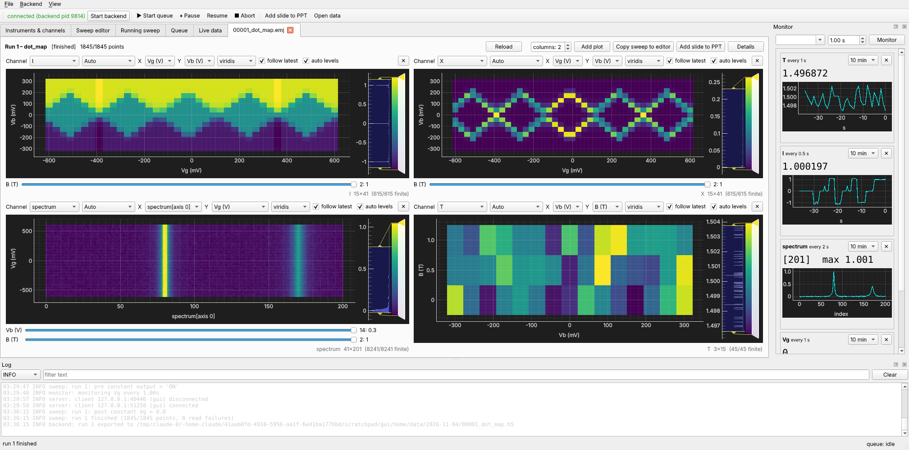
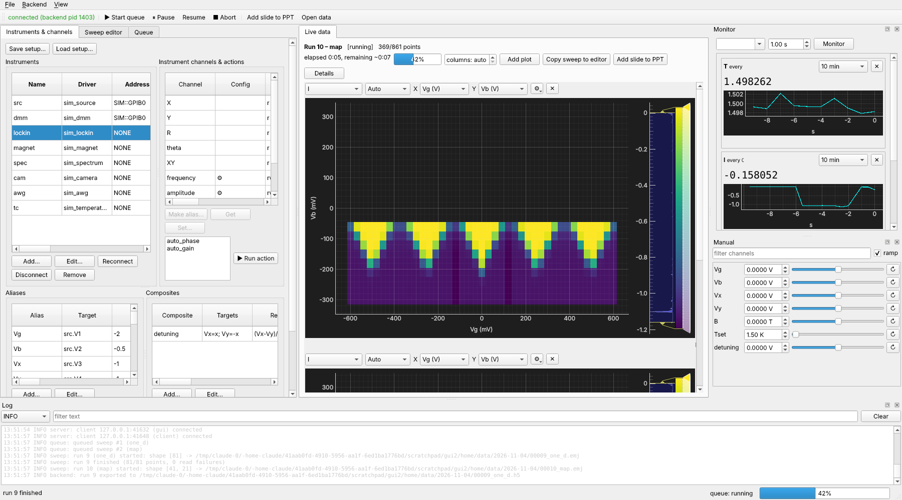
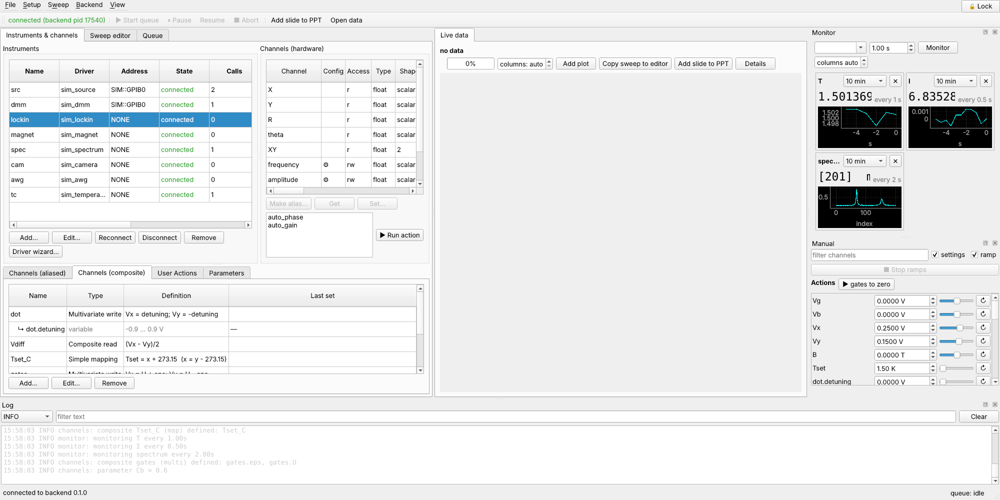
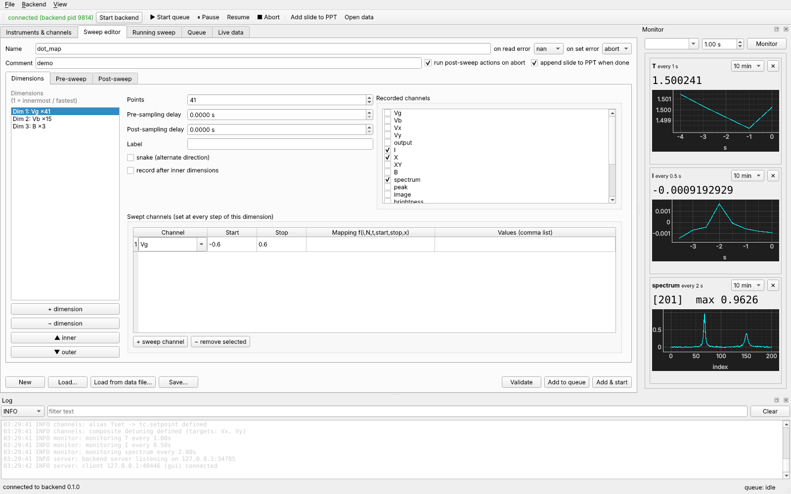
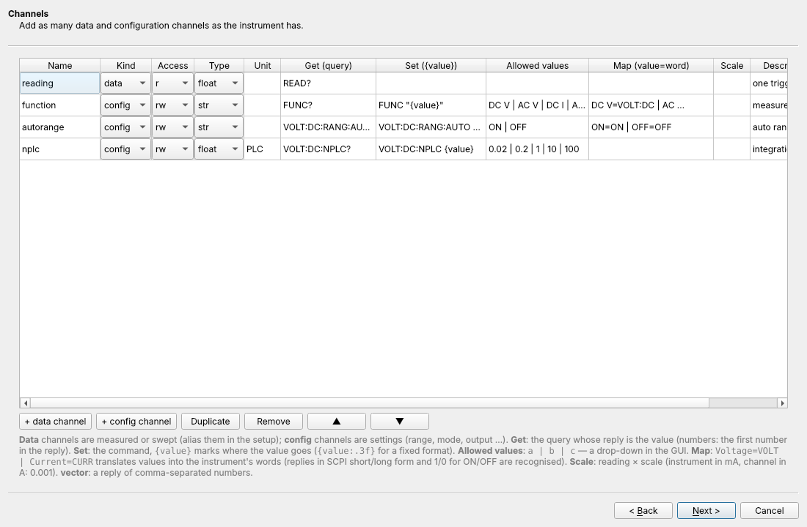
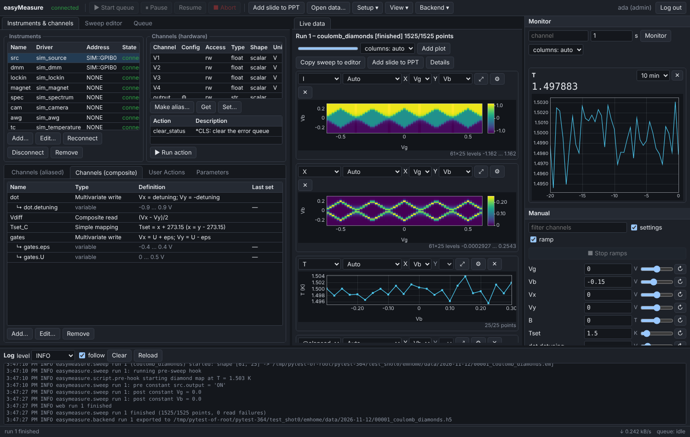

# easyMeasure

A generic Python framework for controlling test instrumentation and running
automatic, arbitrary-dimensional measurements — with a crash-proof backend and
a PySide6 GUI that can be closed, killed or restarted at any time without
disturbing a running measurement.



## Highlights

* **Backend / frontend split.** The backend is its own process. The GUI talks to
  it only over non-blocking sockets; killing a frozen GUI never touches the
  backend, and a reopened GUI picks up the running sweep where it is.
* **Hardened against buggy hardware.** Every driver call runs on a guarded
  worker thread with a hard deadline. Hung drivers are abandoned and the
  instrument reconnected; *any* exception (even `SystemExit`) is contained;
  replies are validated against the channel type/shape; transient errors are
  retried; a channel that keeps hanging is quarantined by a circuit breaker so
  it cannot block the rest of its instrument.
* **Crash-safe data.** Sweeps stream into an append-only, CRC-checked journal
  that is `fsync`-ed continuously. After a crash or power cut, everything up to
  the last fraction of a second loads as a partial dataset (missing points = NaN).
* **Arbitrary N-D sweeps** with any number of swept and recorded channels per
  dimension, mapping functions for non-uniform or vector/tensor setpoints,
  per-dimension delays, snake scans, pre/post constants, recordings and hooks.
* **Protection.** Limits and ramp rates live on aliases; every setpoint of a
  sweep is limit-checked *before* it starts; composite channels respect the ramp
  rate of every target.
* **Live N-D plotting** (curves, stacked curves, heat maps with draggable levels
  and colormaps, sliders for extra dimensions), a monitor panel, and automatic
  PowerPoint slides at the end of every run.
* **Ready-made hardware drivers** (Keithley 2400, Keysight B2901/B2902, SR830/SR850,
  HP 34401A, NI USB-6211, Yokogawa 7651, HP 4145/4155), each tested against an emulator built from the
  instrument's programming manual; mode switches rename channels and change units
  and the front ends follow. A **Driver Wizard** builds drivers for other
  command-based instruments from a form (templates, init script, try-it).
* **Remote access over the internet**: a TLS gateway (in its own process) serves a
  browser version of the GUI and a Python `RemoteClient`, with accounts, roles,
  brute-force lock-out, rate limits and an audit log.

## Install

```bash
pip install -e .                 # numpy, PySide6, pyqtgraph, h5py, python-pptx, matplotlib,
                                 # pyvisa, pyserial, nidaqmx …
pip install -e ".[hardware]"     # + pyvisa-py (VISA without NI-VISA: LAN, USB-TMC, serial)
pip install -e ".[test]"         # + pytest
pip install -e ".[webtest]"      # + playwright (browser test of the web app)
```

Python ≥ 3.9. Real instruments also need the vendor's runtime, which pip cannot
install: a VISA library (NI-VISA or Keysight IO Libraries) for GPIB / USB / LAN, and
NI-DAQmx for NI DAQ cards. (`[hardware]` adds `pyvisa-py`, a pure-Python VISA for
LAN / USB-TMC / serial when there is no vendor VISA.)

## Quick start (simulated instruments)

```bash
# 1. start the backend with the simulated demo setup
python -m easymeasure.backend --setup examples/demo_setup.json

# 2. start the GUI (any number of times, from any terminal)
python -m easymeasure.frontend
```

Or just `python -m easymeasure.frontend --start-backend` — it launches a
detached backend (restoring the last session's setup) if none is running.

While the backend runs, a **tray icon** shows its state (green idle, blue running,
orange paused, red error, gray unreachable) with the current run and progress in the
tooltip; its menu opens the GUI, opens the web page (*Open in browser* — offers to
switch [remote access](#remote-access-internet) on first if it is off), pauses /
resumes / aborts, opens the data folder or log and shuts the backend down, and a notification appears when a run ends. The tray
is a separate helper process (`easymeasure.tray`), so it can never affect the backend;
start the backend with `--no-tray` to disable it.

On Windows: `setup_venv.bat` creates `.venv` and installs everything,
`run_demo_backend.bat` starts a backend with the simulated instruments and
`run_gui.bat` starts the GUI.

In the GUI: *Sweep editor → Load…* `examples/sweep_dot_map.json` → *Add & start*,
then watch *Live data*. Close the GUI mid-sweep and reopen it: the sweep keeps
running and the live view resynchronises.

To see the robustness machinery at work, start the backend with
`examples/faulty_setup.json` (instruments that drop commands, garble replies,
hang, disconnect and raise random exceptions, plus a deliberately pathological
`chaos` instrument) and run `examples/sweep_faulty.json`.

## Architecture

```
 ┌──────────────── GUI process (PySide6) ───────────────┐      ┌─ scripts / notebooks ─┐
 │ Setup │ Sweep editor │ Running │ Queue │ Live/File data│      │  easymeasure.client   │
 │ Monitor dock │ Log dock │  N-D plotting (pyqtgraph)   │      └──────────┬────────────┘
 └────────────── BackendConnection (QTcpSocket, async) ──┘                 │
                              │  framed JSON + raw numpy buffers (no pickle)│
 ┌────────────────────────── backend process ─────────────────────────────┴───────┐
 │ server.py   per-client reader/writer threads, bounded queues, droppable events │
 │ service.py  command API, event bus                                             │
 │ runqueue.py state machine idle/running/paused/aborting; sweeps + scripts        │
 │ sweep.py    definition, validation, N-D execution    scripting.py  script API   │
 │ storage.py  crash-safe journal (.emj), HDF5 export   monitor.py    polling      │
 │ channels.py aliases (limits, ramps, scale), composite channels                  │
 │ instrument.py  guarded handles: deadlines, retries, reconnect, circuit breaker  │
 │ resources.py   one object per port, exclusive/shared, fair priority arbitration │
 │ drivers/       one file per instrument (+ simulated instruments)                │
 │ logsys.py      rotating log file + ring buffer pushed to GUIs                   │
 └─────────────────────────────────────────────────────────────────────────────────┘
```

## Concepts

### Resources (`backend/resources.py`)
Every physical port (`COM3`, `GPIB0::12::INSTR`, `USB0::…`, `TCPIP0::…`,
`TCP::host::port`, `DAQ::Dev1`, simulated `SIM::bus`, or `NONE`) is represented by exactly
one `Resource`. A second instrument asking for an exclusively owned port is
refused. Ports declared `shared` (an instrument option, or a driver default) are
arbitrated: each I/O sequence runs inside a transaction holding a fair,
re-entrant lock; when ownership changes the new owner's `select()` runs (e.g.
`++addr 5` on a Prologix GPIB adapter). The measurement thread gets priority
over monitor/GUI traffic, so monitoring never slows a sweep down.

Every address belongs to one **interface**: `gpib`, `usb` (USB-TMC), `tcpip` (VISA
LAN), `tcp` (raw socket), `serial`, `daq` (NI-DAQmx), `sim`, `none` or `other`
(other VISA types). Each driver lists the interfaces it accepts
(`Instrument.INTERFACES`, shown by `list_drivers`); an address of another interface
is refused when the instrument is added or changed. The GPIB instruments accept
`gpib`, `serial` and `tcp` (RS-232 where they have one, or a Prologix GPIB-USB /
GPIB-Ethernet adapter), the Keysight B2900 also USB and LAN, the NI DAQs `daq`, the
simulated instruments `sim` or `none`; Driver Wizard drivers take what the wizard's
*Interfaces* boxes say.

**Finding instruments.** `discover_resources` (admin) lists what the backend
computer has, by interface: serial ports (pyserial, with their description, e.g.
an FTDI adapter), VISA instruments (GPIB / USB / LAN, with their VISA alias), and
NI-DAQmx devices with their product type; with `identify` it asks each GPIB / USB /
LAN instrument `*IDN?` — never one that an instrument here is configured on. A
driver's `IDN_MATCH` marks the devices that are its kind. What could not be scanned
is reported (pyvisa or a VISA library missing, NI-DAQmx runtime not installed).

### Instruments and drivers (`backend/instrument.py`, `drivers/`)
An instrument exposes **channels** for read / write / query. A channel is
`float` (scalar or an array of any dimension — e.g. a spectrum or a 2-D image)
or `str`. Each driver is one Python file with a class deriving from
`Instrument`, declaring `CHANNELS` and implementing `_read_<ch>` / `_write_<ch>`
(or `read`/`write`). See `examples/driver_template.py`. Drivers are found in
`easymeasure/drivers/`, in `<home>/drivers/` (wizard drivers) and in extra
directories (`driver_paths` setting);
a driver that fails to import is reported, never fatal. `scpi_generic` builds a
SCPI instrument purely from options, and the [Driver Wizard](#driver-wizard) builds
command-based drivers from a form. The hardware drivers that come with
easyMeasure are listed under [Hardware drivers](#hardware-drivers).

**Allowed values** (`ChannelSpec(..., allowed=["Voltage", "Current"])`, or numbers
for a scalar `float` channel, e.g. `allowed=[0.02, 0.2, 1, 10, 100]`): writes must be
one of them and are normalised to the listed spelling (case, blanks, `u`/`µ` and
`Ohm`/`Ω` do not matter: `"500uv"` sets `"500 µV"`). The GUI and the web page show a
drop-down instead of a text box wherever the channel is set (manual panel, *Set…*,
sweep pre/post constants); aliases inherit the list and may narrow it with their own
`allowed`.

**Channel lists that follow the instrument state.** `get_channels()` may return a
different list after a configuration channel was written — the backend asks again
after every configuration write, every action and every (re)connect, and pushes the
new list to all front ends. A mode switch can so rename a channel (34401A: `Vdc` →
`Iac`), change a unit (lock-in X in V or A, compliance `Icompliance` [A] ↔
`Vcompliance` [V]) or make a channel read-only (the measured side of an SMU). An alias
whose target disappeared reports the error instead of silently reading something else
(re-point it, or switch back); cached alias values of that instrument are discarded.
Sweeps whose pre-sweep constants change such a setting are validated again after the
constants were applied, so `pre: smu.mode = Current` followed by a current sweep works,
and a sweep that still does not fit stops before its first point.

**Configuration channels** (`ChannelSpec(..., config=True)`): settings such as
sensitivity, range, integration time or output on/off. They can be read and set
directly (`write_channel("lockin.sensitivity", "1e-3")`, GUI *Instrument channels →
Set…*, sweep pre/post constants and one-off records) but are never aliased or swept,
which keeps the channel lists short with many instruments.

**Actions** (`ACTIONS = [ActionSpec("reset", ...)]`, implemented by `_action_reset()`):
commands without arguments such as trigger, reset, auto-phase. Run them from the GUI
(*Instrument channels & actions → Run action*), the API (`run_action(ref="dmm.reset")`),
or scripts and sweep hooks (`action('dmm.reset')`; the sweep editor has a *+ action*
button that appends this to the pre/post hook). Actions are guarded like every other
call but never retried automatically (a trigger must not fire twice); afterwards the
cached values of that instrument's aliases are discarded, so the next ramp reads back.

Per-instrument guard options: `call_timeout` (deadline per call, default 10 s),
`retries` (2), `retry_delay`, `reconnect_after` (consecutive failures before a
reconnect, 2), `timeout_retries` (1), `breaker_threshold` (2) and
`breaker_cooldown` (10 s, doubling on repeated trips).

### Aliases and protection (`backend/channels.py`)
An alias names one instrument channel and carries the protection: `min`, `max`,
`ramp_rate` (units/s), `ramp_step`, `scale`/`offset` (alias = raw·scale+offset),
`allowed` values for text channels, `read_only`. NaN is never written. Ramps
are time-based and abortable. Raw `instrument.channel` references can be read
anywhere but only *set* through `set_raw()` in scripts.

### Composite channels
Virtual channels that drive several aliases together, e.g.
`{"name": "detuning", "targets": {"VL": "x", "VR": "-x + 0.1"}, "read": "(VL-VR)/2"}`.
Every target value is limit-checked before anything is written, and the ramp
duration is chosen so that no target exceeds its own ramp rate.

### Sweeps (`backend/sweep.py`)
```json
{"name": "map",
 "dimensions": [
   {"points": 101, "sweep": [{"channel": "Vg", "start": -0.5, "stop": 0.5},
                             {"channel": "wave", "mapping": "x*np.sin(np.linspace(0, 2*np.pi, 64))",
                              "start": 0, "stop": 1}],
    "record": ["I", "spectrum", "image"], "pre_delay": 0.05, "post_delay": 0, "snake": false},
   {"points": 21, "sweep": [{"channel": "Vb", "values": [-0.3, -0.2, ...]}], "record": ["T"],
    "record_after_inner": false}],
 "pre":  {"hook": "set('output','ON')", "constants": [{"channel": "mode", "value": "AC"}], "record": ["T"]},
 "post": {"record": ["T"], "constants": [{"channel": "Vg", "value": 0}], "hook": ""},
 "on_read_error": "nan", "on_set_error": "abort", "run_post_on_abort": true,
 "metadata": {"sample": "D17"}}
```
* Dimension 0 is the innermost (fastest) loop.
* Sweep channels: `start`/`stop` (linear), `values` (explicit list) or `mapping`
  — an expression of `i`, `N`, `t = i/(N-1)`, `start`, `stop`, `x` and numpy.
  A mapping is mandatory for vector/tensor channels. Text channels cannot be swept.
* Recording: a channel recorded in dimension *k* is stored as an array of shape
  `(N_k, …, N_{D-1}) + value_shape`. `@time` / `@elapsed` are built in.
* Order per point of a dimension (the editor lays a dimension out in this order):

  `pre_sweep` action → set the swept channels → `post_sweep` action → `pre_delay`
  → `pre_record` action → record → `post_record` action → `post_delay` → inner
  dimensions (with `record_after_inner` the inner dimensions run before `pre_record`).

  Pre phase: hook → constants → record. Post phase (always run, also after errors
  and — by default — aborts): record → constants → hook.
* **Point actions** are optional Python snippets run at every point (trigger a
  meter before recording, wait for a magnet, log a value …). They are off and
  hidden until ticked in the editor; unticked code is kept in the definition but
  not run:
  ```json
  "hooks": {"pre_record": {"enabled": true, "code": "action('dmm.trigger')"},
            "post_record": {"enabled": true, "code": "if values['I'] > 1e-6: log('high at %s' % (index,))"}}
  ```
  Besides the script API they see `k` (dimension), `i` (index in it), `index` (this
  and the outer indices), `setpoints` (channel → value of this point) and, in
  `post_record`, `values` (what was just recorded). An error in an action stops the
  sweep (the post phase still runs). Like the pre/post hooks they need the admin
  role over remote access. Code is compiled once per sweep.
* **Flow control from point actions** — think of the dimensions as nested `for` loops
  (each action's *+ action* helper offers these first):

  | call | entry in the helper | like | effect |
  |---|---|---|---|
  | `skip_point()` | Skip this point | `continue` | the rest of this point (and its inner dimensions, unless they already ran) is skipped; its data are NaN; next point of the same dimension |
  | `skip_line()` | Skip this line | `break` | this point and the remaining points of this dimension are skipped (NaN); the outer dimension continues (in the outermost dimension the sweep is done) |
  | `end_sweep()` | Terminate the entire sweep | `exit` | the sweep ends with status `terminated`; called in `post_record` it keeps the point just recorded |

  A terminated sweep is a normal end: the post phase runs, the file, HDF5 copy and
  slide are written as usual, every point not reached is NaN, the log says where it
  ended (and the file footer has `terminated_at`). Skipped points count as done for the
  progress (`skipped_points` in the footer). The calls cannot be swallowed by an
  `except Exception` in the action, and outside per-point actions they are an error.
  ```python
  # post_record: stop the I-V curve once the current exceeds 1 µA
  if abs(values["I"]) > 1e-6:
      end_sweep()
  ```
* All setpoints are computed and limit-checked before the sweep starts.

### Run queue (`backend/runqueue.py`)
States `idle`, `running`, `paused`, `aborting`. Items are sweeps or **scripts**
(arbitrary Python with `get`, `set`, `set_raw`, `sleep`, `wait_until`, `log`,
`instrument(name).raw_query()`, `run_sweep(definition)`, a persistent `state`
dict, `np`). Pause / resume / abort (current) / abort all / stop after current.
Abort reaches scripts on *every line*, so even `while True: pass` stops.
*Start* processes what is queued; on an empty queue it does nothing, and a queue that
runs empty goes back to `idle` by itself, so an item added later waits for the next
*Start* (or is added with `start=True`, e.g. *Add & start*). `queue_state()["can"]`
tells which controls apply right now; the GUI and the web page enable their buttons
from it (no *Abort* without a running item, no *Resume* unless paused …).

### Storage (`backend/storage.py`)
`<data_dir>/<date>/<run>_<name>.emj`: an append-only sequence of frames, each
with length + CRC32. The first frame holds the full sweep definition and all
setpoints, so any data file can be loaded back into the sweep editor. Frames
are flushed immediately and `fsync`-ed every `fsync_interval` (0.5 s). A torn
or corrupted tail is detected and ignored; the rest loads. At the end an HDF5
copy (`.h5`) is written. If the disk fails mid-run the sweep keeps running in
memory and the error is reported.

```python
from easymeasure.backend.storage import DataSet
ds = DataSet.load("00012_map.emj")        # complete or partial
ds.data["I"]; ds.setpoints[0]["Vg"]; ds.header["definition"]; ds.status
```

### Monitor, logging, setups
* Monitored channels are polled at their own intervals by one thread per
  instrument (a hung instrument never stalls the others) and pushed to all GUIs.
* All activity is logged to `~/.easymeasure/logs/backend.log` (rotating) and
  streamed to the GUI log dock.
* Setups (instruments, aliases, composites, monitor list) save/load as JSON and
  are auto-saved on every change (`--restore` reloads the last one).

### PowerPoint
When a run ends — normally, by error or by abort — a slide (plots of the
recorded channels + run summary) is appended to the configured `.pptx`
(*File → Settings*). The *Add slide to PPT* buttons do it on demand for the
running run or any loaded data file.

The file may be open in PowerPoint: on Windows the slide is inserted into the open
presentation through PowerPoint itself (needs `pywin32`, installed automatically on
Windows) and the presentation is saved. Only if that is impossible (file locked by a
sync client or open on another computer) does the slide go to
`<name>_pending.pptx`, so it is never lost.

## GUI

The window is split in two: instruments, sweep editor and queue on the left, data
(live view and any loaded files) on the right, the monitor on the far right and the
log at the bottom. The read-only *Running sweep* view can be shown from the *View* menu.



| | |
|---|---|
|  |  |

* **Instruments & channels** – add/edit/reconnect instruments (driver list with
  default options; the **Address** is a list of the ports and devices found on the
  backend computer that the driver accepts — identified matches first, marked ✓ and
  picked automatically, then the others, ones in use, and the driver's suggestions
  such as its built-in emulator — or type any address; **Refresh** scans again,
  *ask \*IDN?* identifies GPIB / USB / LAN instruments while scanning), inspect raw channels (with their allowed values and the *last
  value* read or set — nothing is read just to fill the table), define aliases and
  composites, manual get/set, save/load setups, *Driver wizard…* for new
  command-based instruments.
* **Sweep editor** – any number of dimensions; save/load JSON, load from a data
  file, validate against the backend, queue. **Running sweep** shows the
  executing definition read-only.
* **Queue** – controls (enabled by what the queue can do now), queued items
  (reorder/remove), history (*Rerun selected* queues the same sweep/script again,
  *Open data* opens its file), script editor. *Copy to sweep editor* on a queued or
  finished sweep loads its definition into the editor; on a script the button reads
  *Copy to script editor* and fills the script editor.
* **Live data / data files** – N-D plot grid: choose X and Y among all sweep and
  value axes, other axes become sliders (*follow latest* tracks new data); curve,
  stacked curves or heat map (Y is grayed out for 1-D data); drag the histogram to set levels, pick colormaps.
  Redraws are coalesced, so fast sweeps don't load the GUI.
* **Monitor** dock, **Manual** dock below it and **Log** dock. The Manual panel lists
  every writable scalar alias and composite with a spin box, a slider (when the alias
  has a minimum and a maximum) and, on right click, *Set from expression…* (a function
  of the present value `x`, e.g. `x + 0.01`). Writes are protected and ramped; while a
  ramp runs, further changes to that channel are coalesced. The mouse wheel only acts
  on a focused control, so scrolling the panel never moves an instrument.
* **File → Settings → Display**: font size (applied immediately, also to plot axes)
  and an overall UI scale (50–300 %, applied on the next GUI start) to suit any
  screen resolution. The window can be made small: toolbars wrap, panels scroll.
* **🔓 Lock** (top right corner, Ctrl+L) locks the GUI against accidental changes:
  instruments, sweep editor, queue, manual control, adding/removing monitors, the
  queue buttons, *Add slide to PPT*, *Settings* and the *Backend* menu (except
  *Reconnect*) are greyed out. Switching tabs, the plots and all their settings, the
  monitor time spans, opening data files and the log stay usable. Click again to
  unlock; the state is remembered when the GUI restarts. It is a guard against slips,
  not access control — it affects this window only (not other GUIs, the web page,
  the tray or scripts).

Nothing in the GUI blocks on the backend: every request is asynchronous with a
callback, files load and slides render in worker threads.

## Hardware drivers

| driver | instrument | channels (settings in *italics*) |
|---|---|---|
| `keithley2400` | Keithley 2400-series SourceMeter | `voltage`, `current`, *`mode`* (Voltage / Current), *`Icompliance`* or *`Vcompliance`*, *`output`*, *`nplc`*, *`sense`* (2/4-wire), *`terminals`* |
| `keysight_b2901` | Keysight B2901/B2911 SMU | as the 2400, plus *`low`* (ground / float); NPLC up to 100 |
| `keysight_b2902` | Keysight B2902/B2912 SMU | the same per output with suffix `1` / `2` (`voltage1`, *`mode2`* …) |
| `sr830` | SRS SR830 / SR850 (and SR810) lock-in | `X`, `Y`, `R`, `theta`, `Xn`, `Yn`, `aux_in1…4`; sources `sine_out`, `frequency`, `phase`, `aux_out1…4`; *`reference`*, *`sensitivity`*, *`time_constant`*, *`rolloff`*, *`coupling`*, *`ground`*, *`line_filter`*, *`input`*, *`reserve`*, *`harmonic`*, *`sync_filter`*; actions auto gain / phase / reserve |
| `hp34401a` | HP/Agilent 34401A DMM | one reading named after *`mode`*: `Vdc`, `Vac`, `Idc`, `Iac`, `R2w`, `R4w`; *`range`*, *`nplc`*, *`autozero`* (DC/Ω), *`ac_filter`* (AC) |
| `ni6211` | NI USB-6211 DAQ (NI-DAQmx) | `ai0…ai15` (`ai0…7` in DIFF), vector `ai`, `ao0`, `ao1`, `di0…3`, `do0…3`, `ctr0`, `ctr1`; *`rate`*, *`samples`*, *`terminal`*, *`ai_range`* |
| `ni63xx` | NI USB-63xx X Series DAQ: USB-6341/6343/6346/6349/6351/6353/6356/6361/6363/6366 (NI-DAQmx) | channels follow *`model`* (auto = as reported): `ai0…` (8–32), vector `ai`, `ao0…` (2–4), digital lines `dio0…` (port 0: 8 or 32) and `pfi0…15`, `ctr0…3`; *`rate`*, *`samples`*, *`terminal`*, *`ai_range`*, *`ao_range`*; actions `reset_counters`, `release_digital` |
| `yokogawa7651` | Yokogawa 7651 DC source | one source channel named after *`mode`*: `voltage` (10 mV … 30 V ranges) or `current` (1 … 100 mA); *`range`* (AUTO or fixed), *`Icompliance`* / *`Vcompliance`*, *`output`* |
| `hp4145` | HP 4145A/B, HP 4155/4156 in 4145 syntax (user mode) | per SMU 1…4: `voltage<n>`, `current<n>`, *`mode<n>`*, *`Icompliance<n>`* / *`Vcompliance<n>`*, *`output<n>`*, *`range<n>`*; `vs1`, `vs2`, `vm1`, `vm2`; *`integration`* |

**Source-measure units.** In `Voltage` mode `voltage` is the source (read/write) and
`current` is measured (read-only); the compliance is the current limit `Icompliance`
in A. In `Current` mode it is the other way round with `Vcompliance` in V. The
front ends follow the switch at once. Changing the mode requires the output to be
OFF (the driver refuses otherwise rather than switching under load), and the
measured quantity reads NaN while the output is off — nothing is measured, and the
B2900 would otherwise switch its output on by itself for a measurement. A typical I–V
curve in current mode:

```json
{"name": "iv", "dimensions": [{"points": 101,
   "sweep": [{"channel": "Isrc", "start": 0, "stop": 1e-6}], "record": ["Vmeas"]}],
 "pre":  {"constants": [{"channel": "smu.mode", "value": "Current"},
                        {"channel": "smu.Vcompliance", "value": 2},
                        {"channel": "smu.output", "value": "ON"}]},
 "post": {"constants": [{"channel": "Isrc", "value": 0}, {"channel": "smu.output", "value": "OFF"}]}}
```
(`Isrc` → `smu.current`, `Vmeas` → `smu.voltage`.)

**Lock-in.** Sensitivities and time constants are human-readable (`"500 µV"`,
`"300 ms"`); with a current input the sensitivities are listed in A and X/Y/R are
in A. `frequency` is read-only with an external reference. `Xn`/`Yn` are measured on
the instrument's displays (SR830: CH1/CH2 are set to X/Y noise on the first read;
SR850: traces 3 and 4). Sources such as `aux_out1` or `sine_out` are ordinary
channels: alias them with limits and ramp rates and sweep them.

**Yokogawa 7651.** A source only: in `Voltage` mode the channel is `voltage`, in
`Current` mode `current` (no measurement). With `range` = `AUTO` the driver picks the
smallest range that holds the value, but while the output is ON it only ever ranges
*up*, so a sweep coming down does not glitch the output with range changes; a fixed
range refuses values beyond 120 % of it. Every setting is executed (`E`) and read
back (`OD`): an error flag or a value that did not arrive raises an error (and a
command lost on the bus is retried).

**HP 4145 / 4155 / 4156 (user mode).** The analyzer is put into HP-IB user mode
(`US`) and every SMU is forced (`DV` / `DI`) and measured (`TV` / `TI`) point by
point, so it works like four source-measure units — same `mode<n>` logic and
adaptive compliance as the 2400. Settings are remembered by the driver (user mode
has no setting queries): a value written while `output<n>` is OFF is applied when
it is switched ON, which needs a compliance first. The SMU output envelope
(100 mA ≤ 20 V, 50 mA ≤ 40 V, 20 mA ≤ 100 V) is checked before anything is sent.
A reconnect does not touch the outputs (outputs then read OFF until set again).
A 4155/4156 is switched into its 4145 syntax command mode automatically when it is
in SCPI (`:SYST:LANG COMP`) or FLEX mode (`:PAGE` first), checked with `CMD?`; option
`force_4145_syntax` = false leaves the mode alone.
Not yet confirmed from the manual text: the mode switch commands, the VS/VM channel numbers (5, 6), `DS <ch>`
and the exact TV/TI reply layout (the parser accepts the usual variants: status
character first, number last; overflow → ±inf, oscillation → NaN).

**34401A.** The reading channel is renamed by the mode, so an alias on `dmm.Vdc`
cannot record a current by mistake after somebody switched the meter to `idc` (it
reports an error until the mode is back). Reading timeouts follow NPLC / AC filter.
Overload (`9.9E37`) reads as ±inf.

**NI USB-6211.** Needs NI's NI-DAQmx driver runtime (the `nidaqmx` Python package
comes with easyMeasure); address `DAQ::Dev1` (the
NI MAX name). Every analog reading is the mean of `samples` samples at `rate` per
input, and acquires only the inputs it returns: `ai3` alone (up to 250 kS/s), the
vector `ai` all inputs of one scan, which share the 250 kS/s (option `ai_channels`,
e.g. `"0-3"`, puts fewer inputs in it; a vector reading too fast for its inputs is
refused, the single inputs still work). `samples = 1` is a single on-demand
conversion (sub-millisecond). The same holds for `ni63xx`, with the limits of the
model.

**NI USB-63xx (X Series).** One driver for the ten USB X Series models (BNC, screw
terminal, mass termination and OEM variants). The configuration item **`model`**
(also an instrument option, so a setup keeps it) picks the exact model and the
channel list is rebuilt from NI's specifications for it:

| model | analog in | out | port 0 | AI ranges | AO ranges | max rate |
|---|---|---|---|---|---|---|
| USB-6341 / 6343 | 16 / 32 SE (8 / 16 DIFF) | 2 / 4 | 8 / 32 | ±0.2…10 V (4) | ±10 V | 500 kS/s total |
| USB-6351 / 6353 | 16 / 32 SE (8 / 16 DIFF) | 2 / 4 | 8 / 32 | ±0.1…10 V (7) | ±10, ±5 V | 1.25 MS/s one input, 1 MS/s total |
| USB-6361 / 6363 | 16 / 32 SE (8 / 16 DIFF) | 2 / 4 | 8 / 32 | ±0.1…10 V (7) | ±10, ±5 V | 2 MS/s one input, 1 MS/s total |
| USB-6346 / 6349 | 8 / 32 DIFF, simultaneous | 2 | 8 | ±1…10 V (4) | ±10 V | 500 kS/s per input |
| USB-6356 | 8 DIFF, simultaneous | 2 | 8 | ±1…10 V (4) | ±10, ±5 V | 1.25 MS/s per input |
| USB-6366 | 8 DIFF, simultaneous | 2 | 8 | ±1…10 V (4) | ±10, ±5 V | 2 MS/s per input |

All have 16 PFI lines (`pfi0…15` = P1/P2) and 4 counters. `model = auto` takes
what the device reports; a model that does not match the device is refused (a
device type the table does not know is trusted to be the model you set). Settings the
new model does not support fall back (terminal → RSE or DIFF, ranges → ±10 V, rate
lowered to fit) with a log message. In DIFF the
inputs are the pairs aiK/aiK+8, so `ai0…7` (and `ai16…23` on the 32-input models).
Digital lines are inputs until written; a written line is an output driving that
level until `release_digital`. A counter (`ctrK`, started by its first reading)
uses its default source PFI 8 / 3 / 0 / 5, which then refuses to be a digital line.
`DAQ::SIM` emulates the chosen model (`auto` → USB-6363) with a loop-back: `aiK`
sees `aoK`, each digital line is wired to the one half a port away.

**Common options.** `reset` (`*RST` on connect), `check_errors` (read the error queue
after every setting so a refused value raises an error with the instrument's own
message, default on), `verify_writes` (SMUs: read every source value back — worth it
on RS-232), `gpib_addr` + `shared` (several instruments behind one Prologix GPIB
adapter: `++addr N` selects each), `timeout`, `read_termination`.

**Without hardware.** Give a SCPI driver a `SIM::<name>` address and it talks to a
built-in emulator of the instrument (`ni6211`, `ni63xx`: `DAQ::SIM`). The emulators implement
the instruments' command tables from their programming manuals (short/long SCPI
forms, optional nodes, error queue, `*ESR?`), physics good enough to see something
(an SMU into a resistor with compliance clamping, a lock-in with a phase-shifted
signal, loop-back wiring on the DAQ), and `tests/test_drivers.py` checks that every
command a driver sends exists in the manual's table.

## Driver Wizard

For an instrument without a driver that is controlled by text commands (most SCPI
instruments and many older ones) the **Driver Wizard** (*Backend → Driver wizard…*,
or the *Driver wizard…* button under *Instruments & channels*) builds one without
programming:



1. **Start from** a template — *Generic SCPI* (identification, error queue, reset /
   clear), *SCPI source-measure unit* (source level, mode, compliance, output, NPLC,
   measured voltage and current), *SCPI multimeter* (function, autorange, NPLC, reading)
   or *Simple line protocol* (non-SCPI, no error queue) — or reopen a driver made with
   the wizard.
2. **Basics**: driver name (`[a-z][a-z0-9_]*`), description, `*IDN?` check (reply must
   contain one of `a | b`), error query (read after every setting, so a refused value
   raises an error with the instrument's own message), terminations, timeout, query
   delay, and the interfaces it can be reached through (GPIB, USB, LAN, TCP socket,
   serial, simulated: the Add instrument dialog lists ports of those kinds).
3. **Channels**: any number of *data* channels (measured or swept; aliased in the setup)
   and *config* channels (settings). Per channel: access `r` / `w` / `rw`, type
   `float`, `str` or `vector` (comma-separated numbers), unit, **Get** query (numbers:
   the first number in the reply), **Set** command with `{value}` (or `{value:.3f}`)
   where the value goes, **Allowed values** `a | b | c` (a drop-down in the front
   ends), **Map** `Voltage=VOLT | Current=CURR` (value ↔ instrument word; replies are
   recognised in SCPI short or long form and `1`/`0` as `ON`/`OFF`), **Scale**
   (reading × scale, setting ÷ scale: instrument in mA, channel in A → 0.001).
4. **Actions**: named command lists (`*RST | *CLS`), run like any driver action.
5. **Initialization**: commands sent on connect (a command ending in `?` is a query
   whose reply is logged), a **Python script** run after them — with `write(cmd)`,
   `query(cmd)`, `read()`, `sleep(s)`, `log(msg)`, `options`, `instrument`, `np`,
   `math`; raise an exception to refuse the connection — and commands sent on
   disconnect (e.g. `OUTP OFF`).
6. **Check, try and save**: the definition is checked (errors block, warnings don't),
   the generated file can be previewed, and **Try it** connects to an address you
   give (`SIM::…` works too), reads every readable channel once and shows value, unit
   and time per channel — then removes the trial instrument again. **Save** writes
   `<home>/drivers/<name>.py`, reloads the drivers and offers to add an instrument
   with the new driver; instruments already using it are reconnected with the new
   version (not during a sweep).

The generated file holds the definition as a Python literal (`DEFINITION`) and a
small class deriving from `CommandInstrument` (`easymeasure/drivers/_command.py`);
it can be edited by hand — override `read` / `write` for an unusual channel — and the
wizard reopens it through `DEFINITION`; saving from the wizard over a file that was
extended by hand warns first and keeps the old file as `<name>.py.bak`. A built-in
driver name or a file not made by the wizard is never overwritten. With an error
query, a query the instrument does not understand fails at once with the instrument's
own message (e.g. `-113,"Undefined header"`) instead of a read timeout. Over remote access the wizard is admin-only (it
writes code to the backend computer); the backend commands are `wizard_templates`,
`wizard_check`, `wizard_try`, `wizard_save`, `wizard_list`, `wizard_load` and
`wizard_delete`.

## Simulated instruments

| driver | what it simulates |
|---|---|
| `sim_source` | 4-channel DC source, SCPI over a shared `SIM::` bus |
| `sim_dmm` | DMM measuring a simulated quantum dot (Coulomb diamonds) on the same bus |
| `sim_lockin` | lock-in: X, Y, R, θ and a 2-vector `XY` |
| `sim_spectrum` | 1-D trace per reading, peak shifts with field/voltage |
| `sim_camera` | 2-D image per reading, spot moves with two voltages |
| `sim_awg` | vector-valued write channel (waveform) |
| `sim_magnet` | field that ramps in real time; `status` RAMPING/HOLDING |
| `sim_temperature` | setpoint with first-order thermal lag |
| `sim_chaos` | pathological: wrong types, random shapes, hangs forever, slow, raises `SystemExit`/`KeyboardInterrupt`/`MemoryError`, flaky writes, binary garbage |

Fault injection options for every simulated driver: `error_rate` (lost
command), `garble_rate` (corrupted reply / wrong type), `hang_rate` +
`hang_time`, `disconnect_rate`, `exception_rate`, `nan_rate`, `latency`, `seed`.

## Testing

```bash
python -m pytest -q tests                   # ~3 min, GUI tests run offscreen
python examples/stress_test.py --minutes 10  # soak test against faulty hardware
python examples/remote_stress_test.py --minutes 10 --browser   # remote access under attack
```

`tests/test_remote.py` checks the gateway: TLS versions and pinning, security headers,
static-file traversal, cookie flags, generic login errors, brute-force lock-out,
WebSocket authentication and Origin checks, every role's permissions end to end,
sessions closed on account changes, malformed / oversized / non-WebSocket traffic,
rate and in-flight limits, connection limits, slow-loris sockets, a client that never
reads, idle connections, backend and gateway restarts (sessions survive), downloads,
a SIGKILLed gateway (the backend restarts it), the expression sandbox and
performance. `tests/test_web_ui.py` drives the web app in Chromium (needs
`pip install -e ".[webtest]"` and `python -m playwright install chromium`).

`remote_stress_test.py` runs the faulty-hardware stress test locally while legitimate
remote clients work and attackers guess passwords, send random and malformed
messages, forbidden commands, sandbox escapes, oversized messages, request floods and
slow-loris sockets, and one client never reads; it checks that nothing forbidden ever
succeeded, the probe client never failed, both processes survived with bounded memory,
and a remote sweep still completes. Each group of clients runs in its own process (like
separate remote machines). In a 10-minute run on a 2-core machine at load 12 (130 000
fuzz messages, 590 password guesses, 11 700 forbidden requests, 155 000 rate-limited
requests, plus the faulty-hardware stress test and a browser on the live view): no
forbidden request succeeded, 0 of 1545 probe pings failed (p50 7 ms, p99 0.4 s through
the gateway; p50 1.5 ms, p99 0.25 s directly to the backend), the gateway stayed at
180–215 MB, and its event loop never stalled.

`tests/test_drivers.py` runs every hardware driver against its emulator: each
command a driver sends must exist in the instrument's command table, settings
round-trip through all their allowed values, mode switches rename channels and
change units, refused values come back with the instrument's own error message, a
noisy serial line is survived, several instruments share one GPIB adapter, and an
I–V sweep in current-source mode runs from the example setup.
`tests/test_dynamic_channels.py` covers allowed values and channel lists that change
with the instrument state, including sweeps whose pre-sweep constants switch modes.

The suite covers codec fuzzing, fair/priority locks, port arbitration, hung /
crashing / garbage-returning drivers, circuit breaker, limits and ramp rates,
composites, N-D sweeps with vector/image data, abort/pause, scripts (including
an un-cooperative infinite loop), crash recovery of truncated/corrupted files,
disk failure during a sweep, a frozen client, a SIGKILLed frontend process, a
backend restart under a live GUI, and the GUI panels themselves.

The stress test runs a backend process with the faulty setup while six clients
hammer it with reads, out-of-limit writes, configuration-channel writes, every
instrument action (including ones that fail, hang forever or raise `SystemExit`),
sweeps (some with actions in their hooks), scripts, pause/abort, malformed requests
and abrupt disconnects, plus a frozen client and a client sending random bytes. At
the end it checks that the backend is alive and responsive, every protected value is
within its limits, a normal sweep still completes, every data file loads, and it
reports the backend's memory over time (it levels off; a client that stops reading is
disconnected instead of being buffered for without bound).

## Several clients at once

Any number of frontends and scripts can be connected to one backend at the same
time (several GUIs on different screens, a notebook, the tray icon). Every client
sees the same live state: monitor values, sweep data, queue and log are pushed to all
of them. Requests are executed concurrently, but each instrument serialises its own
calls, and the run queue executes one item at a time. There is no locking between
users: two GUIs can both edit the queue or set channels, the last action wins.

Clients choose which events are pushed to them. The GUI subscribes to everything.
Scripts and notebooks (`BackendClient`) get only status events by default (queue
changes, sweep start/end, warnings) and can ask for more with
`client.subscribe(["monitor", "sweep_point"])` or `"*"`; the tray uses the tiny
`sweep_progress` event. Events nobody subscribed to are not even encoded.

Idle connections are never closed. A client is only disconnected when the backend
has data waiting for it and its socket has accepted nothing for 60 s, or more than
64 MB are waiting (a frozen GUI); live data for a slow client is dropped above 16 MB
and the client is told to resynchronise. GUIs reconnect by themselves.

## Using it from Python

```python
from easymeasure.client import BackendClient
c = BackendClient.connect()
c.call("write_channel", name="Vg", value=0.2)
c.call("queue_add", item={"kind": "sweep", "definition": sweep}, start=True)
```
See `examples/client_example.py`. The backend can also be used in-process:
`from easymeasure.backend.service import Backend`.

## Remote access (internet)

The backend itself only listens on `127.0.0.1`. For access from other computers it
starts a **gateway** process that speaks HTTPS and secure WebSockets and forwards
authenticated, permitted requests to the backend over localhost:

```
browser / RemoteClient ──TLS 1.2+ (WSS, compressed)──▶ gateway ──localhost──▶ backend
```

```bash
python -m easymeasure.remote adduser alice --role admin    # asks for a password
python -m easymeasure.backend --remote                     # backend + gateway on port 8443
```

or in the GUI: **Backend → Remote access…** (switch it on, see who is connected,
add / change / remove accounts). Remote access stays on across backend restarts
until it is switched off. Then open `https://<computer>:8443` in a browser:



The web app mirrors the GUI: instruments & channels (with actions and config
channels), the sweep editor (load/save JSON files from your computer, load from a
stored run, validate, queue), the queue with history and rerun, live data and stored
runs with the same N-D plots (curve / heat map / stacked curves, X/Y axis choice,
sliders, follow-latest, colormaps, colour levels by dragging the colour bar, zoom and
pan), monitor tiles, the Manual panel (spin box, slider, right-click expression), the
log, and data-file / PowerPoint download. It reconnects by itself when the network,
gateway or backend restart, and works on a phone. Light and dark themes follow the
system (or Backend → Settings… in the web app).

From Python (same interface as `BackendClient`):

```python
from easymeasure.client import RemoteClient
c = RemoteClient("https://lab-pc.example.org:8443", "alice", password,
                 fingerprint="87:68:0C:…")   # python -m easymeasure.remote cert
c.call("read_channel", name="Vg")
c.subscribe(["monitor"]); c.on_event = lambda kind, data: print(kind, data)
```

### Roles

| role | may |
|---|---|
| `viewer` | watch everything (state, monitor, live and stored data, logs, queue), read channels, download data |
| `operator` | + set channels and config channels (alias limits and ramp rates always apply), run actions, monitor, queue / start / pause / abort sweeps, PPT slides, reconnect instruments |
| `admin` | + scripts and sweep hook code (Python on the backend computer = full control), Driver Wizard, instruments, aliases and limits, raw commands, setups, settings, shutdown |

Operators cannot run code: sweeps with pre/post hook code are refused for them, and
mapping / composite formulas go through a sandboxed evaluator (an allow-list of math
functions, no attribute or file access, size limits on arrays and powers). Remote users
only reach files inside the data directory. Switching remote access, the tray and
account management are only possible on the backend computer.

### Security

* **TLS only** (1.2+, forward-secret AEAD ciphers, no compression or renegotiation).
  Without a configured certificate a self-signed one is generated; browsers warn once
  (compare the SHA-256 fingerprint shown in the dialog / `python -m easymeasure.remote
  cert`), Python clients pin it. For no browser warning, set `certfile` / `keyfile`
  (e.g. Let's Encrypt): `python -m easymeasure.remote config certfile=… keyfile=…`.
* **Accounts** with scrypt-hashed passwords (≥ 10 characters). Failed logins lock out
  the address (5 failures) and the account (10, from anywhere) for 30 s, doubling up
  to 1 h; error messages never reveal whether a user exists.
* **Sessions**: 256-bit random tokens; the browser keeps them in a `__Host-` cookie
  (Secure, HttpOnly, SameSite=Strict); only their hashes are stored. Sessions expire
  after 12 h without a connection or 7 days in total, and end at once when the account
  is removed or its password or role changes.
* **Browser hardening**: strict Content-Security-Policy (no inline or foreign
  scripts), Origin checks against cross-site WebSocket hijacking, clickjacking and
  MIME-sniffing protection, no data inserted as HTML.
* **Limits** per connection (message size, request rate, unanswered requests), per
  user and per address (connections), TLS-handshake and first-request timeouts
  (slow-loris), and a client that accepts no data for 90 s is dropped. Idle
  connections are never dropped.
* **Isolation**: the gateway is a separate process; nothing from the network is parsed
  inside the backend before it has been authenticated and checked, and a crash or
  memory blow-up of the gateway cannot affect a running measurement (the backend
  restarts it).
* **Audit log** `~/.easymeasure/logs/remote.log`: logins, lock-outs, denied commands,
  every command that changes something (with user and address), downloads.

On Windows, allow Python through the firewall when asked (private networks). Only
forward the port (router / firewall) if you need access from outside your network; a
VPN in front of it is better still. All limits are in
`~/.easymeasure/remote/config.json` (`python -m easymeasure.remote config`).

### Performance

Backend frames are forwarded byte-for-byte, so arrays stay raw binary end to end and
the browser decodes them without copying through JSON. WebSocket compression
(deflate, fastest level) shrinks partially filled maps and JSON, and back-pressure from
a slow connection makes the backend drop monitor / sweep-point events for that client
instead of queueing them (the live view resynchronises). Plots redraw at most ~15
times a second and only when visible. On a local network a request takes well under a
millisecond (0.5 ms measured over WSS on localhost) and a 2 MB map ~40 ms.

## Layout

```
easymeasure/
  backend/   resources, instrument, channels, sweep, runqueue, storage, monitor,
             scripting, service, server, logsys, setup_io, registry (driver discovery)
  drivers/   instrument drivers (hardware and simulated), emulators/ of the hardware
  frontend/  connection, model, main_window, panels/, plotting/
  client/    blocking clients for scripts (local and RemoteClient)
  remote/    internet gateway, accounts, access policy, web/ (browser frontend)
  common/    codec, safe expressions, N-D slicing, errors
  report/    figure rendering, PowerPoint
examples/    setups, sweeps, driver template, client example, stress test
tests/
```

## License

MIT
