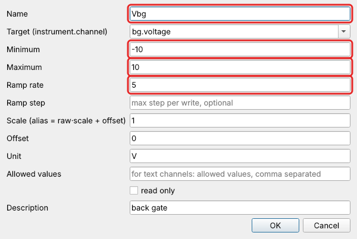
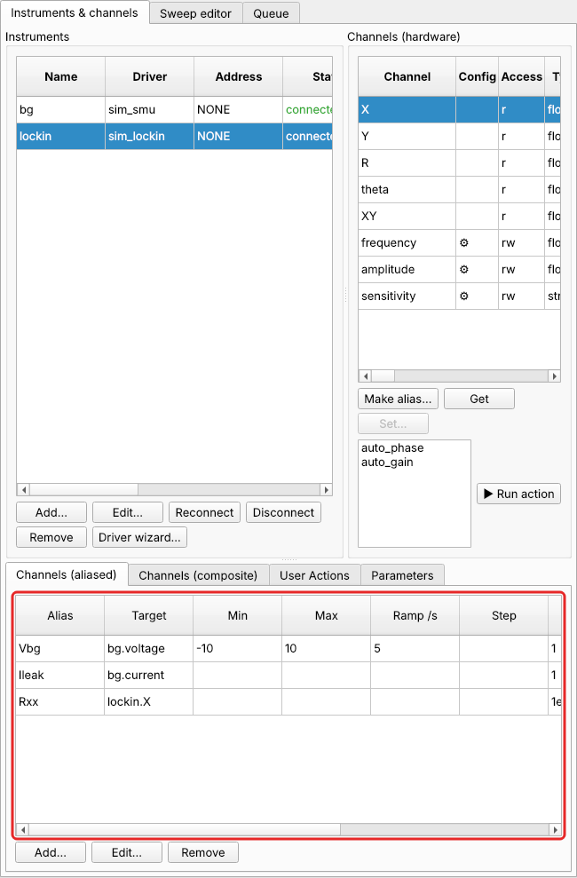

# Aliases and protection

An **alias** gives one instrument channel a short name and carries its
**protection**: limits, ramp rate and scaling. Protection belongs to the alias, not
to the instrument, so the same source can be a gate limited to ±10 V in one setup and
a heater limited to 5 V in another.

Instrument channels can be read anywhere under their full name (`lockin.X`). To
**set** a measurement channel, in a sweep, the Manual panel or a script, it needs an
alias. That way nothing is ever set without limits.

## Making an alias

In *Instruments & channels*, select the instrument, then its channel, and click
**Make alias…**. Or, on the **Channels (aliased)** tab, click **Add…** and choose the target
channel there.



The aliases appear in the *Channels (aliased)* table, and from then on in every channel list:
sweeps, Monitor, Manual, plots.



Select an alias and click **Edit…** to change it, or **Remove** to delete it
(refused while a composite channel uses it).

## The fields

| field | meaning |
|---|---|
| **Name** | the alias name, used everywhere: sweeps, monitor, scripts, Manual panel |
| **Target** | the instrument channel, `instrument.channel` |
| **Minimum**, **Maximum** | hard limits, in alias units. A value outside is refused, and nothing is written |
| **Ramp rate** | the fastest change allowed, in alias units per second. Empty: jump |
| **Ramp step** | optional: the largest step per write while ramping |
| **Scale**, **Offset** | alias value = instrument value × scale + offset (amplifier gain, divider, unit change) |
| **Unit** | shown in the front ends and data files |
| **Allowed values** | text channels: the values that may be written; narrows the instrument's own list |
| **Read only** | refuse every write through this alias |
| **Description** | free text, shown as a tooltip |

## Limits

Limits are checked everywhere a value is set: the Manual panel, scripts, composite
channels, and every setpoint of a sweep. A sweep is checked completely **before** it
starts, so it can't fail halfway because a point is out of range. NaN and infinity are
never written.

Choose limits from what the sample tolerates, not from what the instrument can do: the
breakdown voltage of a gate dielectric, the critical current of a junction, the
largest field the sample holder takes.

## Ramp rates

With a ramp rate, a change moves the instrument there in small, timed steps. Going
from 0 to 5 V at 5 V/s takes one second. This protects gates, magnets and
superconducting samples from sudden jumps.

* Sweeps ramp between points, and to the first point, at the alias' rate.
* Ramps can be aborted.
* A ramp starts from where the instrument really is. After an instrument action or a
  direct write, the remembered value is discarded and the start is read back.
* The Manual panel's *ramp* box can switch ramping off for a single write (a jump);
  use with care.

## Scaling

An amplifier, a divider, or a different unit. The alias is in the units you think in,
the instrument in its own:

| situation | target | scale | alias unit |
|---|---|---|---|
| ×10 voltage amplifier after a DAC output | `daq.ao0` | 10 | V at the sample |
| current preamplifier at 10⁻⁷ A/V into a voltmeter | `dmm.Vdc` | 1e-7 | A |
| a lock-in voltage, as a four-probe resistance at 10 nA excitation | `lockin.X` | 1e8 | Ω |
| a source in millivolts | `src.V1` | 1000 | mV |

Limits and ramp rate are in alias units, after scaling. The graphene setup of the
tutorials uses the third line for `Rxx`.

## Text channels

For a channel whose value is text, such as a measurement mode, **Allowed values** narrows
what can be written: with `Vdc, Idc`, only those two modes can be set through the
alias, even though the meter has more.

## Built-in channels

`@time` (Unix time) and `@elapsed` (seconds since the sweep started) can be recorded
like any channel.

## From Python

??? example "Defining and using aliases from a Python client"

    ```python
    c.call("define_alias", name="Vg", target="src.V1", min=-2, max=2, ramp_rate=2.0,
           unit="V", description="gate voltage")
    c.call("define_alias", name="Isd", target="dmm.Vdc", scale=1e-7, unit="A")
    c.call("define_alias", name="dmm_mode", target="dmm.mode", allowed=["Vdc", "Idc"])

    c.call("write_channel", name="Vg", value=0.6)               # ramps
    c.call("write_channel", name="Vg", value=0.0, ramp=False)   # jumps
    c.call("write_channel", name="Vg", value=5)
    # LimitError: Vg: value 5 above maximum 2

    c.call("define_alias", name="Vg", target="src.V1", min=-1, max=1, ramp_rate=1,
           replace=True)                                       # change it
    c.call("remove_alias", name="Vg")
    ```

    See [Python clients](../scripting/clients.md).

## Next

[Composite channels](composites.md) build channels on top of aliases, such as the
carrier density and displacement field of a dual-gated sample.
