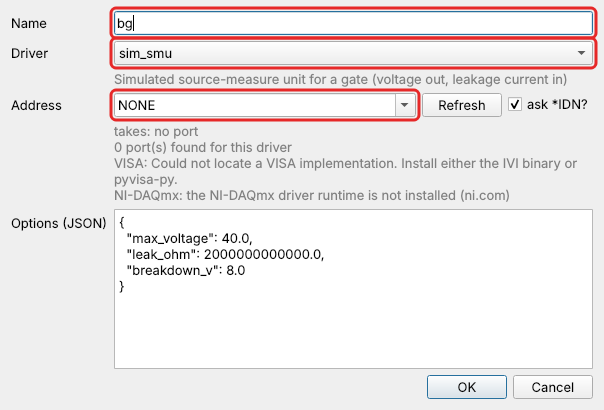
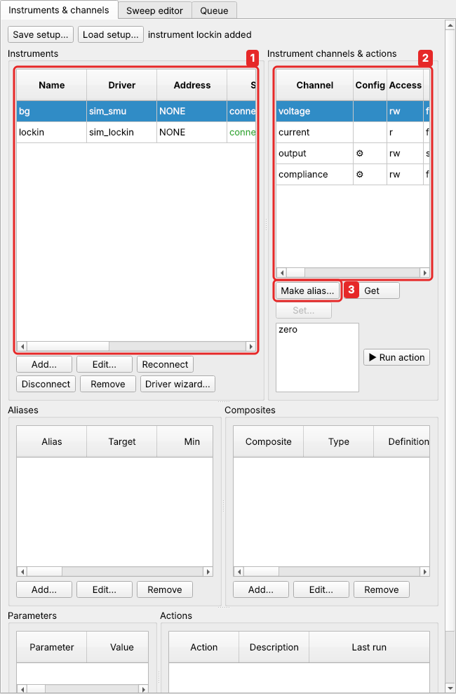
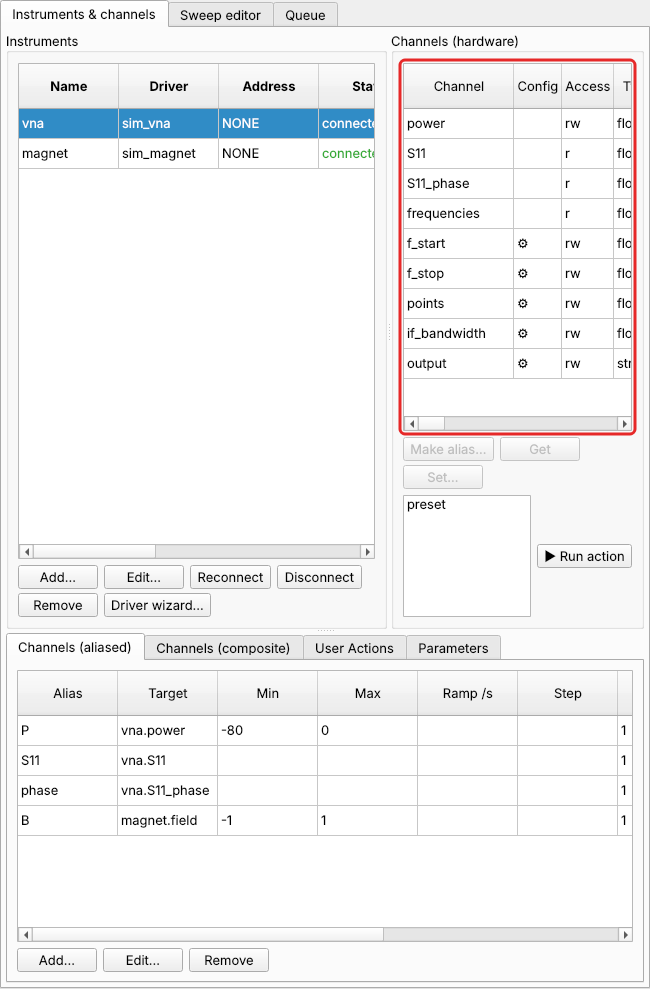
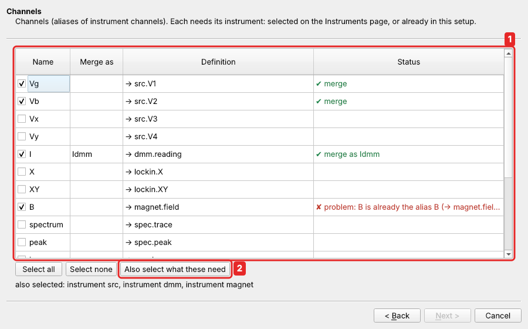

# Instruments

An **instrument** is a driver connected to a port. It exposes:

* **channels**: values to read and/or write. A channel is a `float` (a scalar or an
  array of any dimension, such as a spectrum or a camera image) or a `str`;
* **configuration channels**: settings such as range, sensitivity, mode or output on/off;
* **actions**: commands without arguments, such as reset, trigger or auto-phase.

The drivers that come with easyMeasure are listed under
[Supported instruments](../instruments.md); each has a reference page with every
channel.

## Adding an instrument

In *Instruments & channels*, click **Add…** under the *Instruments* list:



* **Name**: a short name of your choice, such as `lockin` or `bg`. Its channels are
  then called `lockin.X`, `bg.voltage` and so on.
* **Driver**: the kind of instrument. The line below it says what the driver is for.
* **Address**: where it is connected. The list shows the ports and devices the
  backend computer has that this driver accepts:
    * instruments that identified as this driver's kind come first, marked ✓;
    * then the other ports;
    * then ports already in use;
    * then the driver's suggestions, such as its built-in emulator.

    You can also type any address (see [Addresses](#addresses)). **Refresh** scans
    again; with *ask \*IDN?* it also identifies GPIB, USB and LAN instruments.

* **Options**: driver settings, in JSON, such as `"reset": true` or
  `"call_timeout": 20`. Choosing a driver fills in its options with their defaults;
  most instruments need no change. See [Guard options](#guard-options).

The new instrument appears in the list with its state:



| state | means |
|---|---|
| `connected` | ready |
| `disconnected` | switched off with **Disconnect** |
| `error` | could not be reached. The *Last error* column says why |

An instrument that cannot be reached is still added, so a typo in the address doesn't
lose your settings. Fix the problem, then click **Reconnect**. **Edit…** changes the
address or options (and reconnects), **Remove** deletes the instrument (refused while
aliases use it). The *Calls*, *Errors* and *Timeouts* columns count the instrument's
traffic, which helps when a cable is loose.

!!! tip "No hardware at hand?"
    Every hardware driver accepts the address `SIM::<anything>` (NI DAQs: `DAQ::SIM`)
    and then talks to a built-in emulator of the instrument. The `sim_*` drivers
    simulate a whole sample; see [Simulated instruments](simulation.md).

??? example "From Python"

    ```python
    c.call("add_instrument", name="lockin", driver="sr830", address="GPIB0::8::INSTR")
    c.call("add_instrument", name="smu", driver="keithley2400", address="GPIB0::24::INSTR",
           options={"call_timeout": 20, "verify_writes": True})
    c.call("reconnect_instrument", name="lockin")
    c.call("update_instrument", name="lockin", address="GPIB0::9::INSTR")   # reconnects
    c.call("disconnect_instrument", name="lockin")
    c.call("remove_instrument", name="lockin")
    ```

    The returned description has `state` and `last_error`.

## Addresses

| interface | address examples | needs |
|---|---|---|
| `gpib` | `GPIB0::12::INSTR` | VISA library + GPIB card driver |
| `usb` (USB-TMC) | `USB0::0x0957::0x8B18::MY51141134::0::INSTR` | VISA library |
| `tcpip` (VISA LAN) | `TCPIP0::192.168.1.20::inst0::INSTR`, `TCPIP0::192.168.1.20::5025::SOCKET` | VISA library |
| `tcp` (raw socket) | `TCP::192.168.1.30::1234` (e.g. a Prologix GPIB-Ethernet adapter) | – |
| `serial` | `COM3`, `/dev/ttyUSB0`, `ASRL3::INSTR` | adapter driver |
| `daq` | `DAQ::Dev1` (the NI MAX device name), `DAQ::SIM` | NI-DAQmx |
| `sim` | `SIM::<bus name>` | – |
| `none` | `NONE` (instruments without a port, e.g. the simulated ones) | – |

Each driver lists the interfaces it accepts. An address of another interface is
refused when the instrument is added. For example, the GPIB instruments also accept
`serial` and `tcp` (RS-232, or a Prologix adapter), and the Keysight B2900 also
takes USB and LAN.

### Finding what is connected

The **Address** list of the *Add…* dialog already shows what the backend computer
has. Tick *ask \*IDN?* and click **Refresh** to have each GPIB, USB and LAN
instrument identify itself.

??? example "From Python"

    ```python
    r = c.call("discover_resources", identify=True)
    for f in r["found"]:
        print(f["interface"], f["address"], f.get("description", ""), f.get("idn", ""))
    print(r["notes"])     # what could not be scanned (no VISA library, no NI-DAQmx …)
    ```

Serial ports come with their description (e.g. an FTDI adapter), VISA instruments
with their alias, and NI devices with their product type. `identify` asks each GPIB
/ USB / LAN instrument `*IDN?`, except instruments already configured here, which are
left alone.

### Several instruments behind one GPIB adapter

A Prologix GPIB-USB or GPIB-Ethernet adapter is one port shared by several
instruments. Add each of them with the adapter's port as address (e.g. `COM5`), and
in the options set `"shared": true` and its GPIB address, `"gpib_addr": 22`.

??? example "From Python"

    ```python
    for name, drv, addr in (("dmm", "hp34401a", 22), ("src", "yokogawa7651", 3)):
        c.call("add_instrument", name=name, driver=drv, address="COM5",
               options={"shared": True, "gpib_addr": addr})
    ```

Before an instrument talks, the port is switched to it (`++addr N`). The
measurement thread has priority over monitor and GUI traffic, so monitoring
never slows a sweep down.

## Channels

Select an instrument, and its channels are listed under *Instrument channels &
actions*. **Get** reads the selected channel:



| column | |
|---|---|
| Config | ⚙ marks a configuration channel (a setting, below) |
| Access | `r` readable, `w` writable |
| Type, Shape | `float` or `str`; `()` for a single number, `(401,)` for a 401-point trace |
| Allowed values | for settings with a fixed list of values |

Instrument channels, `instrument.channel`, can be read anywhere: sweeps, monitor,
scripts. To **set** a measurement channel, give it an [alias](aliases.md) with
**Make alias…**. The alias carries the limits and ramp rate.

??? example "From Python"

    ```python
    c.call("read_channel", name="lockin.X")              # raw reference: instrument.channel
    c.call("channel_info", name="lockin.X")
    # {'name': 'lockin.X', 'kind': 'raw', 'dtype': 'float', 'shape': [], 'readable': True,
    #  'writable': False, 'unit': 'V', 'config': False, 'choices': None}
    ```

### Configuration channels

Settings such as a range, a time constant or an output switch are set directly with
**Set…** (or in the Manual panel, with *settings* ticked). They are never aliased or
swept, which keeps the channel lists short. In a sweep, set them as **constants** in
the pre-sweep or post-sweep settings (see [Sweeps](sweeps.md#pre-and-post-phases)), so
every data file records how the instrument was set.

??? example "From Python"

    ```python
    c.call("write_channel", name="lockin.sensitivity", value="500uv")   # → '500 µV'
    c.call("write_channel", name="lockin.time_constant", value="300 ms")
    c.call("write_channel", name="smu.nplc", value=10)
    c.call("read_channel", name="lockin.sensitivity")
    ```

**Allowed values.** Many settings accept only certain values. The front ends then
show a drop-down. Writes are checked and normalised to the listed spelling. Case,
blanks, `u`/`µ` and `Ohm`/`Ω` do not matter, so `"500uv"` sets `"500 µV"`.

### Channel lists that follow the instrument

A mode switch can rename channels, change units or make a channel read-only. The
backend asks the driver for its channel list again after every configuration
write, action and reconnect, and the front ends follow:

??? example "From Python"

    ```python
    c.call("write_channel", name="smu.output", value="OFF")    # modes change with output off
    c.call("write_channel", name="smu.mode", value="Current")
    # voltage is now measured (read-only), current is the source,
    # Icompliance [A] became Vcompliance [V]
    ```

An alias whose target disappeared reports an error instead of silently reading
something else. This applies, for example, to `dmm.Vdc` after the meter was switched to
`Iac`. Re-point the alias, or switch back.

## Actions

Instrument actions, such as *auto phase*, *reset* or *preset*, are listed below the
channels. Select one and click **▶ Run action**. In scripts and point actions:
`action('lockin.auto_gain')`. Actions are guarded like
every other call but never retried automatically, because a trigger must not fire twice.
Afterwards the cached values of that instrument's aliases are discarded, so the
next ramp reads back where the instrument really is.

??? example "From Python"

    ```python
    c.call("run_action", ref="lockin.auto_phase")
    ```

## Talking to the instrument directly

Sometimes you need a command the driver does not offer. A user action or a script
can send it: `instrument('lockin').raw_query('*IDN?')` returns the answer,
`instrument('lockin').raw_write('OUTX 1')` sends a command.

??? example "From Python"

    ```python
    c.call("raw_query", instrument="lockin", command="*IDN?")
    # 'Stanford_Research_Systems,SR830,s/n48261,ver1.07'
    c.call("raw_write", instrument="lockin", command="OUTX 1")
    ```

Over remote access this needs the admin role, and every command is logged.

## Guard options

Every instrument, whatever its driver, takes these options:

| option | default | meaning |
|---|---|---|
| `call_timeout` | 10 s | deadline for every driver call |
| `retries` | 2 | retries of a failed read / write |
| `retry_delay` | 0.05 s | pause between retries |
| `reconnect_after` | 2 | consecutive failures before a reconnect |
| `timeout_retries` | 1 | retries after a timeout |
| `breaker_threshold` | 2 | hangs before a channel is quarantined |
| `breaker_cooldown` | 10 s | quarantine time (doubles on repeated trips) |
| `shared` | driver default | the port may be shared with other instruments |

Common driver options of the hardware drivers:

| option | meaning |
|---|---|
| `reset` | `*RST` on connect |
| `check_errors` | read the error queue after every setting, so a refused value raises the instrument's own message (default on) |
| `verify_writes` | SMUs: read every source value back (worth it on RS-232) |
| `gpib_addr` | GPIB address behind a Prologix adapter |
| `timeout`, `read_termination`, `baudrate` | port settings |

See [Robustness](robustness.md) for what happens when an instrument misbehaves.

## Saving the setup

Instruments, parameters, aliases, composites, the monitor list and user actions
together form the **setup**. **Save setup…** and **Load setup…** in the **Setup**
menu write it to a file and read it back. Loading replaces the current setup.

??? example "From Python"

    ```python
    c.call("save_setup", path="C:/lab/fridge_setup.json")
    c.call("load_setup", path="C:/lab/fridge_setup.json")   # returns a list of problems ([] = fine)
    ```

The setup is also autosaved on every change. `python -m easymeasure.backend
--restore` starts with the last one. The file format is in the
[reference](../reference/setup-format.md).

### Merging a setup

**Setup → Merge setup…** takes parts of another setup file into the current one: a second
cryostat's instruments, a colleague's composite channels, a set of user actions. A
wizard asks for the file, then shows one page for each kind of item, in the order they
depend on each other:

1. **Instruments**;
2. **Parameters**;
3. **Channels** (aliases);
4. **Composite channels**;
5. **Actions**;

then a **Review** page, with **Merge**.



1. The items of the file. Tick what to take. **Merge as** gives an item a new name here
   (here `I`, which this setup already has, becomes `Idmm`). **Status** says at once
   whether each ticked item can be merged. `B` cannot: this setup has a different `B`.
   Rename it, or untick it to keep using this setup's `B`.
2. **Also select what these need** ticks, on every page, what the ticked items use:
   here the instruments `src`, `dmm` and `magnet` (the file's `magnet` differs from this
   setup's, so it needs a new name on the Instruments page too).

The statuses:

| status | meaning |
|---|---|
| ✔ merge | it can be merged |
| = already here | this setup has an identical one: it is left as it is |
| ⚠ merge | it can be merged, but look at the message (e.g. an action quotes a channel that will not exist) |
| ✘ problem | it cannot be merged as it is; **Next** stays greyed out until it is fixed or unticked |

The problems it finds:

* **Name conflicts.** A name already used here (by anything with a name: instrument,
  alias, parameter, composite channel or variable, action), or two merged items under
  one name. Give one of them another name in *Merge as*, or untick it. An unticked item
  whose name exists here is replaced by the one already here: whatever uses it in the
  file then uses this setup's one. When that one is different, a warning says so.
* **Missing pieces.** An alias needs its instrument, a formula the channels and
  parameters it uses. Each must be ticked too, or already be here.
* **Inconsistencies.** Everything is checked with the backend's own rules, on a copy of
  the current setup: formulas, writable targets, mappings that must be each other's
  inverse, parameter formulas that use live channels, and **circular references**
  between composite channels or between parameters.

New names are carried through. Renaming the instrument `lockin` to `lockin2` changes
the targets of the merged aliases (`lockin.X` → `lockin2.X`). Renaming an alias or a
parameter changes the formulas that use it, and the names quoted in the merged
actions (`get('Vxx')`). Parameters are also renamed where an action uses them by name.
Nothing changes until you click **Merge**. Then the items are added one by one, in an
order that works.
