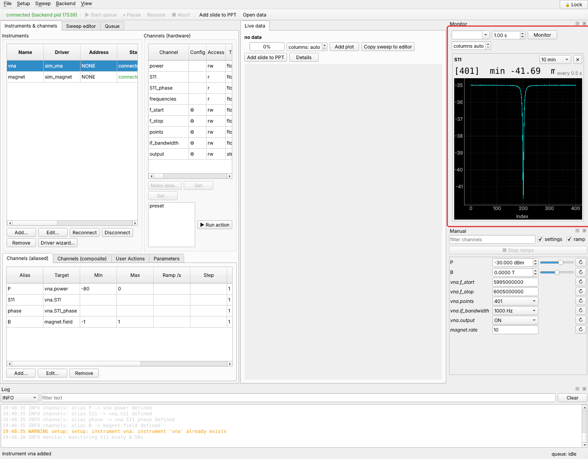
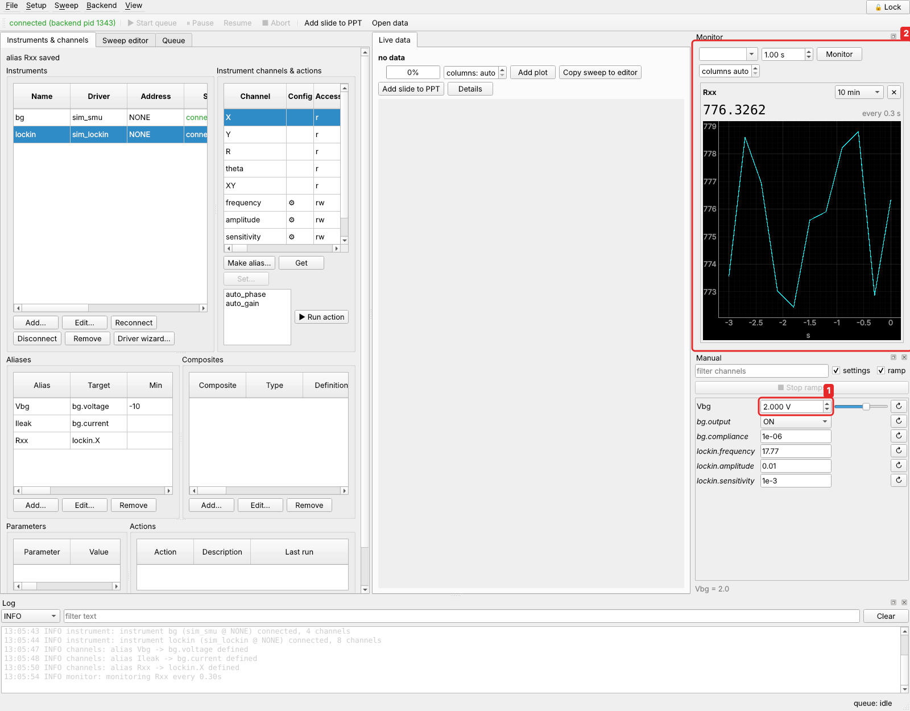
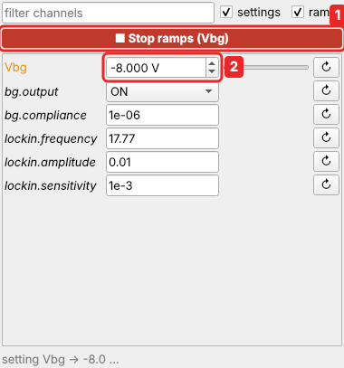
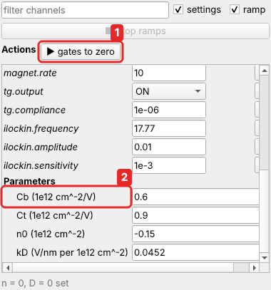

# Monitor and Manual panels

## Monitor

The **Monitor** dock shows channels that the backend polls at their own
intervals: temperatures, field, a leakage current, the eight readings of a supply.
Values are pushed to every GUI and the web app.

Choose the channel at the top of the dock, set the interval, and click **Monitor**.
✕ on a tile removes it.



??? example "From Python"

    ```python
    c.call("monitor_add", channel="T", interval=1.0)
    c.call("monitor_add", channel="cyg.VmeasAll", interval=0.5)
    c.call("monitor_list")          # channel, interval, last value, last error, time
    c.call("monitor_history", channel="T")    # {'T': [[t, value], …]}
    c.call("monitor_remove", channel="T")
    ```

Every instrument is polled by its own thread, so a hung instrument never stalls
the others. Monitoring has lower priority than a running sweep on a shared port.

### Tiles

Each tile shows the latest value in large type, the polling interval, and a plot
over the chosen time span (1 min, 10 min, 1 h or all). Text channels show their
text. Errors are shown in the tile until the next good reading.

**Vector channels** can be shown two ways. Use the tile's selector to switch:

| view | shows | default for |
|---|---|---|
| *vs time* | one curve per element against time, with a legend for up to 8 | vectors up to 16 elements, such as the eight readings of a supply |
| *vs index* | the latest values against the element index | longer vectors, such as spectra |

2-D channels, such as images, are shown as an image of the latest value.

### Layout

**columns**: *auto*, or 1–8 tiles side by side. *Auto* picks the arrangement
that shows every tile largest in the available space. All tiles are shown at once
and share the dock's area. Scroll bars appear only when the dock is smaller than the
tiles' minimum size. The choice is remembered between sessions.

## Manual



The **Manual** dock lists every writable scalar channel:

* aliases;
* [composite](composites.md) variables and mappings;
* instrument settings, with **settings** ticked.

Each channel has a spin box, and a slider when it has a minimum and a maximum.

* Writes are **protected and ramped**: alias limits and ramp rates apply. While a ramp
  runs, further changes to that channel are coalesced, so only the latest value is
  sent after it. The *ramp* box switches ramping off (jumps).
* **■ Stop ramps** lights up (red, with the channel names) while a ramp is running,
  whether it was started here, in another window, the web page or a Python client.
  It stops every such ramp where it is: the channel keeps the value it had reached,
  and the panel shows it. Ramps inside a sweep, a script or a user action are not
  affected; **Abort** stops those.

    
* Right click → **Set from expression…**: a function of the present value `x`,
  e.g. `x + 0.01` or `x/2`.
* **Read back** (↻) reads the present value.
* The mouse wheel only acts on a focused control, so scrolling the panel never moves
  an instrument.
* The filter box narrows the list by name or composite.

### Composite variables: Set all to zero, hold and Set all

Variables of a multivariate composite are listed, indented, under a header with the
composite's name. The header has three controls:

* **Set all to zero** sets every variable to 0 together, with limits and ramps as
  usual. This is the easy way to start.
* **hold**: while ticked, edits only mark the variables (blue) and are not sent.
* **Set all** sends the held values together; the hardware channels are computed
  once from all of them.

**Before the first setting.** Until the variables of a composite have been set, they
have no value, and the panel says so:

* each variable shows **NaN**, and its slider is greyed out;
* the header says *not set yet*, and **hold** is ticked and cannot be unticked: a
  variable can only be set alone once the others have a value;
* **Set all** is greyed out until every variable has a value typed in (each is held,
  blue); **Set all to zero** works at once.

Once the variables are set, hold unticks itself and everything works as usual.

See [Composite channels](composites.md#multivariate-write) and
[tutorial 2](../tutorials/rotated-gates.md#5-set-n-and-d-by-hand).

### User actions and parameters

Your [user actions](user-actions.md) are buttons at the top of the panel: **▶ name**
runs one (asking first if it is marked *ask before running*). While it runs its
button turns orange (**■ name**); clicking it then aborts it.

The setup's [parameters](parameters.md) are listed at the bottom, under
**Parameters**. Type a new value for a value parameter and press Enter: formula
parameters follow, and no instrument moves. Formula parameters show their value and
formula.



### Instrument settings

Tick **settings** to also list the instruments' configuration channels (in italics,
grouped by instrument). Settings with allowed values (modes, ranges, output on/off)
appear as drop-downs.
