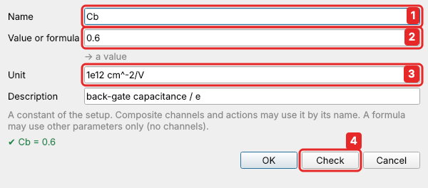
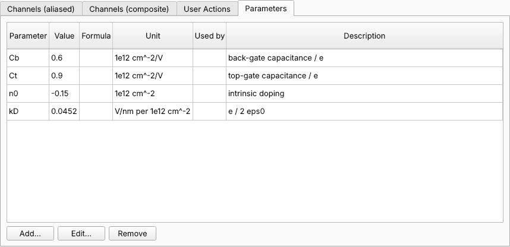

# Parameters

A **parameter** is a named number that belongs to your setup: a gate capacitance, a
geometry factor, the value of a bias resistor, an amplifier gain. Instead of typing
`0.6` into five formulas, you define `Cb = 0.6` once and write `Cb` everywhere. When
the number changes (a new device, a better calibration), you change it in one place.

A parameter is either:

* a **value**, a number you set; or
* a **formula** of other parameters, such as `Ct/Cb` or `2*pi*f0`. A formula may use
  only other parameters, never a live channel, and parameters may not refer to each
  other in a circle.

## Defining parameters

In *Instruments & channels*, on the **Parameters** tab, click **Add…**:



1. **Name**: letters, digits and `_`; not the name of a channel, a composite or a
   function such as `sin`.
2. **Value or formula**: type a number (`0.6`, `1e6`) for a value, anything else
   for a formula of other parameters (`Ct/Cb`). The line below says which it took.
3. **Unit** and an optional description, shown as tooltips.

**Check** asks the backend what the parameter would be, without defining it: its
value, or why it is refused (an unknown name, a circle, a mapping it would break).
**OK** checks first and keeps the dialog open if the check fails.

The table lists every parameter with its present value, its formula, and what uses
it:



**Edit…** (or a double-click) changes one, **Remove** deletes it. A parameter that a
formula, a composite or another parameter uses cannot be removed; the message says
which ones use it.

## Setting a value

A value parameter can also be changed in the **Manual** panel, in the **Parameters**
group at the bottom: type the value and press Enter. Formula parameters are shown
there with their value and formula, and follow at once.

Setting a parameter **moves no instrument**. Composite channels use the new value the
next time they set something: after changing `Cb`, setting `n` again puts the gates
where the new `Cb` says.

Parameters cannot be written like channels: not by `set(...)` in a script, not by
`write_channel`, and not by a sweep. They are constants of the setup, and are changed
only on purpose, in the Parameters or Manual panel.

## Using parameters

Wherever a formula is written, a parameter can be used by its name:

| where | example |
|---|---|
| the targets of a [multivariate composite](composites.md#multivariate-write) | `Vbg = (n - n0 + D/kD) / (2*Cb)` |
| a [composite read](composites.md#composite-read) | `Rxx = Vxx / I * geom` |
| the forward and backward formulas of a [mapping](composites.md#simple-mapping) | `x / gain`, `y * gain` |
| [user actions](user-actions.md), [point actions](point-actions.md) and [scripts](../scripting/scripts.md) | `set('Vbg', V0)`, `params.Cb` |

A parameter can also be **read** like any channel: `get('Cb')`, recorded in a sweep,
shown in the Monitor.

In actions and scripts, each parameter is available:

* by its name, with its value at the start of the action: `set('Vbg', V0 + dV)`;
* as `params.Cb` or `params['Cb']`, always the present value; `dict(params)` gives
  them all.

A parameter whose name the script API already uses (`state`, `np`, `get` …) is only
available through `params`.

!!! note "Mappings are checked again"
    A [mapping](composites.md#simple-mapping) is checked to be its own inverse when it
    is defined. If its formulas use a parameter, it is checked again whenever that
    parameter changes, and a value that would break it is refused (the old one stays).

## In data files

Every data file records the parameters as they were when the sweep started, in its
header: `ds.header["parameters"]` is `{name: {"value", "unit", "formula"}}`. So
months later you can still tell which capacitance a map of $n$ and $D$ was
computed with.

## In setup files

Parameters are saved with the setup, under `"parameters"`, in an order where every
formula comes after the parameters it uses. When a setup is loaded, a parameter that
is wrong (a circle, an unknown name) is reported and left out, and the rest load.

## From Python

??? example "Parameters from a Python client"

    ```python
    c.call("define_parameter", name="Cb", value=0.6, unit="1e12 cm^-2/V")
    c.call("define_parameter", name="ratio", formula="Ct/Cb")
    c.call("define_parameter", name="Ct", definition="1.2")   # as typed: a number or a formula
    c.call("check_parameter", name="k", definition="ratio * 2")
    # {'name': 'k', 'formula': 'ratio * 2', 'current': 4.0, 'warnings': []}   nothing defined
    c.call("set_parameter", name="Cb", value=0.58)       # formulas follow
    c.call("read_channel", name="ratio")
    c.call("list_parameters")
    # [{'name': 'Cb', 'value': 0.58, 'current': 0.58, 'unit': ..., 'used_by': ['ratio', 'nD']}, ...]
    c.call("remove_parameter", name="ratio")
    ```

    Defining and removing parameters needs the admin role over remote access;
    setting a value needs the operator role.
