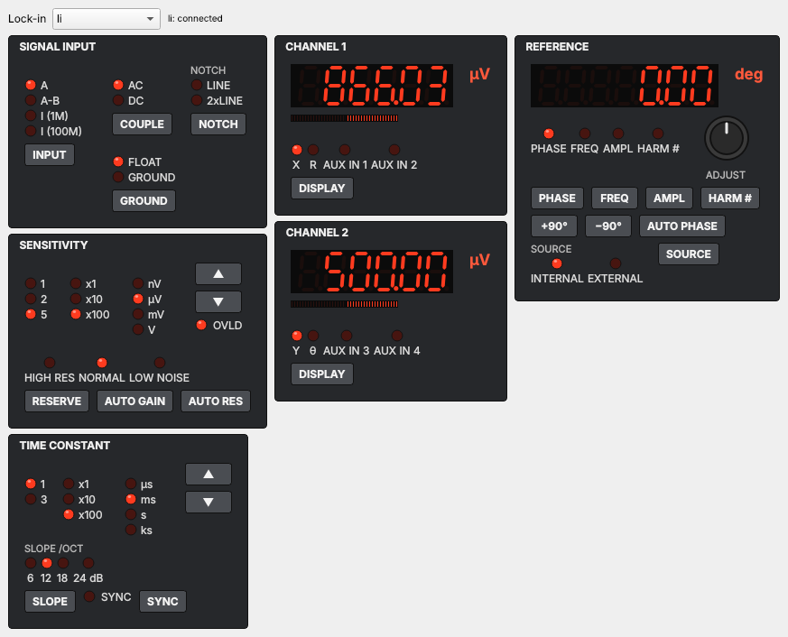

# Plugins

A **plugin** is an add-on to the measurement engine. It brings panels and processing
of its own: a front panel for an instrument, a calculator that follows a running
measurement, a tab with a live plot of something derived. Plugins can be switched on
and off at any time, and whatever a plugin does wrong stays with the plugin.

A plugin can

* add **panels** beside *Instruments & channels*, *Sweep editor* and *Queue*, and
  **data tabs** beside *Live data*;
* provide **channels and actions** of its own. They appear as an instrument named
  after the plugin, so you can monitor them, set them in the Manual panel, alias
  them and sweep them;
* do **work in the background**: read channels at intervals, react to what the
  backend does (a sweep point, an instrument that drops).

A plugin never talks to hardware itself. It uses instruments through the backend,
like a front end does, with the same limits, ramp rates and locks. Communication with
an instrument is always its driver's job.

## The Plugins menu

**Plugins → Manage plugins…** lists every plugin that was found:

| column | |
|---|---|
| Enabled | switches the plugin on or off, at once |
| Plugin | its name |
| State | `off`, `starting`, `running`, or `error` (with the number of errors) |
| Version | |
| From | *built in*, or the file it was loaded from |

Below the list are the selected plugin's description, its **options** (as JSON, e.g.
`{"instrument": "li", "poll": 0.25}`; **Apply options** restarts the plugin with
them) and its most recent **errors**. **Look for plugins again** loads plugins added
or changed since the backend started; a running plugin keeps the code it was started
with until you switch it off and on.

The menu also lists the panels and tabs of the running plugins: choosing one shows it.

The enabled plugins and their options are kept by the backend. When the backend
starts again, it enables them again, once the setup has been restored.

??? example "From Python"

    ```python
    c.call("list_plugins")                       # what there is, and what runs
    c.call("enable_plugin", name="sr830_panel")
    c.call("set_plugin_options", name="sr830_panel", options={"poll": 0.5})
    c.call("disable_plugin", name="sr830_panel")
    ```

## Where plugins come from

* The plugins that come with easyMeasure.
* The folder `plugins` in the easyMeasure home folder (`~/.easymeasure/plugins` by
  default): one `.py` file, or one folder with an `__init__.py`, per plugin.
* The folders of the backend setting `plugin_paths`.

The dialog shows these folders at the bottom, and the files that did not load and
why. [Writing plugins](../scripting/writing-plugins.md) explains how to make one.

## Safe to switch on and off

Each plugin runs on its own thread, next to the backend.

* **Errors** inside a plugin (in a button's code, a timer, a channel read) are
  logged and shown in the Plugins dialog. The plugin goes on and the backend never
  notices. A channel read that fails fails like an instrument call: NaN in a sweep
  (`on_read_error` = `nan`), or the sweep stops (`abort`).
* A plugin whose **start fails** is left off, in state `error`, with the reason.
* **Switching a plugin off** works at once, whatever the plugin is doing. Its panels,
  tabs, channels and timers disappear, and it can no longer use the backend. A plugin
  stuck in a loop that never ends is left behind, cut off from everything.
* Its channels are not part of the **setup**. Saving a setup leaves them out, and
  loading one leaves them alone. An alias of a plugin channel stays defined while
  the plugin is off. Reading it fails meanwhile, and works again once the plugin is
  on.

Plugins are Python code running in the backend. Install only plugins you trust,
as you would a driver.

## Remote access

In the web app the Plugins menu and the plugins' panels work the same way.

* Viewers see the panels.
* Operators may also operate them: press keys, turn knobs, choose from lists. That
  runs what the plugin does, the way a user action an admin wrote does.
* Enabling, disabling, configuring and looking for plugins needs the admin role,
  because a plugin is code.

## The SR830 front panel

The plugin **SR830 front panel** shows an SR830 lock-in amplifier the way its own
front panel does, and operates it. It works with any instrument of the `sr830`
driver, real or [simulated](simulation.md) (`SIM::li`).



* **Lock-in**: which SR830 the panel shows, if there are several.
* **Signal input**: the LEDs show the input (A, A−B, I 1 MΩ, I 100 MΩ), coupling,
  grounding and notch filters. Each key steps to the next setting, as on the
  instrument.
* **Sensitivity** and **time constant** are shown by LEDs in parts: mantissa ·
  decade · unit. For example, 500 µV lights *5*, *×100* and *µV*. ▲ and ▼ step
  through the instrument's values. *OVLD* lights when R exceeds the sensitivity.
  Reserve and slope have a key each, beside *AUTO GAIN*, *AUTO RES* and *SYNC*.
* **Channel 1 / 2**: seven-segment displays with 4½ digits of the sensitivity, a bar
  graph of the reading against full scale, and *DISPLAY* to choose X, R or an aux
  input (Y, θ or an aux input on channel 2).
* **Reference**: the display shows phase, frequency, amplitude or harmonic (the keys
  below it choose), and the **knob** changes it. Turn the knob with the mouse wheel,
  by dragging up or down, or with the arrow keys: 1° of phase, 1 % of frequency or
  2 mV of amplitude per step. *+90°*, *−90°*, *AUTO PHASE*, and the reference source.
* **SR830 trace** (a tab beside Live data): X and Y over the last two minutes.

It provides the instrument `sr830_panel`:

| channel / action | |
|---|---|
| `ch1`, `ch2` | the value the display shows |
| `ch1_display`, `ch2_display` | what it shows: X, R, AUX IN 1, AUX IN 2 / Y, θ, AUX IN 3, AUX IN 4 |
| `overload` | `YES` when R exceeds the sensitivity |
| `auto_sensitivity` | steps the sensitivity until R is 10 … 80 % of full scale. This is quicker than the instrument's AUTO GAIN, and can run as a point action of a sweep |

Options: `instrument` (empty: the first SR830), `poll` (seconds between readings,
0.25), `history` (seconds of trace, 120).
