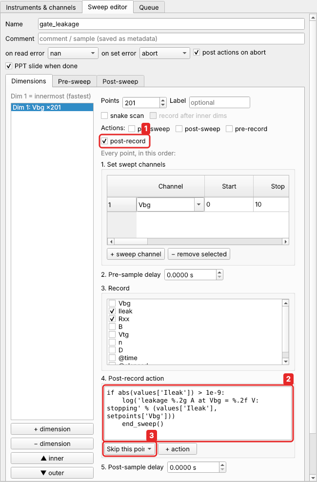

# Point actions and flow control

**Point actions** are optional Python snippets that run at every point of a
dimension. Typical uses are triggering a meter before recording, waiting for a
magnet, logging a value, or stopping a curve once a threshold is crossed. Each
dimension has four of them, at the positions shown in
[the order at each point](sweeps.md#the-order-at-each-point):

| action | runs |
|---|---|
| `pre_sweep` | before the swept channels are set |
| `post_sweep` | after setting, before `pre_delay` |
| `pre_record` | after `pre_delay`, just before recording |
| `post_record` | just after recording, before `post_delay` |

In the sweep editor, tick an action next to *Actions:* and its code box appears at
its place in the sequence. The **+ action** box offers common snippets, and the
drop-down next to it (*Skip this point*, …) inserts the flow-control calls:



Unticked code is kept in the definition but not run. In the sweep's file, the actions
are under `hooks`:

```json
{"points": 101, "sweep": [{"channel": "Vg", "start": -0.5, "stop": 0.5}],
 "record": ["I"],
 "hooks": {"pre_record":  {"enabled": true, "code": "action('dmm.trigger')"},
           "post_record": {"enabled": true,
                           "code": "if values['I'] > 1e-6: log('high at %s' % (index,))"}}}
```

## What the code sees

Everything of the [script API](../reference/script-api.md) (`get`, `set`,
`set_many`, `sleep`, `wait_until`, `action`, `log`, `state`, `np` …), plus:

| name | meaning |
|---|---|
| `k` | the dimension (0 = innermost) |
| `i` | the index of this point in the dimension |
| `index` | the indices of this and the outer dimensions, e.g. `(i, j)` |
| `setpoints` | the dimension's channel → value at this point |
| `values` | (`post_record` only) what was just recorded: channel → value |

Code is compiled once per sweep. An error in an action stops the sweep, and the post
phase still runs.

## Examples

**Trigger a meter in a triggered mode before every reading** (`pre_record`):

```python
action('dmm.trigger')
```

**Wait for a magnet to reach its field** (`post_sweep` of the field dimension):

```python
wait_until(lambda: get('magnet.status') == 'HOLDING', timeout=600, interval=0.5)
```

**Wait for the temperature to settle** (`post_sweep` of a temperature dimension):

```python
target = setpoints['Tset']
wait_until(lambda: abs(get('T') - target) < 0.01, timeout=1800, interval=2)
sleep(60)                      # and let the sample follow
```

**Log values above a threshold** (`post_record`):

```python
if abs(values['I']) > 1e-6:
    log('high current %.3g A at Vg = %.3f' % (values['I'], setpoints['Vg']))
```

**Keep a running count across points** (`state` persists):

```python
state['n_high'] = state.get('n_high', 0) + (values['I'] > 1e-9)
```

**Auto-range a lock-in when it overloads** (`post_record`, with the simulated lock-in,
whose sensitivity is a number in volts):

```python
if abs(values['X']) > 0.9 * float(get('lockin.sensitivity')):
    action('lockin.auto_gain')
    sleep(1)
```

## Flow control

Think of the dimensions as nested `for` loops. Three calls change the flow. Each
action's *+ action* helper in the editor offers them first.

| call | entry in the helper | like | effect |
|---|---|---|---|
| `skip_point()` | Skip this point | `continue` | the rest of this point (and its inner dimensions, unless they already ran) is skipped; its data are NaN; next point of the same dimension |
| `skip_line()` | Skip this line | `break` | this point and the remaining points of this dimension are skipped (NaN); the outer dimension continues (in the outermost dimension the sweep is done) |
| `end_sweep()` | Terminate the entire sweep | `exit` | the sweep ends with status `terminated`; called in `post_record` it keeps the point just recorded |

**Stop an I–V curve once the current exceeds 1 µA** (`post_record`):

```python
if abs(values["I"]) > 1e-6:
    end_sweep()
```

**In a 2-D map, finish a line early once the device has switched**
(`post_record` of the inner dimension). The next bias value starts at once:

```python
if values["R"] > 1e6:
    skip_line()
```

**Skip setpoints that are known to be bad** (`pre_sweep`):

```python
if 0.10 < setpoints['Vg'] < 0.12:      # a charge jump in this range
    skip_point()
```

A terminated sweep is a normal end:

* the post phase runs;
* the file, the HDF5 copy and the slide are written as usual;
* every point not reached is NaN;
* the log says where it ended, and the file footer has `terminated_at`.

Skipped points count as done for the progress; the footer has `skipped_points`.

The calls cannot be swallowed by an `except Exception` in the action. Outside
per-point actions, such as in the pre/post hooks or in scripts, they are an error.

## Permissions

Point actions are Python running in the backend. Over
[remote access](remote.md#roles), sweeps with point actions or pre/post hook code
need the admin role. Operators can run sweeps without code.
