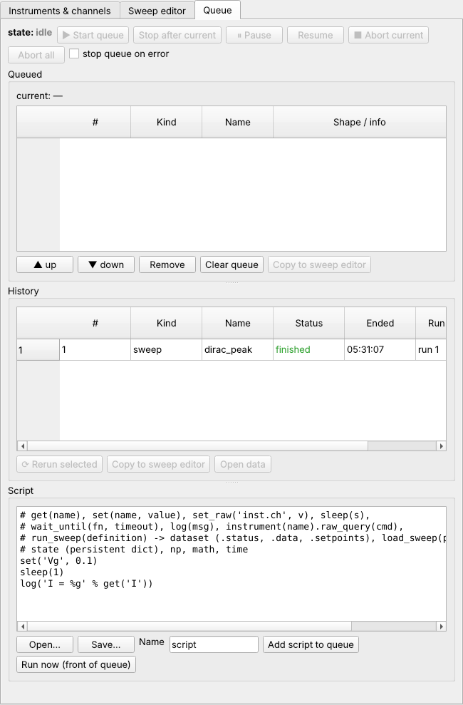

# The run queue

Sweeps and scripts run one at a time from the **queue**. You can line up a night's
worth of measurements and look at the results in the morning. The **Queue** tab shows
it:



* **Queued**: what waits. The first line is the item running now (`current`).
* **History**: what has run, with its status and data file.
* **Script**: the script editor (see [Queue scripts](../scripting/scripts.md)).

## Adding to the queue

In the **Sweep** menu (for the sweep in the editor):

* **Add to queue** puts the sweep at the end of the queue.
* **Add & start** does the same and starts the queue.

The sweep is validated when it is added: a sweep that would exceed a limit is refused
right there, not at 3 a.m. Later changes in the editor do not change a sweep that is
already queued.

**Start queue** runs what is queued, one item after the other. When the queue runs
empty it goes back to *idle* by itself; a sweep added after that waits for the next
**Start queue**. Use **up** / **down** to change the order of waiting items, **Remove**
to drop one, **Clear queue** to drop all.

## Pause, abort, stop

| button | effect |
|---|---|
| **Pause** / **Resume** | the running item halts at the next point (sweeps) or line (scripts), with everything left as it is, and continues from there |
| **Abort current** | ends the running item. A sweep's **post-sweep** settings still run, so the gates still go back to zero |
| **Abort all** | ends the running item, empties the queue, and stops running [user actions](user-actions.md) |
| **Stop after current** | lets the running item finish, then stops the queue |
| **stop queue on error** | when an item fails, the queue stops instead of going on with the next |

The same buttons are on the main toolbar, so they are at hand whichever tab is open.
Buttons that don't apply right now are greyed out.

## History

Every finished, aborted or failed item stays in the **History**, with its status:

* *finished*: ran to the end.
* *terminated*: ended itself, with `end_sweep()` (see
  [tutorial 3](../tutorials/stop-at-threshold.md)).
* *aborted*: you pressed Abort.
* *error*: something went wrong; the log has the reason.

Select an item, then:

* **Rerun selected** queues the same sweep or script again, from the start, into a new
  data file.
* **Continue…** (an *aborted* or *error* sweep) goes on from where it stopped: see
  [below](#continuing-an-aborted-sweep).
* **Copy to sweep editor** (or **Copy to script editor**) loads it, so you can run a
  variation.
* **Open data** opens its data file in a new data window.

## Continuing an aborted sweep

A sweep that was aborted, or that stopped on an error, can be continued from the first
point it did not measure. Select it in the History and press **Continue…**, or use
*Sweep → Continue an aborted run…* to pick any data file of the data folder. That
includes a file whose run was cut off without its end, for example by a crash or a
power cut (its status is *incomplete*).

The dialog says why and when the run stopped, how many points it measured, and the
setpoints of the next point. It asks:

| field | what it does |
|---|---|
| **Wait after setting the channels** (s, default 0) | every swept channel is ramped to the next point, then the sweep waits this long before it measures again. Use it to let a sample settle, or a temperature recover, after the post-sweep settings changed things at the abort |
| **run the pre-sweep settings and hook again first** (on by default) | the pre phase runs again before the sweep goes on: its constants are set again and its hook runs again. Untick it when the pre phase should not repeat, for example when it starts a long cool-down |

**Continue now** queues the continuation and starts the queue. **Add to queue** only
queues it.

What you get:

* **A new data file**, with a new run number. It starts with a copy of everything the
  aborted run measured, and the sweep appends to it. **The aborted file is not
  changed.**
* **The same data as a run that was never aborted.** No point is measured twice and
  none is left out. Points are visited in the same order, with the snake directions
  kept. A dimension recorded *after* its inner loop is recorded once. Skipped points
  stay skipped. `@elapsed` goes on from where it stopped.
* **Every abort, recorded in the file.**
    * The header has `aborts`, a list with one entry per abort. Each entry has the run, the file, the status and reason, when it stopped, the points measured by then, the last index, when it was continued, the wait and `rerun_pre`.
    * The header also has `continued_from`, the file this run continued, and `first_run`, the run number the sweep started as.
    * The events have an `aborted` and a `continued` event for each abort, in order.
    * If the pre phase ran again, its new recordings are in a `pre_rerun` event; the pre-sweep values of the first run stay as they were.
    * The footer counts the aborts.
* **No limit on the number of continuations.** A continued run that is aborted again
  can be continued again. Its new file carries all the earlier aborts, and the data
  stay contiguous.

While a continued run goes on, the live data view, the GUI and web status bars and the
tray show the points measured before the abort together with the new ones. The progress
starts at the breakpoint, not at zero, and the time remaining comes from the rate since
the run was continued. The data window lists the aborts under *Details*.

A run cannot be continued when it finished or was terminated with `end_sweep()`.
It also cannot be continued when a channel it sweeps or records no longer exists.
Continuing also refuses the file of the run that is going on now.

Files that go missing or change:

* **A file that is deleted, moved or damaged** cannot be continued, and the dialog
  says so. A file whose last frame was cut off by a crash is not damaged in this
  sense: it continues from its last complete point.
* **A file deleted or replaced after its continuation was queued.** The item checks the
  file again right before it runs. If the file is gone or is now a different run, the
  item ends with an *error* that says why. It writes no data file.
* **Once the continuation has started, the old file is no longer needed.** It has
  been copied. The files of earlier aborts can also be deleted, because the newest
  file holds all the data. Their names stay in `aborts` as a record.
* **The same file cannot be queued for continuation twice.** If it was continued
  before, the dialog warns that continuing it again measures the remaining points a
  second time. To go on with the newest data, continue the newest run instead.
* **An abort during the wait, before any new point,** leaves a new file with the same
  data and one more entry in `aborts`. It can be continued like any other.

??? example "From Python"

    ```python
    info = c.call("continue_info", path=item["path"])
    info["continuable"], info["points"], info["total"], info["next_setpoints"]
    c.call("continue_sweep", path=item["path"], wait=30, rerun_pre=True, start=True)
    ```

    ```python
    from easymeasure.backend.storage import DataSet
    ds = DataSet.load(path)
    for a in ds.header.get("aborts", []):
        print(a["run"], a["status"], a["error"], a["points"], "of", a["total"])
    ```

## Scripts in the queue

A **script** is a Python program that runs from the queue like a sweep, for example
a loop that runs the same sweep at several temperatures. Scripts are an advanced
topic with their own chapter: [Queue scripts](../scripting/scripts.md).

## From Python

??? example "Queueing and controlling from a Python client"

    With a [Python client](../scripting/clients.md) `c`:

    ```python
    id1 = c.call("queue_add", item={"kind": "sweep", "definition": sweep1})
    id2 = c.call("queue_add", item={"kind": "sweep", "definition": sweep2}, start=True)
    c.call("queue_move", item_id=id2, position=0)     # run it first
    c.call("queue_remove", item_id=id1)
    c.call("pause"); c.call("resume"); c.call("abort"); c.call("abort_all")
    c.call("queue_stop")                              # stop after the current item
    c.call("queue_options", stop_on_error=True)

    st = c.call("queue_state")
    st["state"], st["current"], len(st["queued"])     # 'running', {...}, 3
    st["can"]       # which controls apply now: {'start': False, 'pause': True, ...}
    for item in st["history"]:
        print(item["id"], item["kind"], item["name"], item["status"], item.get("path"))
    ```

    The queue is `idle`, `running`, `paused` or `aborting`. The GUI and the web
    page enable their buttons from `can`.

## Permissions

Over [remote access](remote.md), operators can queue, control and continue sweeps. Scripts, and
sweeps with code in their point actions, need the admin role, because they run Python
on the measurement computer.
