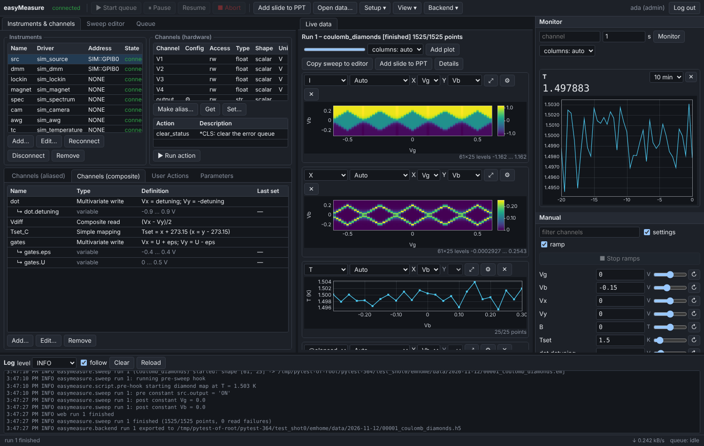

# Remote access and the web app

The backend itself only listens on `127.0.0.1`. For access from other computers it
starts a **gateway** process, which speaks HTTPS and secure WebSockets and forwards
authenticated, permitted requests to the backend over localhost:

```
browser / RemoteClient ──TLS 1.2+ (WSS, compressed)──▶ gateway ──localhost──▶ backend
```

## Switching it on

```bash
python -m easymeasure.remote adduser alice --role admin    # asks for a password
python -m easymeasure.backend --remote                     # backend + gateway on port 8443
```

Or in the GUI: **Backend → Remote access…**. There you can switch it on, see who is
connected, and add, change or remove accounts. Remote access stays on across backend
restarts until it is switched off. The tray's *Open in browser* offers to switch it on.

Then open `https://<computer>:8443` in a browser.



## The web app

The web app mirrors the GUI:

* **instruments and channels**, with actions, configuration channels, aliases,
  composites and user actions;
* **the sweep editor**: load and save JSON files from your computer, load from a stored
  run, validate, queue;
* **the queue**, with history and rerun;
* **live data and stored runs**, with the same N-D plots: curve, heat map and stacked
  curves, X/Y choice, sliders, follow latest, colormaps, colour levels by dragging
  the colour bar, and zoom and pan;
* **monitor tiles**, with columns and per-element curves for vector channels;
* **the Manual panel**: spin box, slider, right-click expression, hold + Set all;
* **the log**, and downloads of data files and the PowerPoint file.

It reconnects by itself when the network, gateway or backend restarts, and it works
on a phone. Light and dark themes follow the system, or *Backend → Settings…* in the
web app.

## Accounts

```bash
python -m easymeasure.remote adduser bob --role operator
python -m easymeasure.remote passwd bob
python -m easymeasure.remote role bob viewer
python -m easymeasure.remote deluser bob
python -m easymeasure.remote users
```

Passwords have at least 10 characters and are stored scrypt-hashed. Account
changes take effect at once, also for running gateways. Sessions of a removed user,
or of a user whose password or role changed, are closed.

## Roles

| role | may |
|---|---|
| `viewer` | watch everything (state, monitor, live and stored data, logs, queue), read channels, download data |
| `operator` | + set channels and configuration channels (alias limits and ramp rates always apply), run instrument actions and user actions, monitor, queue / start / pause / abort sweeps, PPT slides, reconnect instruments |
| `admin` | + scripts and sweep hook code (Python on the backend computer = full control), user actions' code, Driver Wizard, instruments, aliases and limits, raw commands, setups, settings, shutdown |

Operators cannot run code:

* sweeps with pre/post hook code or point actions are refused for them;
* mapping and composite formulas go through a sandboxed evaluator, with an allow-list
  of math functions, no attribute or file access, and size limits on arrays and powers.

Remote users only reach files inside the data folder. Switching remote access, the
tray and account management are only possible on the backend computer. The
[command reference](../reference/commands.md) gives each command's minimum role.

## Certificate (Let's Encrypt)

Without a configured certificate, the gateway generates a self-signed one. Browsers
warn once: compare the SHA-256 fingerprint shown in the dialog, or by
`python -m easymeasure.remote cert`. Python clients pin it with `fingerprint=`.

With a DNS name pointing to the backend computer (e.g. `lab.example.org`), the gateway
can serve a real certificate. Browsers then connect to `https://lab.example.org`
without a warning. In **Backend → Remote access… → Certificate**:

1. Set the gateway **Port** to 443, the standard HTTPS port, so the address needs no
   port number. Remote access remembers it.
2. On Windows, **Open Windows firewall…** allows incoming TCP 80 and the gateway port
   (one rule, *easyMeasure remote access*; Windows asks for administrator rights).
   The router must forward both ports to this computer.
3. Enter the **domain name**, and an e-mail address for Let's Encrypt's expiry
   warnings. Agree to the Let's Encrypt Subscriber Agreement and press **Get Let's
   Encrypt certificate**.

Let's Encrypt checks that the name points here by fetching a token from
`http://<domain>/.well-known/acme-challenge/…`. easyMeasure answers on port 80 for
the few seconds of the check, so nothing else may use port 80 then. On Windows this
means IIS, or the *World Wide Web Publishing Service*. Progress and any error (e.g.
"nothing reached port 80 of this computer") show in the dialog. The *test
certificate* box uses Let's Encrypt's staging server first, without its rate
limits.

The certificate (`<home>/remote/tls/acme/<domain>/fullchain.pem` + `privkey.pem`)
is used at once: a running gateway picks up changed certificate files within 30 s,
without dropping connections. It is renewed automatically 30 days before it expires;
the gateway checks hourly while it runs.

**Use certificate files…** takes any other certificate, such as one from your
institution (PEM chain + key). **Use self-signed** goes back.

From the command line:

```bash
python -m easymeasure.remote letsencrypt lab.example.org --email me@example.org --agree-tos
python -m easymeasure.remote letsencrypt lab.example.org --email me@example.org --agree-tos --staging
python -m easymeasure.remote letsencrypt --renew [--force]
```

## Security

* **TLS only**: version 1.2 or later, forward-secret AEAD ciphers, no compression or
  renegotiation.
* **Accounts and lock-out.** Failed logins lock out the address (after 5 failures)
  and the account (after 10, from anywhere) for 30 s, doubling up to 1 h. Error
  messages never reveal whether a user exists.
* **Sessions**:
    * 256-bit random tokens, kept by the browser in a `__Host-` cookie (Secure,
      HttpOnly, SameSite=Strict);
    * only their hashes are stored;
    * they expire after 12 h without a connection, or 7 days in total;
    * they end at once on account changes.
* **Browser hardening**:
    * a strict Content-Security-Policy;
    * Origin checks against cross-site WebSocket hijacking;
    * clickjacking and MIME-sniffing protection;
    * no data inserted as HTML.
* **Limits**:
    * per connection: message size, request rate, unanswered requests;
    * per user and per address: connections;
    * TLS-handshake and first-request timeouts against slow-loris.

  A client that accepts no data for 90 s is dropped. Idle connections are never
  dropped.
* **Isolation.** The gateway is a separate process. Nothing from the network is
  parsed inside the backend before it has been authenticated and checked. A crash of
  the gateway cannot affect a running measurement; the backend restarts it.
* **Audit log** (`~/.easymeasure/logs/remote.log`): logins, lock-outs, denied commands,
  every command that changes something (with user and address), downloads.

On Windows, allow Python through the firewall when asked (private networks). Only
forward the port on your router or firewall if you need access from outside your
network; a VPN in front of it is better still. All limits are in
`~/.easymeasure/remote/config.json`:

```bash
python -m easymeasure.remote config                       # show
python -m easymeasure.remote config max_ws_per_user=8 rate=50
```

## Performance

* Backend frames are forwarded byte-for-byte, so arrays stay raw binary end to end.
* WebSocket compression shrinks partially filled maps and JSON.
* A slow connection makes the backend drop monitor and sweep-point events for that
  client instead of queueing them; the live view resynchronises.

On a local network a request takes well under a millisecond, and a 2 MB map
takes about 40 ms.
