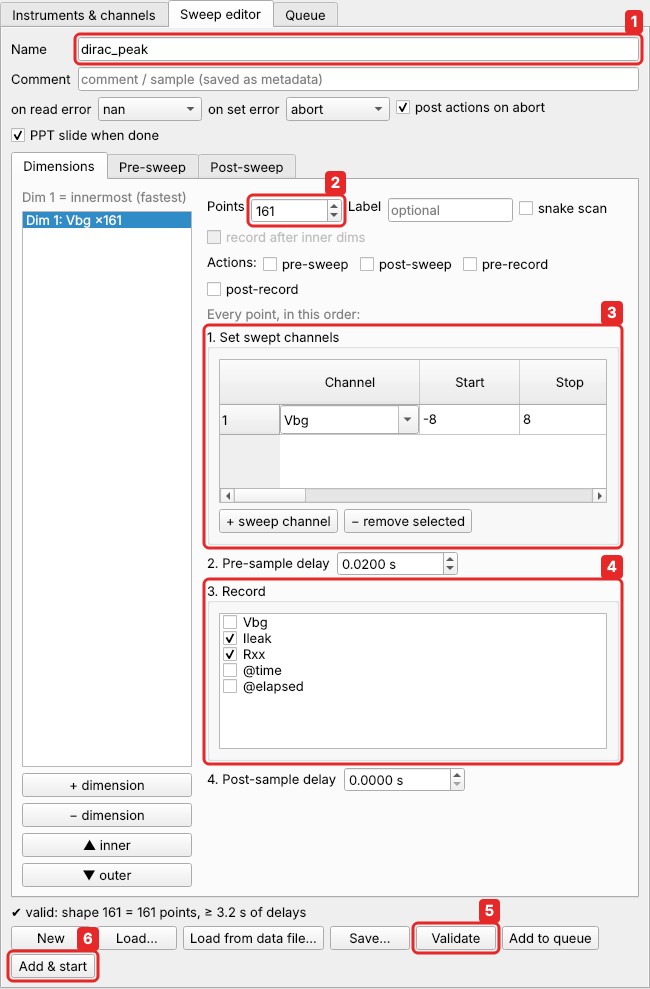

# Sweeps

A **sweep** steps some channels through values in any number of nested
**dimensions** and records other channels at every point. The **Sweep editor** tab
builds it. [The Quick start](../quickstart.md#6-describe-the-measurement-a-sweep) makes a first one,
and [tutorial 1](../tutorials/landau-fan.md) a two-dimensional one.

## The sweep editor



From top to bottom:

* **Name** (1) of the sweep and its data file, a **Comment** (stored as metadata),
  and what to do on errors (see [Errors](#errors)).
* **Dimensions**: the list of dimensions on the left, the selected one on the right.
  For each: the number of **Points** (2), the channels it sets (*Set swept
  channels*, 3), the delays, the channels it records (*Record*, 4), and the optional
  [point actions](point-actions.md). They are laid out in the order they happen at
  every point.
* **Pre-sweep** and **Post-sweep** tabs: settings applied before the first point and
  after the last (see [Pre and post phases](#pre-and-post-phases)).
* The buttons at the bottom: **Validate** (5) checks the sweep and shows its number of
  points and shortest duration. **Add to queue** and **Add & start** (6) queue it.
  **Save…** / **Load…** write and read it as a `.json` file, and **Load from data
  file…** loads the sweep of an earlier measurement, for a rerun or a variation.

A sweep is stored as a plain dictionary, the same as a JSON file. The examples
below show that form, since it is compact: each key is a box of the editor. The full
list of keys is in the [sweep definition reference](../reference/sweep-format.md).

??? example "From Python"

    ```python
    sweep = {"name": "iv",
             "dimensions": [{"points": 101,
                             "sweep": [{"channel": "Vb", "start": -0.3, "stop": 0.3}],
                             "record": ["I"]}]}
    c.call("validate_sweep", definition=sweep)      # {'ok': True, 'shape': [101], …}
    c.call("queue_add", item={"kind": "sweep", "definition": sweep}, start=True)
    ```

    In a [queue script](../scripting/scripts.md), `run_sweep(sweep)` runs it and
    returns the data.

## Dimensions

**Dimension 1 is the innermost (fastest) loop.** **+ dimension** adds another one
around it, and **▲ inner** / **▼ outer** reorder them. (In the file, the dimensions
are a list, so dimension 1 is the first entry, index 0.)

A 2-D map of current against gate and bias voltage, where the gate is stepped for
every bias value:

```json
{"name": "coulomb_diamonds",
 "dimensions": [
   {"points": 101, "sweep": [{"channel": "Vg", "start": -0.6, "stop": 0.6}],
    "record": ["I", "X"]},
   {"points": 41,  "sweep": [{"channel": "Vb", "start": -0.3, "stop": 0.3}],
    "record": ["T", "@elapsed"]}]}
```

It behaves like:

```python
for Vb in linspace(-0.3, 0.3, 41):          # dimension 2 (outer)
    set Vb; record T, @elapsed
    for Vg in linspace(-0.6, 0.6, 101):     # dimension 1 (inner)
        set Vg; record I, X
```

A channel recorded in a dimension is stored with one axis for that dimension and one
for each outer dimension: `I` and `X` are 101 × 41 maps, and `T` is a 41-point line. There is no limit on the number of
dimensions. A 3-D map just adds a third entry.

## Setpoints

Each row of *Set swept channels* gets its values in one of three ways. The table's
**Mapping** and **Values** columns are to the right of Start and Stop; scroll or widen
the window. [Custom sweeps](../scripting/custom-sweeps.md) has worked examples.

**Linear:** `start` / `stop`:

```json
{"channel": "Vg", "start": -0.5, "stop": 0.5}
```

**Explicit values:**

```json
{"channel": "B", "values": [0, 0.5, 1, 2, 4]}
```

The dimension's `points` must match the number of values.

**Mapping:** an [expression](../reference/expressions.md) of `i` (index), `N`
(points), `t = i/(N-1)`, `start`, `stop` and `x` (the linear value from `start` to
`stop`):

```json
{"channel": "Vg", "start": 0, "stop": 1, "mapping": "start + (stop - start)*t**2"}
{"channel": "B",  "start": -3, "stop": 3, "mapping": "sign(x)*x**2/3"}
{"channel": "f",  "start": 1e3, "stop": 1e6, "mapping": "start*(stop/start)**t"}
```

The first example is quadratic spacing, denser near the start. The second is denser
near zero field. The third is logarithmic.

### Several channels in one dimension

Every channel listed in a dimension's `sweep` steps together, which is useful for a
diagonal cut or a compensated gate:

```json
{"points": 201,
 "sweep": [{"channel": "Vx", "start": -0.5, "stop": 0.5},
           {"channel": "Vy", "start": 0.5,  "stop": -0.5},
           {"channel": "Vg", "start": 0, "stop": 0.2, "mapping": "0.1 + 0.4*(x - 0.1)"}],
 "record": ["I"]}
```

Variables of one [composite channel](composites.md) swept in the same dimension
are set together at every point.

### Vector channels

A channel whose value is an array, such as an AWG waveform, needs a mapping that
returns the array for each point:

```json
{"channel": "wave", "start": 0, "stop": 1,
 "mapping": "x*np.sin(np.linspace(0, 2*np.pi, 64))"}
```

## Recording

Any readable channel can be recorded: aliases, raw `instrument.channel` references,
composite channels, configuration channels and the built-ins `@time` and `@elapsed`.
Array channels are stored with their own shape appended:

```json
{"name": "spectrum_vs_field",
 "dimensions": [{"points": 61, "sweep": [{"channel": "B", "start": -1.5, "stop": 1.5}],
                 "record": ["spectrum", "peak", "image"]}]}
```

`spectrum` (a trace per reading) becomes a 61 × length array, `image` (a 2-D
camera frame) a 61 × h × w array. The live view shows them with sliders for the
extra axes.

## Delays

```json
{"points": 101, "sweep": [{"channel": "Vg", "start": -0.5, "stop": 0.5}],
 "record": ["X"], "pre_delay": 0.3, "post_delay": 0}
```

`pre_delay` runs after setting and before recording. For a lock-in, use about 3 to 5
time constants. `post_delay` runs after recording. The shortest duration of a sweep,
from its delays, is in `validate_sweep(...)["min_duration"]`.

## Snake scans

```json
{"points": 101, "sweep": [{"channel": "Vg", "start": -0.5, "stop": 0.5}],
 "record": ["I"], "snake": true}
```

With `snake` the dimension alternates its direction on each pass of the outer loop:
up, down, up, and so on. This avoids a long ramp back to the start, and hysteresis
shows up as a difference between the even and odd lines.

## The order at each point

Every point of a dimension runs:

1. `pre_sweep` action
2. set the swept channels (ramped at their alias rates)
3. `post_sweep` action
4. `pre_delay`
5. `pre_record` action
6. record
7. `post_record` action
8. `post_delay`
9. the inner dimensions

With `"record_after_inner": true` (outer dimensions only) the inner dimensions run
before step 5. You then record, for example, the temperature *after* each line rather
than before it. The editor lays every dimension out in this order. The actions are
optional code snippets; see [Point actions](point-actions.md).

## Pre and post phases

```json
"pre":  {"hook": "log('starting at T = %.3f K' % get('T'))",
         "constants": [{"channel": "src.output", "value": "ON"},
                       {"channel": "lockin.sensitivity", "value": "1e-2"}],
         "record": ["T", "B"]},
"post": {"record": ["T"],
         "constants": [{"channel": "Vg", "value": 0}, {"channel": "Vb", "value": 0}],
         "hook": ""}
```

* **Pre phase:** hook, then constants, then record. This happens before the first point.
* **Post phase:** record, then constants, then hook. This **always** runs: after the
  last point, after an error and, by default (`run_post_on_abort`), after an abort.
  Use it to bring the sample back to a safe state.

Constants are a natural place for configuration channels (ranges, modes, output
on/off). A sweep whose pre-sweep constants switch a mode, such as
`smu.mode = Current` before a current sweep, is validated again after the constants
were applied. A sweep that still does not fit stops before its first point.

Hook code is Python using the [script API](../reference/script-api.md). Over remote
access, a sweep with hook code needs the admin role.

## Errors

```json
"on_read_error": "nan",     // a failed reading: store NaN and go on (or "abort")
"on_set_error": "abort",    // a failed setting: stop the sweep (or "skip" the point)
"run_post_on_abort": true
```

The guarded instrument layer already retries transient errors and reconnects
instruments, so these policies only see what survived that.

## Validation

Before a sweep starts, **every setpoint is computed and limit-checked**: alias limits,
composite variables, and mapping ranges. A sweep that would exceed a limit anywhere
never starts:

??? example "From Python"

    ```python
    bad = {"name": "x", "dimensions": [{"points": 11,
           "sweep": [{"channel": "Vg", "start": 0, "stop": 5}], "record": []}]}
    c.call("validate_sweep", definition=bad)
    # SweepDefinitionError: Vg: value 2.5 above maximum 2   (the first setpoint beyond the limit)
    ```

`validate_sweep` returns the shape, total points, minimum duration, warnings and the
normalised definition. The editor's *Validate* button calls it.

## Metadata

```json
"metadata": {"sample": "D17", "cooldown": 3, "comment": "after thermal cycle"}
```

The metadata goes into the data file header and the PowerPoint slide. `"ppt": false`
skips the slide for this sweep.

## Complete example: I–V curve with a source-measure unit in current mode

```json
{"name": "iv",
 "dimensions": [{"points": 101,
   "sweep": [{"channel": "Isrc", "start": 0, "stop": 1e-6}], "record": ["Vmeas"]}],
 "pre":  {"constants": [{"channel": "smu.mode", "value": "Current"},
                        {"channel": "smu.Vcompliance", "value": 2},
                        {"channel": "smu.output", "value": "ON"}]},
 "post": {"constants": [{"channel": "Isrc", "value": 0},
                        {"channel": "smu.output", "value": "OFF"}]}}
```

Here `Isrc` is an alias of `smu.current`, and `Vmeas` is an alias of `smu.voltage`.
This is `examples/sweep_iv_current.json`; the other `examples/sweep_*.json` files
show vector channels (`sweep_awg_vector.json`), a 3-D camera scan
(`sweep_camera_3d.json`) and spectra against field (`sweep_spectrum_vs_field.json`).

## Loading a sweep from a data file

Every data file holds the full definition of its sweep. In the editor, *Load from
data file…* opens it for a rerun or a variation. From Python, use
`c.call("read_run_header", path=...)["definition"]`.
