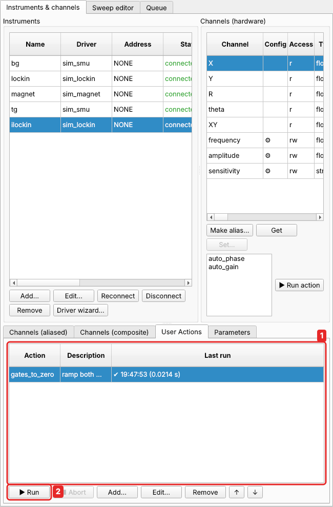
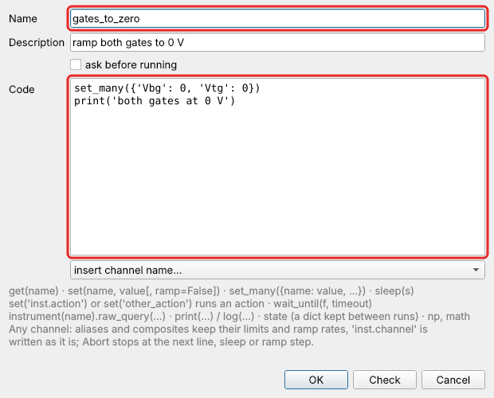

# User actions

**User actions** are your own named snippets of Python, run with one click, such as
`gates_to_zero`, `magnet_down` or `outputs_off`. They can control any channel. They
are part of the setup, so they are saved, loaded and autosaved with it.

A user action is itself a **channel**: a write-only one with a plain name (letters,
digits and `_`, like an alias). Writing it runs it, from anywhere: its button,
`set('gates_to_zero')` in a script or another action, a pre- or post-sweep constant
without a value, or `write_channel` from Python. Its name is unique among all names
of the setup (aliases, composites, parameters, instruments).

```python
set_many({'VL': 0, 'VR': 0})      # limits and ramp rates apply as always
set('B', 0)
print('gates and field at 0')
```

Each action is also a button at the top of the [Manual panel](monitor-manual.md#user-actions-and-parameters):
▶ runs it, and while it runs, the same button aborts it.

The code can use the setup's [parameters](parameters.md): by name
(`set('Vbg', V0)`, the value when the action starts) or as `params.V0` (the present
value). `set('Cb', 0.6)` (or `params.Cb = 0.6`) changes a value parameter.

## The Actions panel

*Instruments & channels → User Actions* (a tab; desktop and web) lists your actions with their
description and last run: finished ✔ / aborted ■ / error ✘, time and duration.
Hover a failed run to see its error.



| button | does |
|---|---|
| **▶ Run** (or Enter, or double click on the web) | run the selected action now |
| **■ Abort** | stop the running action(s) at the next line, sleep or ramp step |
| **Add… / Edit…** | the editor: name, description, *ask before running*, code; *insert channel name…* puts a channel name at the cursor; **Check** checks the name and the code (OK checks too) |
| **Remove**, **↑ ↓** | delete, reorder |

**Add…** opens the editor:



Tick **ask before running** for actions that should be confirmed first, such as
"outputs off" during a cooldown. [Tutorial 3](../tutorials/stop-at-threshold.md#4-one-click-actions-of-your-own)
makes the `gates_to_zero` button step by step.

## From Python

??? example "From Python"

    ```python
    c.call("define_user_action", name="gates_to_zero",
           code="set_many({'Vx': 0, 'Vy': 0})\nset('Vg', 0)",
           description="all gates to 0 V", confirm=True)

    c.call("write_channel", name="gates_to_zero")          # runs it
    # {'name': 'gates_to_zero', 'status': 'finished', 'error': None, 'elapsed': 0.41, …}

    c.call("list_user_actions")
    c.call("define_user_action", name="zero_gates", code="…", rename_from="gates_to_zero")
    c.call("move_user_action", name="zero_gates", position=0)
    c.call("remove_user_action", name="zero_gates")
    ```

`write_channel` waits for the end and returns how it ended (`finished` or
`aborted`). A failure raises, like any write that fails; the last result of every
action, failures included, is in `list_user_actions`.

## How they run

* **Immediately**, not through the queue, like a write from the Manual panel. A
  paused sweep does not hold an action back.
* With the same namespace as [scripts](../scripting/scripts.md#what-a-script-can-use): `get`, `set`,
  `set_many`, `sleep`, `wait_until`, `instrument`, `print`, `log`, `np`, `math` and
  `state` (the same dict as scripts).
* Alias and composite limits and ramp rates apply to every `set`; channels of
  instruments are written as they are.
* Each run has its own abort control. **Abort**, or *abort all*, stops it at the next
  line, sleep or ramp step. Run from a script or a sweep, aborting those stops it too.
* One run of the same action at a time: running it again while it runs is refused.

Sweeps cannot be started from an action; queue them instead.

## Actions calling actions

```python
set('gates_to_zero')
set('B', 0)
```

An action runs another by writing it, `set('name')`. An error or abort in the inner
one stops the outer one too. An action that ends up calling itself is refused,
with the chain in the message (`action loop1 calls itself (loop1 → loop2 → loop1)`).

## Examples

**Outputs off** (with *ask before running*):

```python
for k in range(1, 9):
    set('cyg.output%d' % k, 'OFF')
set('smu.reset')
```

**Bring a cryostat to base temperature and report:**

```python
set('Tset', 0.01)
wait_until(lambda: get('T') < 0.05, timeout=7200, interval=10)
log('at base: %.1f mK' % (1000 * get('T')))
```

**Park the gates where the last good sweep left them:**

```python
set_many(state.get('parking', {'Vx': 0, 'Vy': 0}))
```

## Permissions

Defining an action is writing code that runs on the backend computer, so over
[remote access](remote.md#roles) it needs the admin role. Running and aborting
actions is an operator right.
