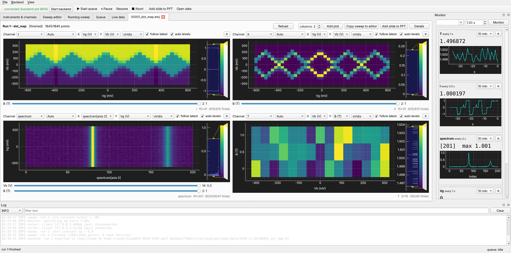

# easyMeasure

**A generic Python framework for controlling test instrumentation and running
automatic, arbitrary-dimensional measurements**, with a crash-proof backend and
a PySide6 GUI that can be closed, killed or restarted at any time without
disturbing a running measurement.



[Install it](installation.md){ .md-button .md-button--primary }
[Quick start](quickstart.md){ .md-button }
[Tutorial](tutorial/index.md){ .md-button }
[Supported instruments](instruments.md){ .md-button }

## What it does

You describe your instruments once (a *setup*): which driver, which port, which
channels you care about and how far and how fast each may be driven. You then
describe a measurement as a *sweep*: which channels step through which values, in
how many nested dimensions, and what is recorded at each point. easyMeasure checks every
setpoint against the limits before the first one is set. It then runs the sweep, streams the
data into a crash-safe file, plots it live in as many windows as you like, and
appends a summary slide to your PowerPoint file when it ends.

```json
{"name": "coulomb_diamonds",
 "dimensions": [
   {"points": 101, "sweep": [{"channel": "Vg", "start": -0.6, "stop": 0.6}], "record": ["I", "X"]},
   {"points": 41,  "sweep": [{"channel": "Vb", "start": -0.3, "stop": 0.3}], "record": ["T"]}]}
```

## Highlights

* **Backend / frontend split.** The backend is its own process. The GUI talks to
  it only over non-blocking sockets. Killing a frozen GUI never touches the
  backend, and a reopened GUI picks up the running sweep where it is.
* **Hardened against buggy hardware.**
    * Every driver call runs on a guarded worker thread with a hard deadline.
    * Hung drivers are abandoned and the instrument reconnected.
    * *Any* exception is contained, even `SystemExit`.
    * Replies are validated against the channel type and shape.
    * Transient errors are retried.
    * A channel that keeps hanging is quarantined by a circuit breaker, so it
      cannot block the rest of its instrument.
* **Crash-safe data.** Sweeps stream into an append-only, CRC-checked journal
  that is `fsync`-ed continuously. After a crash or power cut, everything up to
  the last fraction of a second loads as a partial dataset; missing points are NaN.
* **Arbitrary N-D sweeps.** Each dimension can have any number of swept and recorded
  channels. Also supported:
    * mapping functions for non-uniform or vector / tensor setpoints;
    * per-dimension delays and snake scans;
    * pre / post constants, recordings and hooks;
    * per-point actions with `continue` / `break` / `exit` flow control.
* **Protection.** Limits and ramp rates live on aliases. Every setpoint of a
  sweep is limit-checked *before* it starts, and composite channels respect the
  ramp rate of every target.
* **Composite channels.** These are software channels built on the hardware ones:
    * multivariate writes, where several variables drive several gates;
    * computed reads;
    * one-to-one mappings, checked to be invertible.
* **Live N-D plotting.** Plots can be curves, stacked curves or heat maps with
  draggable levels and colormaps, with sliders for the extra dimensions. There is also
  a monitor panel, and automatic PowerPoint slides at the end of every run.
* **Ready-made hardware drivers**, each tested against an emulator built from the
  instrument's programming manual:
    * SMUs: Keithley 2400, Keysight B2901 / B2902;
    * SR830 / SR850 lock-in amplifiers;
    * HP 34401A multimeter;
    * Yokogawa 7651 source;
    * HP 4145 / 4155 parameter analyzers;
    * NI USB-6211 and USB-63xx DAQs;
    * Cygnus 16430 supply.

  A **Driver Wizard** builds drivers for other command-based instruments from a form. See
  [Supported instruments](instruments.md).
* **Remote access over the internet.** A TLS gateway, running in its own process,
  serves a browser version of the GUI and a Python `RemoteClient`. It has accounts,
  roles, brute-force lock-out, rate limits and an audit log.

## How it fits together

```
 ┌──────────────── GUI process (PySide6) ───────────────┐      ┌─ scripts / notebooks ─┐
 │ Setup │ Sweep editor │ Running │ Queue │ Live/File data│      │  easymeasure.client   │
 │ Monitor dock │ Log dock │  N-D plotting (pyqtgraph)   │      └──────────┬────────────┘
 └────────────── BackendConnection (QTcpSocket, async) ──┘                 │
                              │  framed JSON + raw numpy buffers (no pickle)│
 ┌────────────────────────── backend process ─────────────────────────────┴───────┐
 │ server.py   per-client reader/writer threads, bounded queues, droppable events │
 │ service.py  command API, event bus                                             │
 │ runqueue.py state machine idle/running/paused/aborting; sweeps + scripts        │
 │ sweep.py    definition, validation, N-D execution    scripting.py  script API   │
 │ storage.py  crash-safe journal (.emj), HDF5 export   monitor.py    polling      │
 │ channels.py aliases (limits, ramps, scale), composite channels                  │
 │ instrument.py  guarded handles: deadlines, retries, reconnect, circuit breaker  │
 │ resources.py   one object per port, exclusive/shared, fair priority arbitration │
 │ drivers/       one file per instrument (+ simulated instruments)                │
 └─────────────────────────────────────────────────────────────────────────────────┘
        ▲ localhost only
        │
 ┌──────┴── remote gateway (own process) ──┐◀── TLS 1.2+ (HTTPS / WSS) ── browsers, RemoteClient
 └──────────────────────────────────────────┘
```

Everything the GUI does goes through [backend commands](reference/commands.md),
so a script or notebook can do exactly the same.

## Where to go next

| I want to … | read |
|---|---|
| install it | [Installation](installation.md) |
| try it in five minutes without hardware | [Quick start](quickstart.md) |
| learn it properly | [Tutorial](tutorial/index.md) |
| know whether my instrument is supported | [Supported instruments](instruments.md) |
| look up a command, a sweep field or a function | [Reference](reference/index.md) |
| control a measurement from Python | [Python clients](tutorial/clients.md) |
| support a new instrument | [Driver Wizard](tutorial/driver-wizard.md), [Writing a driver](tutorial/writing-drivers.md) |
