# Quick start: your first measurement

This page takes you from an empty program to a finished measurement, clicking through the
GUI. It takes about fifteen minutes. You need no hardware: easyMeasure comes with
simulated instruments that behave like real ones, connected to a simulated graphene
device.

**The story.** You have a graphene Hall bar with a back gate. You want the classic first
measurement: the four-probe resistance $R_{xx}$ as a function of the back-gate voltage.
It shows a peak, the *Dirac peak*, where the carrier density crosses zero. In the lab
you would wire it up like this:

| role | real instrument | simulated stand-in (this page) |
|---|---|---|
| back-gate voltage, and measure the gate leakage current | a source-measure unit, e.g. Keithley 2400 (`keithley2400`, GPIB) | `sim_smu` |
| four-probe voltage; its 10 mV sine output drives about 10 nA through a 1 MΩ series resistor and the sample | a lock-in amplifier, e.g. SR830 (`sr830`, GPIB) | `sim_lockin` with `sample = graphene` |

The steps are the same with the real instruments. Only the driver and the address
differ.

## 1. Start easyMeasure

After [installing](installation.md), start the GUI. It starts the *backend* too:

```bash
python -m easymeasure.frontend --start-backend
```

On Windows you can also double-click `run_gui.bat`.

easyMeasure runs as two programs:

* the **backend**, which talks to the instruments and runs the measurements;
* the **GUI** (the window), which is only a view of the backend.

You can close the window at any time; a running measurement goes on. A small
**tray icon** shows what the backend is doing.

The first time, the GUI asks where to save your data and which PowerPoint file to
append a summary slide to after every measurement. Leave the PowerPoint file empty if
you don't want slides. Both can be changed later in *File → Settings*.

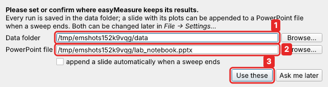

1. **Data folder**: every measurement is saved here, in one sub-folder per day.
2. **PowerPoint file**: optional; a slide with plots is added after each measurement.
3. **Use these**.

## 2. The window

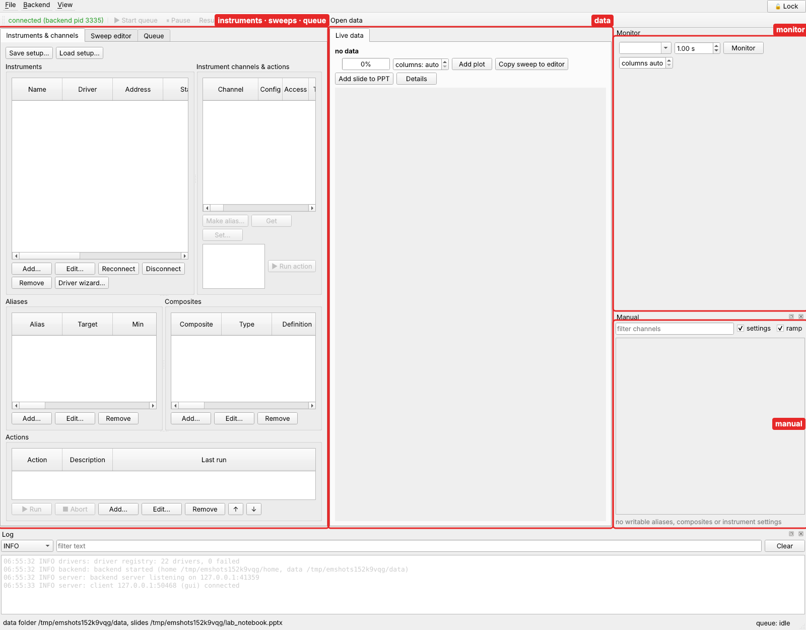

* **Left**: three tabs.
    * *Instruments & channels*: which instruments you have, and what you call their
      channels.
    * *Sweep editor*: where you describe a measurement.
    * *Queue*: what is running, and what ran before.
* **Middle**: the data, with *Live data* for the running measurement and one tab for
  each file you open.
* **Right**: the **Monitor**, which shows values that are read continuously, and the
  **Manual** panel, which sets values by hand.
* **Bottom**: the log.

## 3. Add the instruments

On the *Instruments & channels* tab, click **Add…** under *Instruments*:

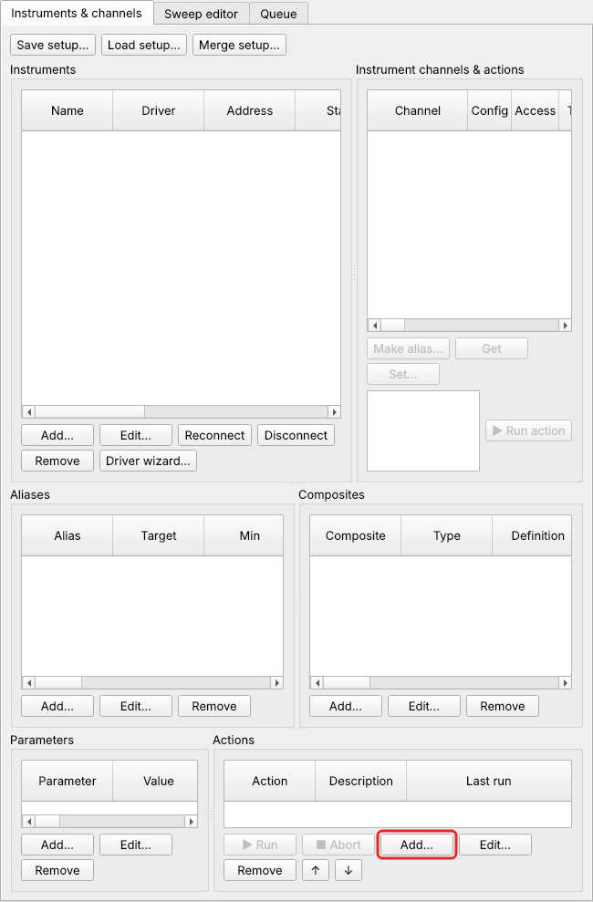

**The gate source.** Fill in the dialog:

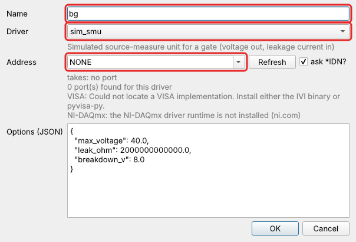

* **Name**: a short name you choose. `bg` for *back gate*.
* **Driver**: the kind of instrument. `sim_smu` is a simulated source-measure unit.
  For a real Keithley 2400 you would pick `keithley2400`. See the full list of
  [supported instruments](instruments.md).
* **Address**: where the instrument is connected. Simulated instruments need no
  port: `NONE`. For real instruments the list offers every port and device found on
  the computer, for example `GPIB0::24::INSTR`, with the ones that answer as this kind
  of instrument marked ✓.

Click **OK**. The instrument appears in the list as *connected*.

**The lock-in.** Click **Add…** again. Name `lockin`, driver `sim_lockin`, address
`NONE`. In **Options**, change `"sample": "dot"` to `"sample": "graphene"`, so the
simulated lock-in measures the graphene device:

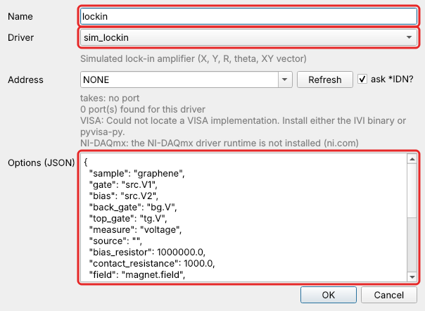

Options are settings of the instrument that you set once. Every driver has its own
options, listed in the [driver's reference page](reference/drivers/sim_lockin.md).
Real instruments mostly need none.

## 4. Name the channels you care about

Select an instrument on the left. Its **channels** appear in the middle list. `bg`
has `voltage` (what it sources), `current` (what it measures), and two settings
marked ⚙: `output` and `compliance`.

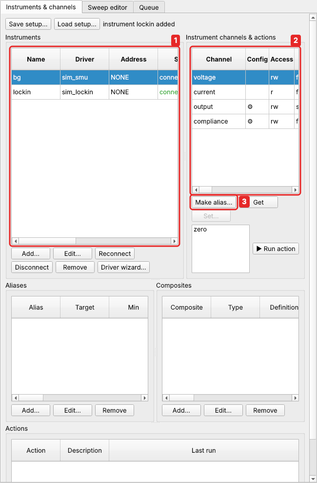

You won't use `bg.voltage` directly. Instead you give it a name, an **alias**, which
also carries its **protection**: how far and how fast it may ever be driven. A gate
dielectric breaks if the voltage is too high, and a fast jump can damage the sample.
easyMeasure checks these limits for every value it sets, including every point of a
measurement **before** the measurement starts.

1. Select `bg`.
2. Select `voltage`.
3. Click **Make alias…**.

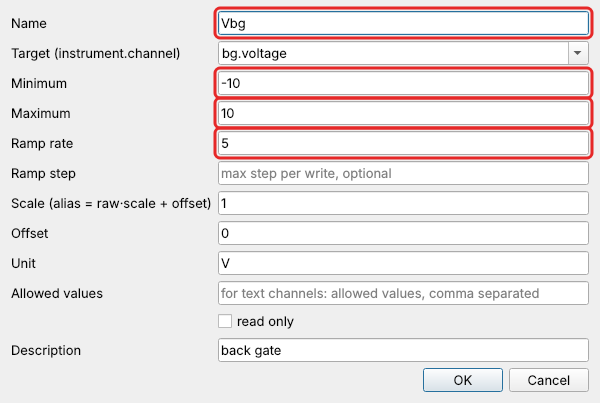

* **Name** `Vbg`.
* **Minimum** −10 and **Maximum** 10 (V): nothing will ever set the gate beyond ±10 V.
* **Ramp rate** 5 (V/s): every change of the gate is a smooth ramp at most this fast,
  never a jump.
* **Unit** V, and a **Description** if you like.

Do the same for `bg.current`, naming it `Ileak` with unit `A`. It is the gate
leakage current, worth watching.

**The resistance.** The lock-in measures a voltage, $V_{xx}$. With 10 nA flowing,
$R_{xx} = V_{xx} / 10\,\text{nA} = V_{xx} \times 10^8$. An alias can do this
conversion for you. Select `lockin`, then its channel `X`, then **Make alias…**:

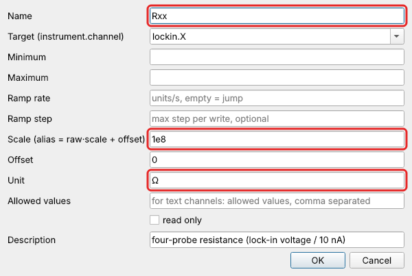

* **Name** `Rxx`.
* **Scale** `1e8`, since the alias value is the raw value × scale.
* **Unit** `Ω`.

This assumes the current stays at 10 nA, which holds while the sample resistance is
small compared with the 1 MΩ series resistor. [Tutorial 2](tutorials/rotated-gates.md#2-measure-the-current-too-rxx-vxx-i)
measures the current with a second lock-in and computes $R_{xx} = V_{xx}/I$ exactly.

Now you have three aliases:

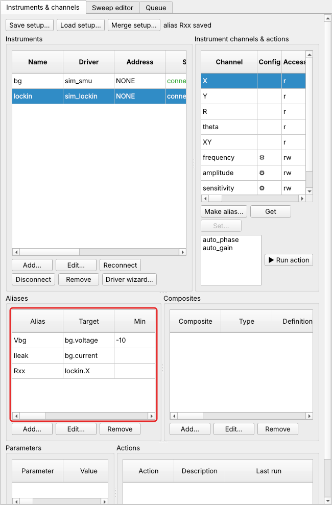

## 5. Try it by hand

Before measuring, check that everything responds. The **Manual** panel (right) lists
every channel you can set. Type `2` into `Vbg` (1) and press Enter: the gate ramps to
2 V at 5 V/s. To watch the resistance, choose `Rxx` at the top of the **Monitor**
and click **Monitor** (2):

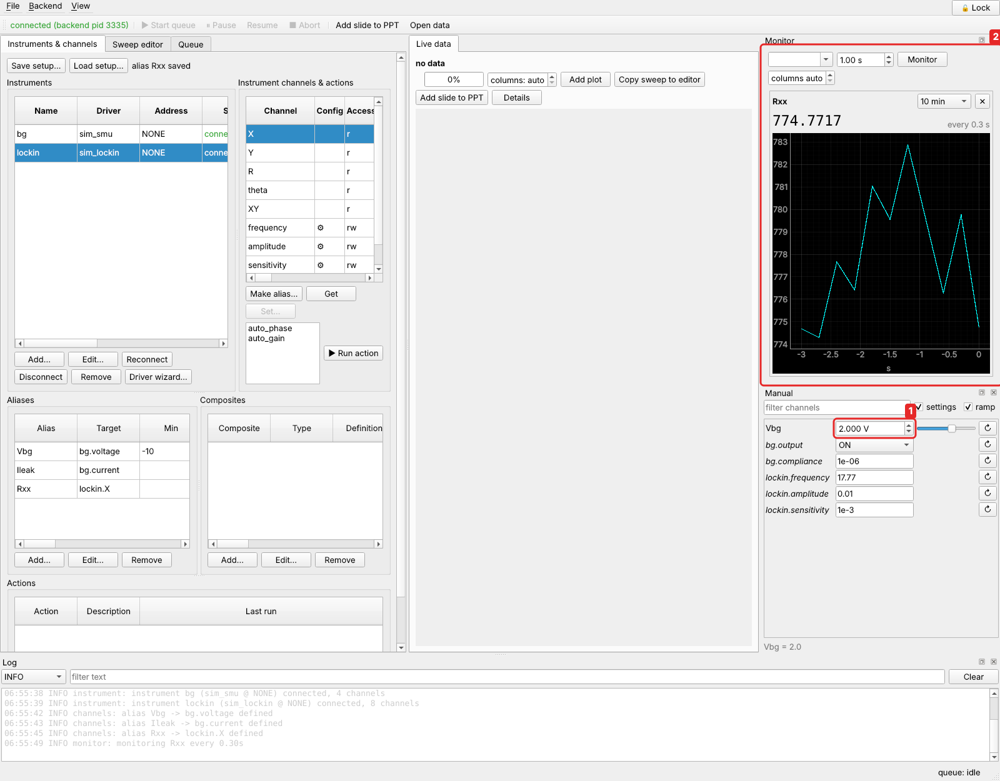

Set `Vbg` back to 0 when you are done.

## 6. Describe the measurement: a sweep

A measurement in easyMeasure is a **sweep**: some channels are stepped through
values, and at every step others are recorded. Open the **Sweep editor** tab:

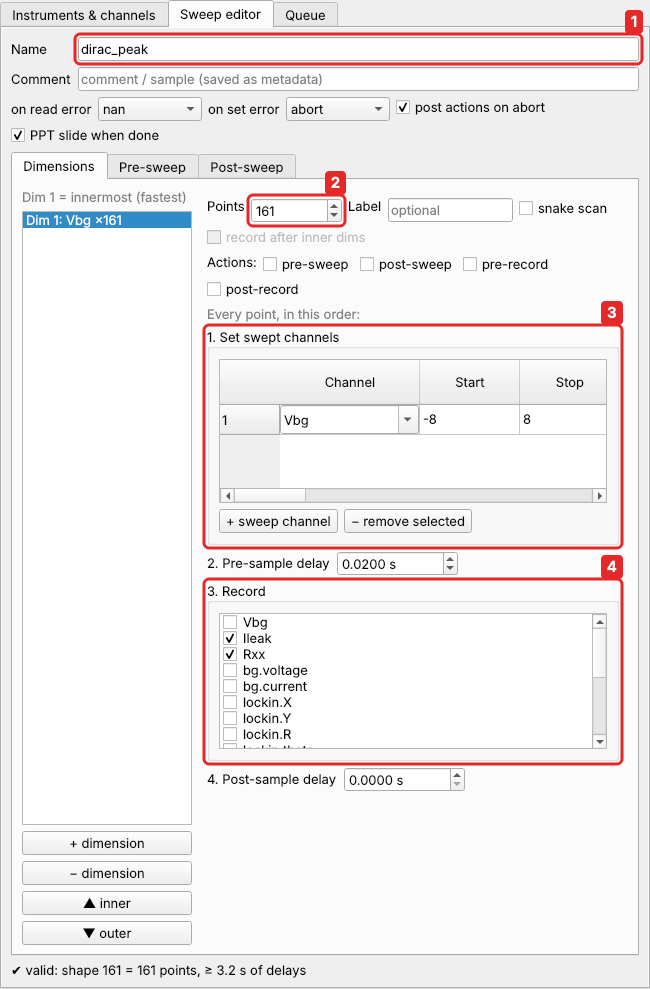

1. **Name**: `dirac_peak`. It goes into the file name.
2. **Points**: `161`.
3. **Set swept channels**: click **+ sweep channel**, choose `Vbg`, Start `-8`,
   Stop `8`. That gives 161 points, 0.1 V apart.
4. **Record**: tick `Rxx` and `Ileak`. Before recording, the **pre-sample delay** of
   0.02 s gives the lock-in time to settle after each step. With a real lock-in, use 3
   to 5 time constants.
5. **Validate**: easyMeasure computes every point and checks it against the limits.
   The status line says `✔ valid: shape 161 = 161 points`.
6. **Add & start**.

Also worth a look: the **Post-sweep** tab. Add a constant there, `Vbg` = 0, and the
gate goes back to 0 V when the measurement ends, even if it ends with an error or you
abort it. *Save…* stores the sweep as a file for next time. This one is
`examples/graphene_dirac.json` (*Load…*).

## 7. Watch it run

The **Live data** tab shows the measurement as it comes in. There is one plot for each
recorded channel, a progress bar, and the estimated time left:

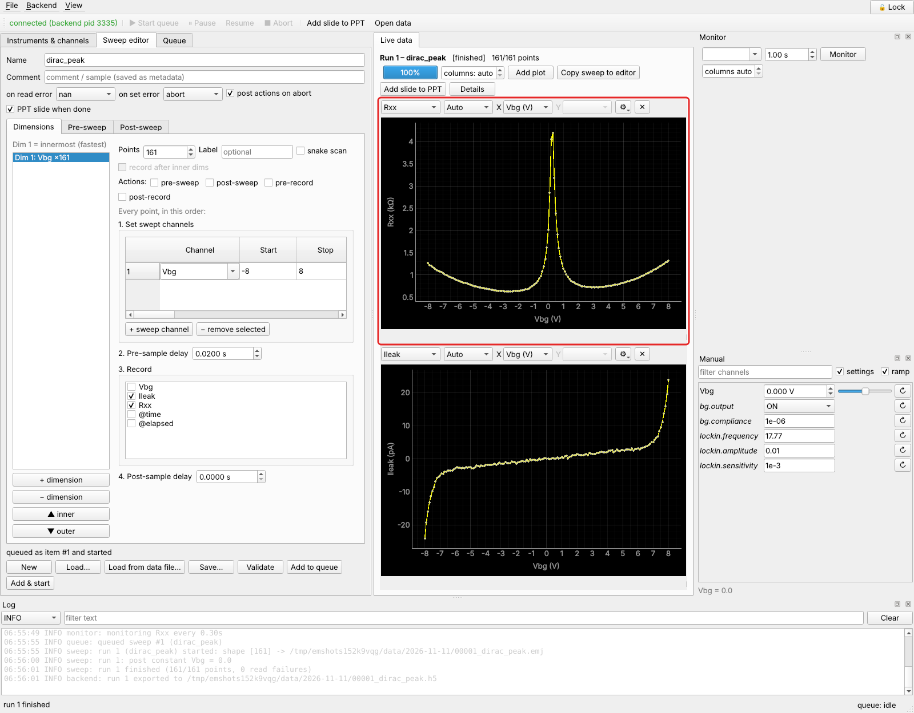

There's the Dirac peak, at $V_{bg} \approx 0.3$ V where the carrier density is zero,
and the leakage current stays in the picoampere range. Things to try:

* the **X** box chooses the horizontal axis, and **⚙** the colours and options;
* move the mouse over a plot to read values;
* **Add plot** shows another channel, or the same one twice;
* the toolbar's **Pause** and **Abort** work at any point. Abort still runs the
  post-sweep phase, so the gate returns to 0.

Close the window during a measurement and start it again: the measurement never
stopped, and the live view picks it up where it is.

## 8. Your data

When the sweep ends, the **Queue** tab lists it in the history:

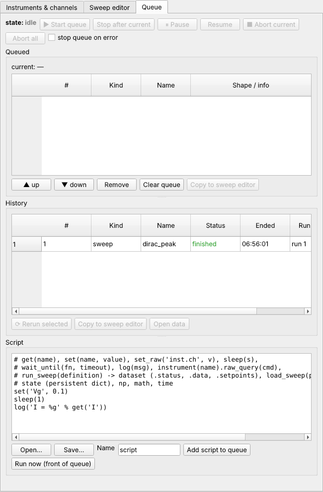

* The data is in your data folder, e.g. `data/2026-11-11/00001_dirac_peak.emj`. The
  file is written while the measurement runs, so it survives a crash or a power cut. An
  HDF5 copy (`.h5`) is written next to it at the end.
* **Open data** (or *File → Open data file…*) opens it in a new tab with the same
  plots.
* If you set a PowerPoint file, a slide with the plots and a summary was appended.
* Loading the data in Python, or in any program that reads HDF5: see [Data files](guide/data.md).

## 9. Save your setup

Instruments, aliases and everything else you defined form your **setup**. easyMeasure
saves it automatically after every change and restores it when it starts again. To
keep a copy, or to use it on another computer, use **Save setup…** on the *Instruments
& channels* tab. The setup of this whole tutorial series is `examples/graphene_setup.json`.

## Next

* **[Tutorial 1: a Landau fan](tutorials/landau-fan.md)**: a 2-D map of gate voltage and
  magnetic field, with a magnet that takes time to ramp.
* **[Tutorial 2: rotated gate sweeps](tutorials/rotated-gates.md)**: sweep carrier density
  and displacement field with two gates, using a composite channel.
* **[Tutorial 3: stop at a threshold](tutorials/stop-at-threshold.md)**: end a measurement
  automatically when the leakage current gets too high.
* **[Tutorial 4: a VNA power sweep](tutorials/vna-power.md)**: spectra as a function
  of power and field; 3-D data.
* **[Key ideas](concepts.md)**: the handful of terms everything else builds on.
