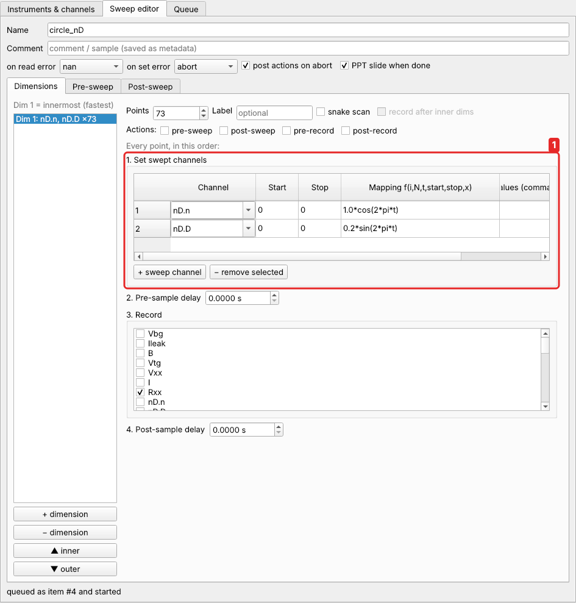
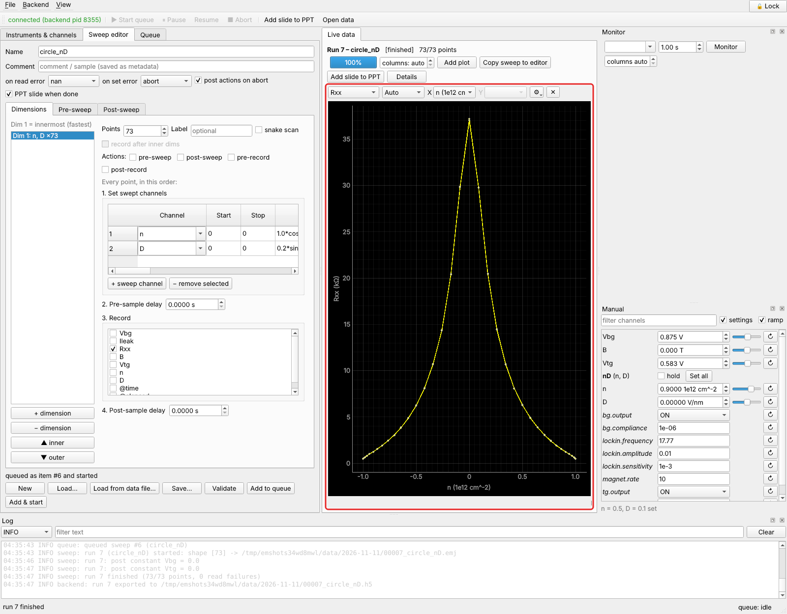

# Custom sweeps

A plain sweep steps each channel in equal steps from *start* to *stop*. Many
measurements need something else: more points where something interesting happens,
a path that is not a straight line, a loop up and back down, or no stepping at all.
This page shows how, first in the sweep editor where that is possible, then with a
[queue script](scripts.md) for what the editor can't do.

All examples use the graphene setup of the tutorials (`examples/graphene_setup.json`).
The `.json` files load in the sweep editor with *Sweep → Load…*; the `.py` files in the
script editor with **Open…**.

## Three ways to give the points

Each row of a dimension's *Set swept channels* table gets its values in one of three
ways. The table has more columns than fit: scroll it to the right, or widen the
window.

| columns used | the values | example |
|---|---|---|
| **Start**, **Stop** | equal steps from start to stop | −8 … 8 V in 161 points |
| **Mapping** (plus Start, Stop) | a formula, evaluated for every point | `start*(stop/start)**t`: logarithmic steps |
| **Values** | the list you type, comma-separated | `0, 0.5, 1, 2, 4, 9` |

A **mapping** is a formula of these names:

| name | is |
|---|---|
| `i` | the point number: 0, 1, …, N−1 |
| `N` | the number of points |
| `t` | `i/(N−1)`: runs from 0 to 1 |
| `start`, `stop` | the Start and Stop of the row |
| `x` | the plain linear value: `start + (stop − start)·t` |

It can use `sin`, `cos`, `exp`, `log`, `sqrt`, `sinh`, `sign`, `abs`, `pi` and the
other functions listed under [expressions](../reference/expressions.md). Every value it
gives is checked against the channel's limits before the sweep starts, like any other
sweep: *Sweep → Validate* shows an error if the formula goes too far.

## More points near the Dirac peak

The resistance changes fast near the Dirac point and slowly far from it. Equal steps
are either too coarse at the peak or wasteful elsewhere.

**In the editor**, with a mapping: Start −1, Stop 1, 161 points, and

```text
0.3 + 7.7*sinh(3*x)/sinh(3)
```

As `x` runs from −1 to 1, this goes from −7.4 V to 8.0 V, with steps of 0.03 V at
the peak (0.3 V) and 0.29 V at the ends: ten times denser where it matters, for the
same number of points.

```json
--8<-- "examples/graphene_dense_dirac.json"
```

Other useful mappings:

| mapping | gives |
|---|---|
| `start + (stop - start)*t**2` | dense near *start* |
| `sign(x)*x**2/stop` (Start = −Stop) | dense near zero, e.g. small fields |
| `start*(stop/start)**t` | logarithmic: frequencies, powers in W, times |

**With a script**, when a formula is awkward, build the list with numpy. Here: 0.2 V
steps everywhere, plus 0.02 V steps within 1 V of the peak.

```python
--8<-- "examples/scripts/dense_near_dirac.py"
```

`"values": values.tolist()` is the **Values** column of the editor, for any number of
points. `np.unique` sorts the merged list and removes duplicates.

## A path through the (n, D) plane

Every channel in the same dimension is set at every point, each from its own row.
With mappings, the rows can draw any curve. Here is a circle around the
charge-neutrality point, using the composite channels `n` and `D` of
[tutorial 2](../tutorials/rotated-gates.md):



1. **+ sweep channel** adds a second row to the same dimension. Row 1: `n`, mapping
   `1.0*cos(2*pi*t)`. Row 2: `D`, mapping `0.2*sin(2*pi*t)`. With 73 points, `t` goes
   once around the circle in 5° steps. Start and Stop are not used by these formulas.

`n` and `D` belong to the same composite, so they are set together at every point, and
both gate voltages follow. The result, against `n`:



The resistance is largest where the path crosses $n = 0$, at $D = \pm 0.2$ V/nm,
where the gap is open. The two crossings give the same curve because the gap only
depends on $|D|$.

```json
--8<-- "examples/graphene_circle.json"
```

**With a script**, the same circle at several radii, each in its own file. The values
are computed with numpy and given as lists:

```python
--8<-- "examples/scripts/circles_in_nD.py"
```

## Hysteresis loops

To sweep up and back down in one file, use a triangle wave. A gate sweep
0 → 5 → 0 → −5 → 0 V in 0.1 V steps (201 points), with Start 0, Stop 5 and the
mapping

```text
stop*(2/pi)*arcsin(sin(2*pi*t))
```

```json
--8<-- "examples/graphene_hysteresis.json"
```

Plot `Rxx` against `@elapsed` to see the loop in time order, or against `Vbg` to
compare the up and down branches.

In a script, the same with explicit pieces, each with its own step size if you like:

```python
--8<-- "examples/scripts/hysteresis_loop.py"
```

!!! tip "Hysteresis in a map"
    In a 2-D sweep, the **snake scan** option of the inner dimension makes every
    second line run backwards. The even and odd lines of the map are then the two
    sweep directions.

## Time traces

A dimension with **no swept channel** just records, again and again. With a
*post-sample delay* it is a time trace: watch a sample relax after a gate jump, or a
drift overnight.

In the editor: **+ dimension**, leave the *Set swept channels* table empty, choose
what to record (add `@elapsed`, the time since the start of the sweep), set the
number of points and the post-sample delay. 600 points every 0.5 s is 5 minutes:

```json
--8<-- "examples/graphene_time_trace.json"
```

**Measure while the magnet ramps.** Stepping the field and waiting at every step, as
in [tutorial 1](../tutorials/landau-fan.md), is slow. Many groups instead ramp the
magnet continuously and record as fast as possible, plotting against the field that
was measured at each reading. That is a time trace that starts the ramp first and
stops itself when the magnet has arrived:

```python
--8<-- "examples/scripts/field_ramp_trace.py"
```

* `set("B", 3)` only sets the magnet's target; the supply ramps by itself while the
  sweep runs.
* The point action `end_sweep()` stops the trace once the supply reports `HOLDING`
  (see [tutorial 3](../tutorials/stop-at-threshold.md)). 20000 points is just an upper
  limit; the file holds what was measured, the rest is `nan`.
* In the plot, choose `B` as the X axis to see the Shubnikov–de Haas oscillations of
  `Rxx`.

## Deciding during the measurement

When the next points depend on what was just measured, use a script that runs one
sweep, looks at the data and runs the next: see
[an adaptive measurement](scripts.md#your-first-script) and
[safety checks first](scripts.md#safety-checks-first).

Within a single sweep, the [point actions](../guide/point-actions.md) can skip a
point (`skip_point()`), the rest of a line (`skip_line()`) or end the sweep
(`end_sweep()`), based on the values just recorded.

## Instruments that take arrays

Some channels take a whole array per point, such as the waveform of an arbitrary
waveform generator. Their mapping returns the array:
`x*np.sin(np.linspace(0, 2*np.pi, 64))`. See
[vector channels](../guide/sweeps.md#vector-channels).
