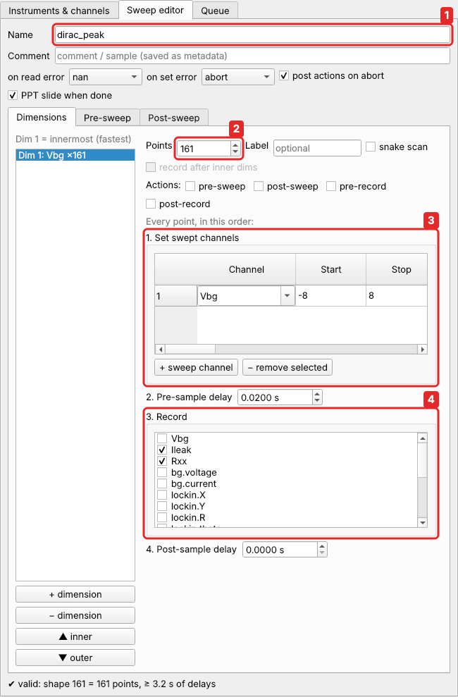

# Scripting and Python

!!! info "An advanced topic"
    You don't need anything on these pages for everyday measurements. The
    [Quick start](../quickstart.md) and the [tutorials](../tutorials/index.md) do
    everything from the GUI. Come here when you notice that you are clicking the same
    thing for the tenth time, or the measurement you want can't be described as a
    grid of points.

## When the GUI is not enough

Some typical cases:

| you want to … | use |
|---|---|
| run the same sweep at a list of temperatures, fields or gate voltages, one file each | a [queue script](scripts.md) with a loop |
| measure first, then decide where to measure next (find a peak, then zoom in) | a [queue script](scripts.md): `run_sweep()` returns the data |
| put points closer together near something interesting, or walk a path that is not a straight line | a [custom sweep](custom-sweeps.md) |
| measure while something drifts by itself (a magnet ramp, a warm-up) | a time trace: a [custom sweep](custom-sweeps.md#time-traces) with no swept channel |
| check a measurement while it runs, from a Jupyter notebook, or start it from your own program | a [Python client](clients.md) |
| use an instrument easyMeasure has no driver for | the [Driver Wizard](../guide/driver-wizard.md), or [write a driver](writing-drivers.md) |

## How much code?

easyMeasure has code at four levels. Each one is a small step up from the one before.

1. **Formulas.** The scale of an alias, the formulas of a
   [composite channel](../tutorials/rotated-gates.md) and the *mapping* of a sweep
   are single [expressions](../reference/expressions.md) such as
   `(n + 0.15 + D/0.0452) / 1.2`. You have used these in the tutorials.
2. **Point actions and user actions.** A line or two of Python run at every point of
   a sweep (`if abs(values['Ileak']) > 1e-9: end_sweep()`) or at the click of a
   button (`set_many({'Vbg': 0, 'Vtg': 0})`). See
   [tutorial 3](../tutorials/stop-at-threshold.md).
3. **Queue scripts.** A whole Python program that the backend runs from the queue, like
   a sweep. It can set and read channels, wait, and run sweeps one after another. This
   is the main subject of this chapter: [Queue scripts](scripts.md) and
   [Custom sweeps](custom-sweeps.md).
4. **Python outside easyMeasure.** A notebook or program that connects to the
   running backend: [Python clients](clients.md). And
   [drivers](writing-drivers.md), which are Python classes.

All of them use the same names: `get('Rxx')`, `set('Vbg', 1.0)`, and so on. What
you learn at one level works at the next.

## A sweep is a dictionary

Everything you set up in the sweep editor is stored as a plain dictionary. *Sweep →
Save…* writes it to a JSON file, and every data file contains it. The Dirac-peak
sweep from the Quick start looks like this (`examples/graphene_dirac.json`):

=== "In the editor"

    

=== "As a dictionary"

    ```json
    --8<-- "examples/graphene_dirac.json"
    ```

Each box of the editor is a key: `points` is box 2, `sweep` box 3, `record` box 4.
A script builds the same dictionary, or [loads](scripts.md#start-from-a-saved-sweep)
one saved from the editor and changes a few values. Every key is listed in the
[sweep definition reference](../reference/sweep-format.md).

!!! tip "Design in the GUI, repeat with a script"
    The easiest way to write a sweep for a script is not to write it at all. Set it
    up in the editor, check it with *Sweep → Validate*, save it (*Sweep → Save…*), and load it in the
    script with `load_sweep(...)`.

## In this chapter

* [Queue scripts](scripts.md): your first script, from the GUI's script editor; the
  functions a script can use; adaptive measurements and series of sweeps.
* [Custom sweeps](custom-sweeps.md): non-uniform points, paths through the
  (n, D) plane, hysteresis loops, time traces. With complete examples.
* [Python clients](clients.md): control a running easyMeasure from a notebook or
  another program.
* [Writing a driver](writing-drivers.md): support a new instrument in Python.

The [Script API reference](../reference/script-api.md) lists every function.
