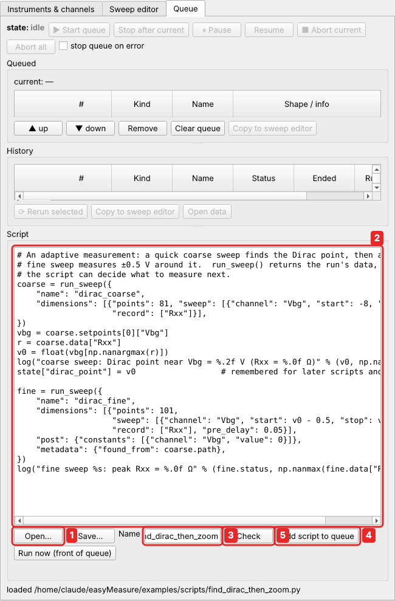
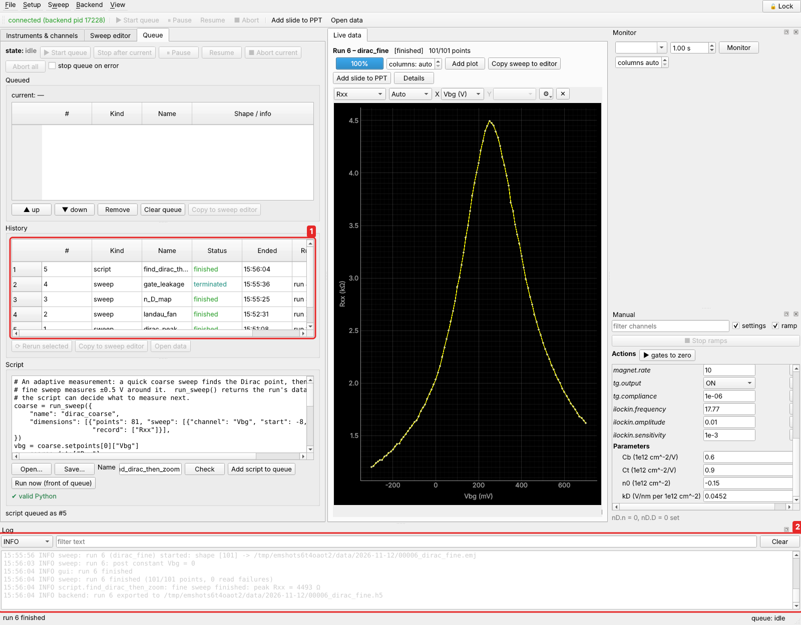

# Queue scripts

A **queue script** is a Python program that the backend runs from the run queue, just
like a sweep. It waits its turn, it can be paused and aborted, and it appears in the
queue history. Inside it you can set and read channels, wait for instruments and run
sweeps, as many as you like, each into its own data file.

This page uses the graphene setup from the tutorials
(*Setup → Load setup…* → `examples/graphene_setup.json`).

## Your first script

**The task.** You want to measure the Dirac peak carefully: 101 points in ±0.5 V around
it, slowly. But you don't know exactly where it is, and it moves a little after every
thermal cycle. By hand, you would run a quick coarse sweep, read off the peak, and
then type the range into the editor. A script can do both steps in one go.

Open the **Queue** tab. At the bottom is the **Script** editor.



1. **Open…** loads a `.py` file into the editor (and **Save…** saves it). Open
   `examples/scripts/find_dirac_then_zoom.py`, or type it in.
2. The script. It is shown in full below.
3. A name for the queue and the log. Opening a file uses the file name.
4. **Add script to queue**. Then **Start** the queue (at the top of the tab), as for a
   sweep. **Run now** puts it at the front of the queue and starts it at once.
5. **Check** looks at the script without running it: a syntax error is shown with its
   line, and a channel name in quotes that does not exist (`get('Vbgg')`) is a warning.
   *Add script to queue* and *Run now* check first, and refuse a script that does not
   compile.

The script:

```python
--8<-- "examples/scripts/find_dirac_then_zoom.py"
```

Line by line:

* `run_sweep({...})` runs a sweep and waits until it has finished. The dictionary is
  the same as a sweep made in the editor (see [A sweep is a dictionary](index.md#a-sweep-is-a-dictionary)):
  81 points of `Vbg` from −8 to 8 V, recording `Rxx`. Like every sweep, it is checked
  against the limits of `Vbg` before it starts, and it is saved in its own data file.
* `run_sweep` **returns the measured data**: `coarse.setpoints[0]["Vbg"]` holds the
  81 gate voltages, and `coarse.data["Rxx"]` the 81 resistances, as numpy arrays.
* `np.nanargmax(r)` finds the index of the largest resistance (`nan` points, if any,
  are skipped). `v0` is the gate voltage of the peak.
* `log(...)` writes a line to the log (the **Log** dock at the bottom of the window).
* `state["dirac_point"] = v0` keeps the result. `state` is a dictionary that stays
  in the backend until it is closed, so a later script or a [user
  action](../guide/user-actions.md) can use `state["dirac_point"]`.
* The second `run_sweep` measures 101 points around `v0`, more slowly
  (`pre_delay` 0.05 s), sets `Vbg` back to 0 afterwards, and stores the file name of
  the coarse sweep in its metadata.

After it has run:



1. The queue history shows the script. Its sweeps appear in **Live data** while they
   run, like any sweep: here the fine sweep around the peak.
2. The log, with the lines from `log(...)` and the files of both sweeps. **File →
   Browse recent runs…** (or **Open data file…**) opens them again.

!!! tip "Pause and abort work everywhere"
    **Pause** and **Abort** in the Queue tab act on a script as on a sweep: in a
    running `run_sweep()` at the next point, and otherwise at the next line of the
    script. Even an endless `while True:` loop can be aborted. Use `sleep(...)` to
    wait, never `time.sleep(...)`, so the wait can be aborted at once.

## What a script can use

Everything here is available without `import`:

| name | does |
|---|---|
| `get('Rxx')` | read a channel: an alias, a composite variable, or `instrument.channel` |
| `set('Vbg', 1.0)` | set a channel, with its limits and ramp rate. Waits until the ramp is done |
| `set_many({'nD.n': 0, 'nD.D': 0.2})` | set several at once; needed for the variables of one composite |
| `set_raw('bg.voltage', 0)` | set an instrument channel directly, **without** limits or ramps |
| `sleep(2)` | wait 2 s (abortable) |
| `wait_until(lambda: get('magnet.status') == 'HOLDING', timeout=600)` | check every 0.2 s until it is true, for at most `timeout` s. Returns `False` on timeout |
| `run_sweep(definition)` | run a sweep, wait for it, return its data (below) |
| `load_sweep(path)` | a sweep saved with *Sweep → Save…*, or the sweep of a data file, as a dictionary |
| `action('vna.preset')` | run an instrument action |
| `instrument('vna').raw_query('*IDN?')` | talk to an instrument directly |
| `log('text')`, `print(...)` | write to the log |
| `state` | a dictionary kept between scripts and user actions |
| `np`, `math`, `time` | numpy and the standard modules |

The [Script API reference](../reference/script-api.md) has the full list. Any other
module can be imported as usual (`import json`, `from scipy.optimize import curve_fit`).

### What `run_sweep` returns

`run_sweep()` returns a [`DataSet`](../reference/api/easymeasure/backend/storage.md),
the same object as `DataSet.load(path)` gives for a data file:

| attribute | is |
|---|---|
| `ds.status` | `"finished"`, `"terminated"` (stopped by `end_sweep()`), `"aborted"` or `"error"` |
| `ds.data["Rxx"]` | the recorded values, a numpy array with one axis per dimension. Points not measured are `nan` |
| `ds.setpoints[0]["Vbg"]` | the set values of dimension 1 (`setpoints[1]`: dimension 2, …) |
| `ds.value_axes["S11"]` | the axes of a spectrum channel, e.g. the frequencies of a VNA trace |
| `ds.path` | the data file |
| `ds.header["definition"]` | the sweep that was run (its `"metadata"` key holds the metadata) |

An aborted sweep does not raise an error: check `ds.status` if the script should stop
then too.

### Start from a saved sweep

Rather than writing the dictionary by hand, design the sweep in the editor, check it
with *Sweep → Validate*, and save it (*Sweep → Save…*). Then load it, change what should change, and run
it:

```python
--8<-- "examples/scripts/repeat_saved_sweep.py"
```

`dict(base, name=..., metadata=...)` is a copy of `base` with two keys replaced, so
each run gets its own name. Every run goes into its own file, with the top-gate voltage
in its metadata.

`load_sweep` also takes a data file, so *"measure again what I measured yesterday"*
is `run_sweep(load_sweep("D:/data/2026-11-10/00012_dirac_peak.emj"))`.

!!! note "Paths"
    A relative path such as `examples/graphene_dirac.json` is relative to the folder
    the backend was started in. A full path is always safe.

## A series of sweeps

A loop over conditions, with a wait for a slow instrument in between. This one runs a
gate sweep at each of a list of fields. The fields need not be evenly spaced, and
each gate sweep is its own file:

```python
--8<-- "examples/scripts/gate_sweeps_at_fields.py"
```

* `set("B", b)` only sets the magnet's target. `wait_until(...)` waits until the
  supply reports `HOLDING`.
* `if ds.status != "finished": break` ends the series when you abort one of the gate
  sweeps. Without it, aborting a sweep would just move on to the next field. To stop
  everything at once, use **Abort all** in the Queue tab.

The same structure works for temperatures (`set("Tset", T)`, then wait until
`get("T")` is close), for sample positions, and so on.

Compare this with [tutorial 1](../tutorials/landau-fan.md), where the field is the
outer dimension of a single 2-D sweep. A 2-D sweep is easier to plot as a map. A
script is the better choice when the conditions are unevenly spaced, when something
else has to happen in between (a gate sweep at some fields only, a warm-up, a recalibration)
or when you want a separate file per condition.

## Safety checks first

Combine a quick test with the real measurement: find how far the gate may go, then
use only 90 % of that.

```python
--8<-- "examples/scripts/leakage_then_map.py"
```

The first sweep is the leakage sweep of [tutorial 3](../tutorials/stop-at-threshold.md),
with its point action written into the dictionary as `"hooks"`. Its last measured
point is the last finite (not `nan`) value. The map then sweeps the composite channels
`nD.n` and `nD.D` of [tutorial 2](../tutorials/rotated-gates.md), with the D range computed
from the safe gate voltage.

## Scripts and the rest of easyMeasure

* **Queue a script after a sweep** to have it run when the sweep is done, e.g. a
  script that ramps the field down at the end of the night.
* **Rerun** a script from the queue history, or **Copy to script editor** to change it.
* A script cannot be started from a user action or a point action, because they
  run outside the queue. Queue it instead.
* Over [remote access](../guide/remote.md), scripts need the *admin* role: a script
  is Python with full access to the measurement computer.

**Next:** [Custom sweeps](custom-sweeps.md).
