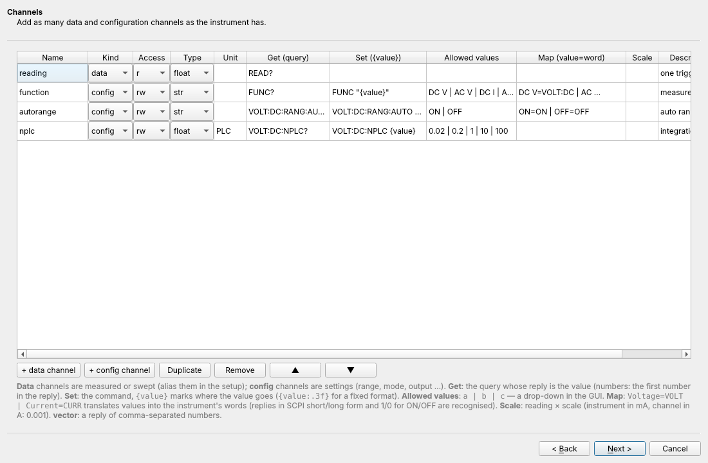

# Driver Wizard

Most SCPI instruments, and many older ones, are controlled by text commands. For an
instrument like that without a driver, the **Driver Wizard** builds one without
programming. Open it from *Backend → Driver wizard…*, or the *Driver wizard…* button
under *Instruments & channels*.



## The steps

### 1. Start from

Start from a template, or reopen a driver made with the wizard:

| template | contains |
|---|---|
| *Generic SCPI* | identification, error queue, reset / clear |
| *SCPI source-measure unit* | source level, mode, compliance, output, NPLC, measured voltage and current |
| *SCPI multimeter* | function, autorange, NPLC, reading |
| *Simple line protocol* | non-SCPI, no error queue |

### 2. Basics

* **Driver name**: `[a-z][a-z0-9_]*`, e.g. `keysight_e3631a`.
* **Description**: shown in the driver list.
* **`*IDN?` check**: the reply must contain one of `a | b`, e.g. `E3631A | E3632A`. It
  is checked on connect, and also used to recognise the instrument when scanning
  ports.
* **Error query**: e.g. `SYST:ERR?`. It is read after every setting, so a refused value
  raises an error with the instrument's own message. A query the instrument does not
  understand then fails at once with its message (e.g. `-113,"Undefined header"`)
  instead of a read timeout.
* **Terminations, timeout, query delay.**
* **Interfaces**: GPIB, USB, LAN, TCP socket, serial, simulated. The Add instrument
  dialog lists ports of those kinds.

### 3. Channels

Add any number of channels of two kinds:

* **data** channels: measured or swept values, aliased in the setup;
* **config** channels: settings.

Per channel:

| field | meaning | example |
|---|---|---|
| access | `r`, `w` or `rw` | `rw` |
| type | `float`, `str` or `vector` (comma-separated numbers) | `float` |
| unit | | `V` |
| **Get** | the query; for numbers the first number in the reply is taken | `VOLT?` |
| **Set** | the command, with `{value}` (or `{value:.3f}`) where the value goes | `VOLT {value:.4f}` |
| **Allowed values** | `a \| b \| c`; a drop-down in the front ends | `P6V \| P25V \| N25V` |
| **Map** | value ↔ instrument word | `Voltage=VOLT \| Current=CURR` |
| **Scale** | reading × scale, setting ÷ scale | `0.001` (instrument in mA, channel in A) |

Replies to a mapped channel are recognised in SCPI short or long form, with `1` / `0`
read as `ON` / `OFF`.

### 4. Actions

Actions are named command lists, e.g. `reset` = `*RST | *CLS`. They run like any driver
action.

### 5. Initialization

* **Commands on connect.** A command ending in `?` is a query whose reply is logged.
* **A Python script** run after them. It can use `write(cmd)`, `query(cmd)`, `read()`,
  `sleep(s)`, `log(msg)`, `options`, `instrument`, `np` and `math`. Raise an exception
  to refuse the connection.
* **Commands on disconnect**, e.g. `OUTP OFF`.

```python
idn = query("*IDN?")
if "E3631A" not in idn:
    raise RuntimeError("not an E3631A: %s" % idn)
write("SYST:REM")
log("connected to %s" % idn.strip())
```

### 6. Check, try and save

* **Check**: errors block saving, warnings don't. The generated Python file can be
  previewed.
* **Try it**: connects to an address you give (`SIM::…` works too), reads every
  readable channel once and shows the value, unit and time per channel. It then
  removes the trial instrument again.
* **Save**:
    * writes `<home>/drivers/<name>.py`;
    * reloads the drivers;
    * offers to add an instrument with the new driver.

  Instruments already using the driver are reconnected with the new version, but not
  during a sweep.

## Example: a Keysight E3631A triple supply

| channel | kind | access | type | unit | get | set |
|---|---|---|---|---|---|---|
| `output_sel` | config | rw | str | | `INST?` | `INST {value}` (allowed `P6V \| P25V \| N25V`) |
| `voltage` | data | rw | float | V | `VOLT?` | `VOLT {value:.4f}` |
| `current_limit` | config | rw | float | A | `CURR?` | `CURR {value:.4f}` |
| `Vmeas` | data | r | float | V | `MEAS:VOLT?` | |
| `Imeas` | data | r | float | A | `MEAS:CURR?` | |
| `output` | config | rw | str | | `OUTP?` | `OUTP {value}` (map `ON=1 \| OFF=0`) |

The actions are `reset` = `*RST | *CLS`, and the error query is `SYST:ERR?`. After
*Save*, add it like any instrument and alias `voltage` with limits and a ramp rate.

## The generated file

The file holds the definition as a Python literal (`DEFINITION`) and a small class
deriving from `CommandInstrument` (`easymeasure/drivers/_command.py`). It can be
edited by hand, e.g. to override `read` / `write` for an unusual channel, and the
wizard reopens it through `DEFINITION`.

Saving from the wizard over a file that was extended by hand warns first, and keeps
the old file as `<name>.py.bak`. A built-in driver name, or a file not made by the
wizard, is never overwritten.

## From Python

The wizard's backend commands are available to scripts:

```python
tmpl = c.call("wizard_templates")[0]["definition"]
d = dict(tmpl, name="my_meter", description="my meter")
c.call("wizard_check", definition=d)          # {'errors': [], 'warnings': [...], 'source': '…'}
c.call("wizard_try", definition=d, address="GPIB0::5::INSTR")
c.call("wizard_save", definition=d)
c.call("wizard_list"); c.call("wizard_load", name="my_meter"); c.call("wizard_delete", name="my_meter")
```

Over remote access the wizard is admin-only, because it writes code to the backend
computer.
