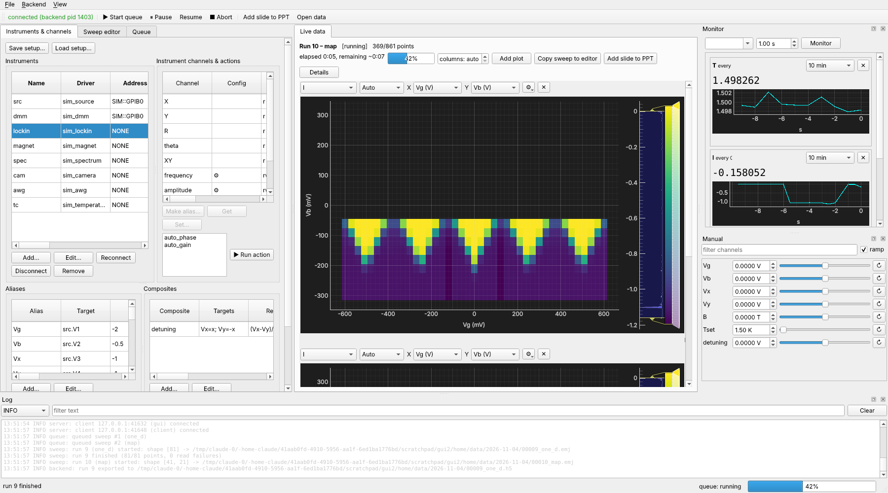
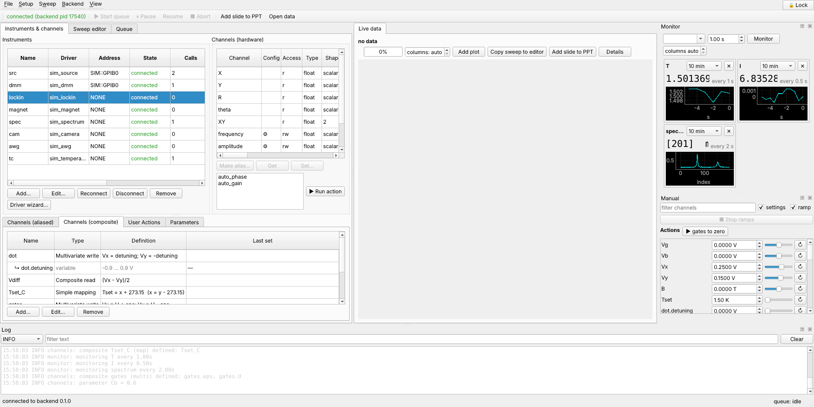
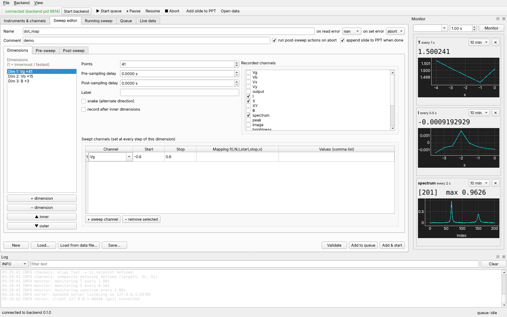
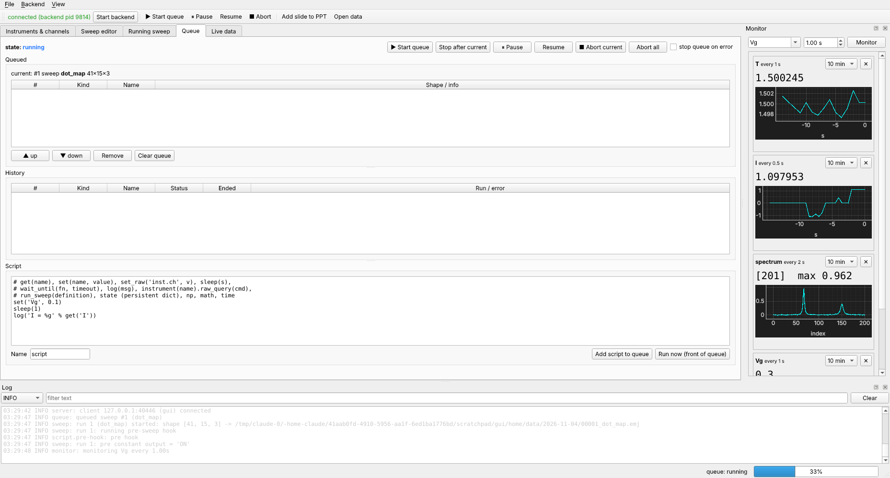

# Desktop GUI

```bash
python -m easymeasure.frontend                    # connect to the running backend
python -m easymeasure.frontend --start-backend    # … starting one if none runs
```

The GUI is only a view: it talks to the backend over a socket and never blocks on
it. Close it, kill it or start several on different screens; the measurement does
not notice. A reopened GUI picks up the running sweep where it is.



The window is split in two:

* on the left, the instruments, sweep editor and queue;
* on the right, the data: the live view and any loaded files;
* on the far right, the **Monitor** and **Manual** docks;
* at the bottom, the **Log**.

The read-only *Running sweep* view can be shown from the *View* menu.

## Instruments & channels



* **Instruments**: Add…, Edit…, Reconnect, Disconnect, Remove, and
  *Driver wizard…*. The Add dialog's address list shows the ports found on the
  backend computer that fit the driver (see [Instruments](instruments.md#adding-an-instrument)).
* **Instrument channels & actions**: the selected instrument's channels, with their
  allowed values and the *last value* read or set (nothing is read just to fill the
  table). Buttons: *Make alias…*, *Get*, *Set…* for configuration channels, and *Run action*.
* **Aliases** and **Composites**: definitions with their last values; Add… / Edit…
  open the editors (see [Aliases](aliases.md), [Composites](composites.md)).
* **Actions**: your [user actions](user-actions.md).
* *Save setup… / Load setup…*.

## Sweep editor



The editor has any number of dimensions, each laid out in the order of one point:

1. the actions;
2. setting the swept channels;
3. the pre-sample delay;
4. recording;
5. the post-sample delay.

An outer dimension also shows where the next inner dimension's loop runs: last, or
before recording with *record after inner dims*. The pre and post phases, error
policies and metadata are below.

*Load… / Save…* read and write JSON, and *Load from data file…* takes the
definition of a stored run. *Validate* limit-checks every setpoint, and *Add* /
*Add & start* queue the sweep.

## Queue



The queue panel has:

* the controls: Start, Pause, Resume, Abort, Abort all and Stop after current,
  enabled by what the queue can do now;
* the queued items, which can be reordered and removed;
* the history: *Rerun selected*, *Open data*, and *Copy to sweep / script editor*;
* a script editor.

See [Run queue and scripts](queue-scripts.md).

## Data views

The **Live data** tab follows the running sweep. *File → Open data file…* opens stored
runs in further tabs. See [Plotting](plotting.md).

## Docks

* **Monitor**: channels polled at their own intervals.
* **Manual**: every writable channel with a spin box and slider.

See [Monitor and Manual panels](monitor-manual.md).

The **Log** dock shows the backend log (all clients see the same) with level filter
and search.

## Menus

* **File**: Open data file… (Ctrl+O), Browse recent runs…, Settings… (data folder,
  PowerPoint file, display), Quit (the backend keeps running).
* **Backend**: Start backend, Reconnect, Restart backend…, Show tray icon, Remote
  access…, Driver wizard…, Shut down backend….
* **View**: show or hide the Monitor, Manual and Log docks and the *Running sweep* view.

The toolbar has the queue controls, *Add slide to PPT* and *Open data…*.

## First start

The first time the GUI meets a backend, it asks for:

* the **data folder**, where every run is saved;
* the **PowerPoint file** that slides are appended to (empty = none).

Both are prefilled with the current values. *Ask me later* asks again at the next
start. Both stay editable in *File → Settings*, and a data folder that cannot be
created is refused.

## Display settings

*File → Settings → Display*:

* **font size**: applied at once, also to plot axes;
* **UI scale**: an overall scale of 50–300 %, applied on the next GUI start.

Together they suit any screen resolution. The window can be made small: toolbars
wrap, and panels scroll only when they must.

Combo boxes stay narrow so toolbars do not grow, but their drop-down lists show
long channel names in full.

## Lock

**🔓 Lock** (top right corner, Ctrl+L) locks the GUI against accidental changes.

Greyed out:

* instruments, the sweep editor and the queue;
* manual control;
* adding / removing monitors;
* *Add slide to PPT* and *Settings*;
* the *Backend* menu, except *Reconnect*.

Still usable:

* switching tabs;
* the plots and all their settings;
* monitor time spans;
* opening data files;
* the log.

Click again to unlock; the state is remembered across restarts. It is a guard
against slips, not access control. It affects this window only, not other GUIs,
the web page, the tray or scripts.

## Tray icon

While the backend runs, a tray icon shows its state:

| colour | state |
|---|---|
| green | idle |
| blue | running |
| orange | paused |
| red | error |
| gray | unreachable |

Its tooltip shows the current run and its progress.

The tray menu can:

* open the GUI;
* open the web page (*Open in browser*, which offers to switch on remote access
  first if it is off);
* pause, resume and abort;
* open the data folder or the log;
* shut the backend down.

A notification appears when a run ends. The tray is a separate helper process, so it
can never affect the backend. Start the backend with `--no-tray` to disable it.
