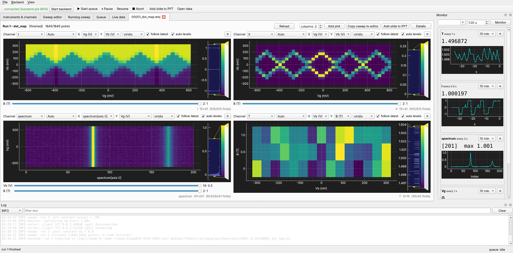

# Plotting live and stored data

The **Live data** tab follows the running sweep. *File → Open data file…* opens
stored runs, complete or partial, in further tabs with exactly the same plots.

## The data view

At the top is the run: number, name, status, points done of total, elapsed time and the
estimated remaining time. Below it is a **grid of plots**, one per recorded channel
to start with.

| button | does |
|---|---|
| **Add plot** | another plot (e.g. the same channel twice, as a map and as a line) |
| **columns** | how many plots side by side; *auto* picks the arrangement that shows every plot largest |
| **Add slide to PPT** | a slide of this run now (see [PowerPoint](powerpoint.md)) |
| **Copy sweep to editor** | the run's definition into the sweep editor |
| **Details** | header, metadata, pre/post values, footer |
| **Reload** (stored runs) | read the file again (a run still being written grows) |

**Every plot is shown at once.** The plots share the available area. Scroll bars
appear, in either direction, only when the area is smaller than the plots' minimum
size.

## One plot

Each plot's toolbar has:

* **channel**: any recorded channel;
* **mode**:
    * *Auto*;
    * *Curve*;
    * *Heatmap* (for 2-D data, the default);
    * *Stacked curves* (2-D data as a set of offset lines);
* **X** and **Y**: which axes to plot. Any sweep axis or value axis can be chosen,
  for example the bias instead of the gate as X, or the wavelength axis of a spectrum.
  Y is greyed out for 1-D data;
* **⚙**: colormap, auto levels, *follow latest*, stack offset;
* **✕**: close the plot.

**Sliders.** Every axis that is not X or Y becomes a slider below the plot: the
outer sweep dimensions of a 3-D scan, the second spectrum dimension, and so on. With
**follow latest** the sliders track the point being measured. Move a slider to look
back, and tick *follow latest* again to return.

**Heat maps.** Drag the histogram or colour bar to set the levels; *auto levels*
returns to the data range. Colormaps: `viridis`, `plasma`, `inferno`, `magma`,
`cividis`, `turbo`, `gray`, `hot`, `jet`, `CET-L17`, and the diverging `RdBu_r`,
`coolwarm`, `seismic` and `CET-D1` for signed data.

**Redraws are coalesced**, so a fast sweep does not load the GUI, and hidden plots
are not redrawn.

## Typical views

| data | view |
|---|---|
| 1-D sweep (`I` vs `Vg`) | *Curve* |
| 2-D map (`I` vs `Vg`, `Vb`) | *Heatmap*, X = `Vg`, Y = `Vb`; or *Curve* with a slider on `Vb` |
| 2-D map, line by line | *Stacked curves*, with an offset |
| spectrum vs field | *Heatmap*, X = spectrum index, Y = `B` |
| camera image vs voltage | *Heatmap*, X/Y = image axes, slider = voltage |
| 3-D scan | *Heatmap* of two axes, slider on the third |

## The web app

The web app's data tab has the same plots: curve / heat map / stacked curves, X/Y
choice, sliders, follow latest, colormaps, colour levels by dragging the colour bar,
zoom and pan. They redraw at most about 15 times a second, and only when visible.

## Plotting in Python

See [Data files](data.md#plotting-with-matplotlib) for loading a run and plotting it
with matplotlib.
