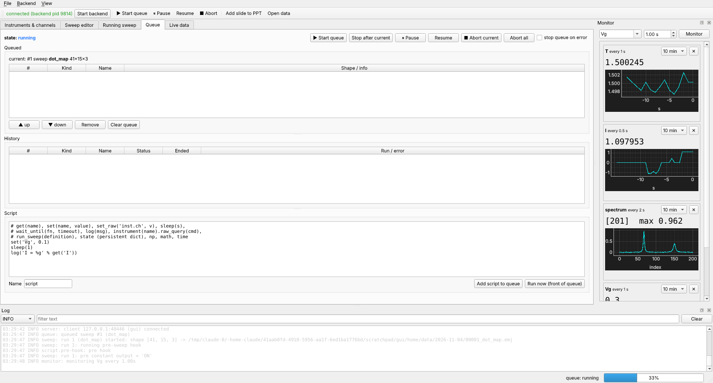

# Run queue and scripts

Sweeps and scripts run one at a time from the **queue**. You can queue a night's
worth of measurements and look at them in the morning.



## Queueing

```python
id1 = c.call("queue_add", item={"kind": "sweep", "definition": sweep1})
id2 = c.call("queue_add", item={"kind": "sweep", "definition": sweep2})
id3 = c.call("queue_add", item={"kind": "script", "name": "warm up",
                                "code": "set('Tset', 10)\nsleep(600)"})
c.call("queue_start")
```

`queue_add(..., start=True)` adds and starts in one go. This is the editor's *Add & start*
button. Items are checked when they are added: sweeps are normalised, and script
code must compile.

*Start* processes what is queued. On an empty queue it does nothing, and a queue
that runs empty goes back to `idle` by itself, so an item added later waits for the
next *Start*.

```python
c.call("queue_move", item_id=id3, position=0)    # run the warm-up first
c.call("queue_remove", item_id=id2)
c.call("queue_clear")                             # everything that is waiting
```

## States and controls

The queue is `idle`, `running`, `paused` or `aborting`.

| control | effect |
|---|---|
| `pause` / `resume` | at the next point (sweeps) or line (scripts) |
| `abort` | the running item; a sweep's post phase still runs |
| `abort_all` | the running item and everything waiting (and running [user actions](user-actions.md)) |
| `queue_stop` | finish the running item, then stop |
| `queue_options(stop_on_error=True)` | stop the queue when an item fails |

```python
st = c.call("queue_state")
st["state"], st["current"], len(st["queued"])
st["can"]     # {'start': False, 'stop': True, 'pause': True, 'resume': False, 'abort': True, …}
```

`can` says which controls apply right now; the GUI and the web page enable their
buttons from it.

## History

```python
for item in c.call("queue_state")["history"]:
    print(item["id"], item["kind"], item["name"], item["status"], item.get("path"))
```

In the GUI's *Queue* panel:

* *Rerun selected* queues the same sweep or script again.
* *Open data* opens the run's file.
* *Copy to sweep editor* (or *Copy to script editor*) loads its definition for a
  variation.

## Scripts

A script is Python run in the backend, with a small API in its namespace. See the
[Script API reference](../reference/script-api.md) for all of it.

```python
code = '''
for T in (1.5, 4, 10, 20):
    set('Tset', T)
    wait_until(lambda: abs(get('T') - T) < 0.05, timeout=3600, interval=5)
    sleep(120)
    sweep = {"name": "iv_%gK" % T,
             "dimensions": [{"points": 201,
                             "sweep": [{"channel": "Vb", "start": -0.3, "stop": 0.3}],
                             "record": ["I"]}],
             "metadata": {"T": T}}
    log("T = %g K: %s" % (T, run_sweep(sweep)))
set('Tset', 1.5)
'''
c.call("queue_add", item={"kind": "script", "name": "iv vs T", "code": code}, start=True)
```

The namespace has:

| name | does |
|---|---|
| `get(name)` | read an alias, composite or `instrument.channel` |
| `set(name, value, ramp=True)` | protected write (limits, ramp rate) |
| `set_many({name: value})` | set several together, e.g. composite variables |
| `set_raw('inst.ch', value)` | unprotected write to an instrument channel |
| `sleep(s)` | abortable sleep (use it instead of `time.sleep`) |
| `wait_until(f, timeout, interval)` | poll `f()` until true |
| `check()` | honour pause / abort explicitly |
| `log(msg)`, `print(…)` | write to the backend log (GUI log dock) |
| `action('inst.action')` | run an instrument action |
| `instrument(name)` | guarded proxy: `.raw_query`, `.raw_write`, `.call`, `.action`, `.read` |
| `run_sweep(definition)` | run a sweep synchronously; returns its status |
| `state` | a dict kept between scripts (and user actions) in this backend |
| `np`, `math`, `time` | modules |

**Abort reaches scripts on every line**, so even `while True: pass` stops. A script
that raises is reported in the log and the history; the queue goes on (unless
`stop_on_error`).

### Run a script now

`run_script_now` puts a script at the front of the queue and starts it:

```python
c.call("run_script_now", code="set_many({'Vx': 0, 'Vy': 0})", name="zero gates")
```

For one-click actions that should run immediately, even while a sweep is paused,
use [user actions](user-actions.md) instead.

### More script examples

**Ramp the magnet down and wait:**

```python
set('B', 0)                                    # ramps at B's ramp rate
wait_until(lambda: get('magnet.status') == 'HOLDING', timeout=1800)
```

**Talk to an instrument directly:**

```python
smu = instrument('smu')
log(smu.raw_query('*IDN?'))
smu.raw_write(':SYST:BEEP 1000,0.2')
```

**Find a resonance, then measure around it:**

```python
fs = np.linspace(1e3, 1e5, 200)
r = []
for f in fs:
    set('f', f)
    sleep(0.05)
    r.append(get('R'))
f0 = fs[int(np.argmax(r))]
state['f0'] = f0
log('resonance at %.1f Hz' % f0)
run_sweep({"name": "zoom", "dimensions": [{"points": 101,
           "sweep": [{"channel": "f", "start": f0 - 500, "stop": f0 + 500}],
           "record": ["X", "Y"]}]})
```

## Permissions

Scripts are Python with full access to the backend computer. Over remote access
they need the admin role. Operators can queue and control sweeps without code.
