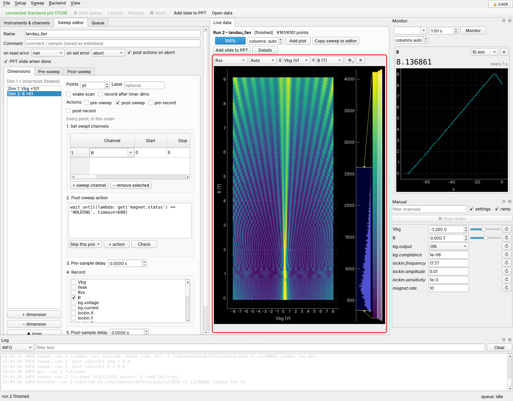
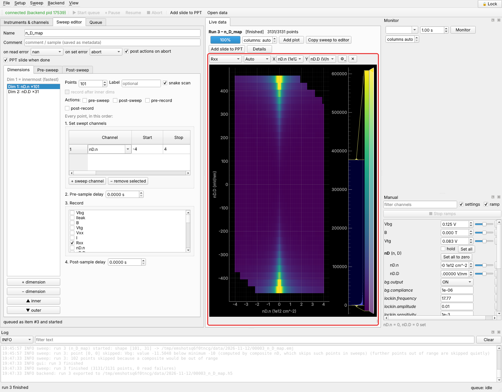
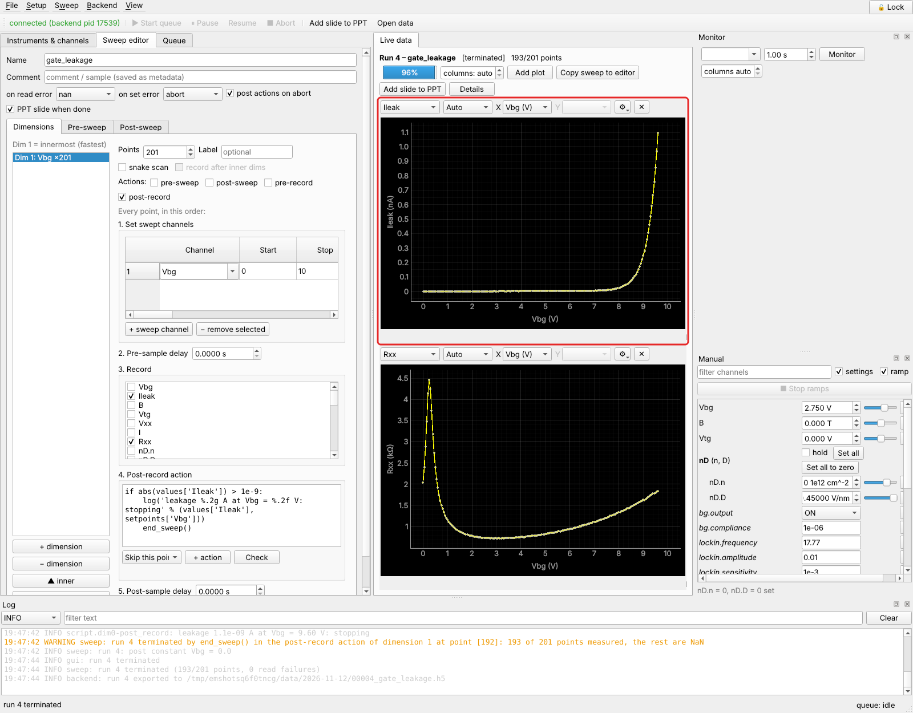
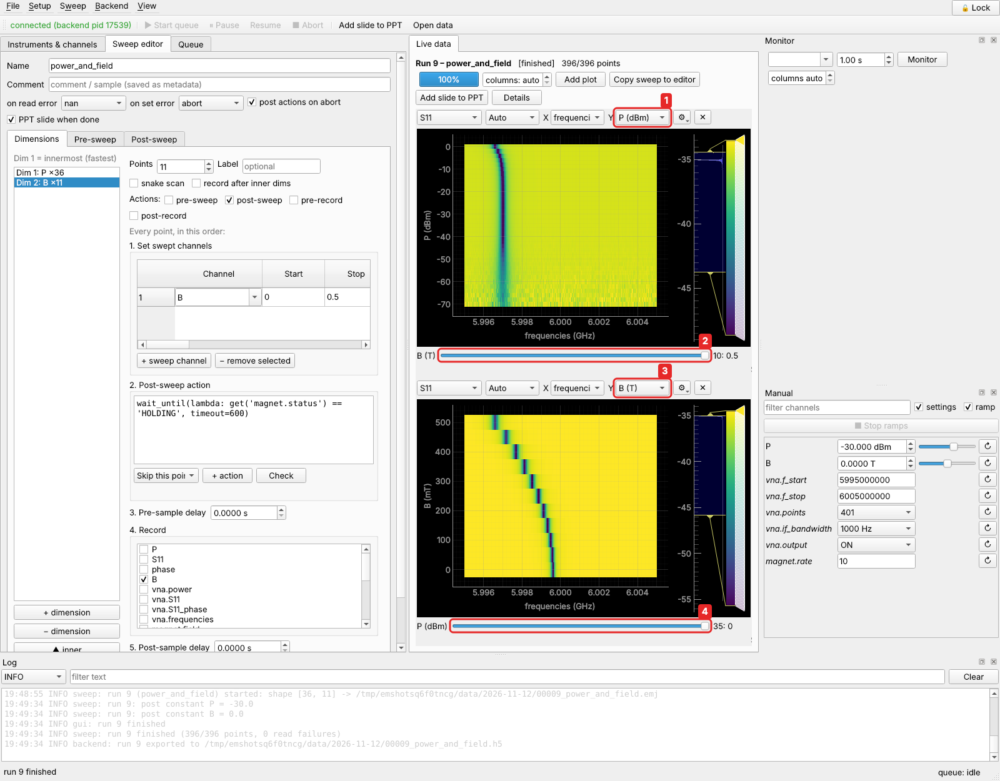

# Tutorials

The tutorials follow a new PhD student through the first measurements of a project.
Each one is a real measurement, done entirely in the GUI, step by step with
screenshots. Each introduces one or two new ideas.

All of them run on **simulated instruments** that come with easyMeasure: a
dual-gated bilayer graphene Hall bar measured with a lock-in, a superconducting
magnet, and a microwave resonator measured with a vector network analyzer. The
simulations behave like the real thing (Dirac peak, Landau levels, a band gap that
opens with displacement field, gate leakage, a resonance that shifts with power and
field), so you can try everything before touching a real sample. With real
instruments, only the driver and address change.

Start with the [Quick start](../quickstart.md) if you haven't yet: it sets up the
instruments the first three tutorials use.

-   **[Tutorial 1: a Landau fan](landau-fan.md)**

    ---

    

    A 2-D map of gate voltage against magnetic field. Two dimensions, snake scans,
    waiting for a magnet that takes time to ramp, heat maps and curves with sliders.

-   **[Tutorial 2: rotated gate sweeps](rotated-gates.md)**

    ---

    

    $R_{xx} = V_{xx}/I$ from two lock-ins, and sweeps of carrier density and
    displacement field instead of two gate voltages: composite channels, and what
    happens to points the gates can't reach.

-   **[Tutorial 3: stop at a threshold](stop-at-threshold.md)**

    ---

    

    Ramp a gate until the leakage current reaches 1 nA, then stop by itself. Point
    actions, and one-click buttons of your own (`gates_to_zero`).

-   **[Tutorial 4: a VNA power sweep](vna-power.md)**

    ---

    

    The power and field dependence of a microwave resonance. Instruments that return a
    whole spectrum per reading, 2-D and 3-D data, and how to look at them.

**After the tutorials**, the [User guide](../guide/index.md) explains every part in
full, and [Scripting and Python](../scripting/index.md) shows what to do when the GUI
is not enough: series of sweeps, measurements that decide where to measure next, and
sweeps along any path you can write down.
