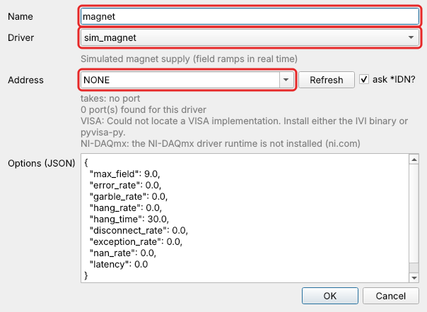
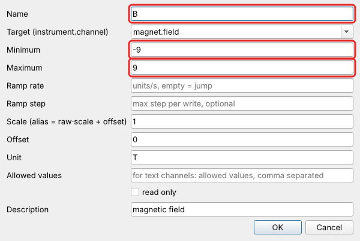
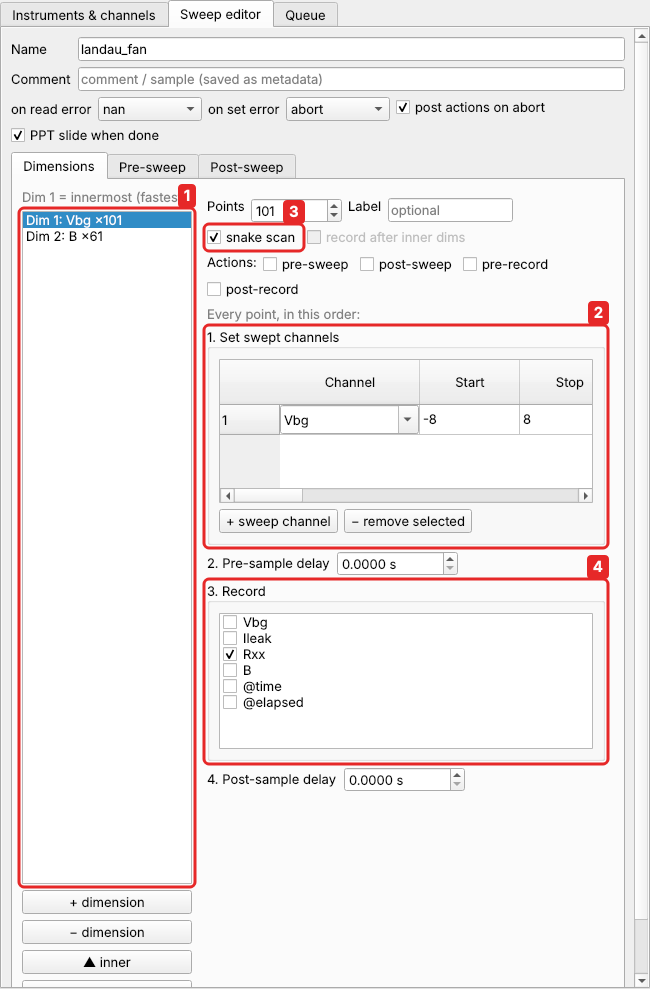
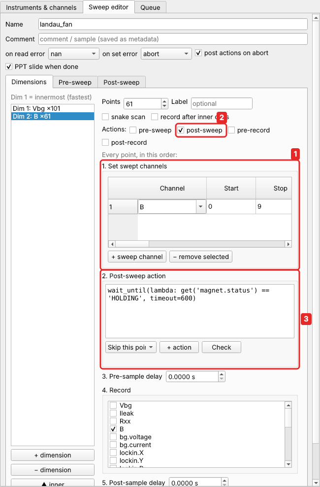
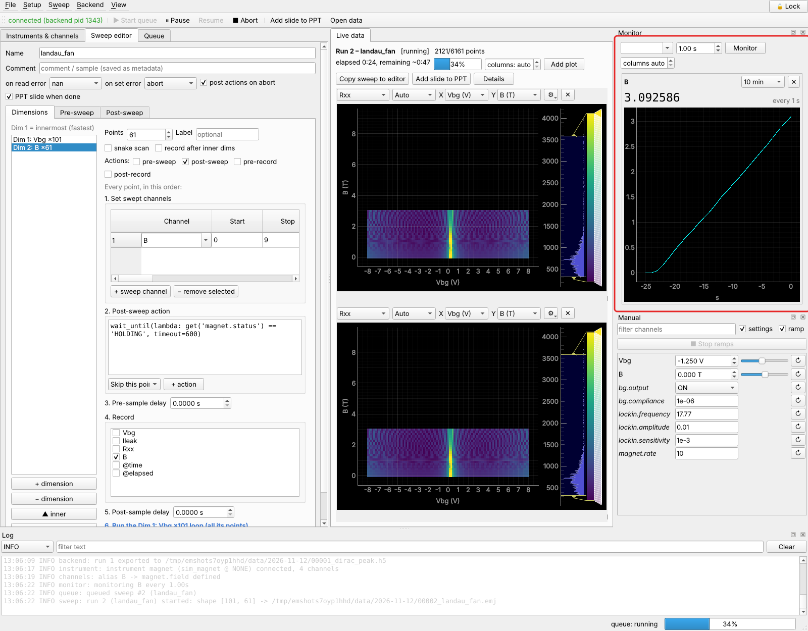
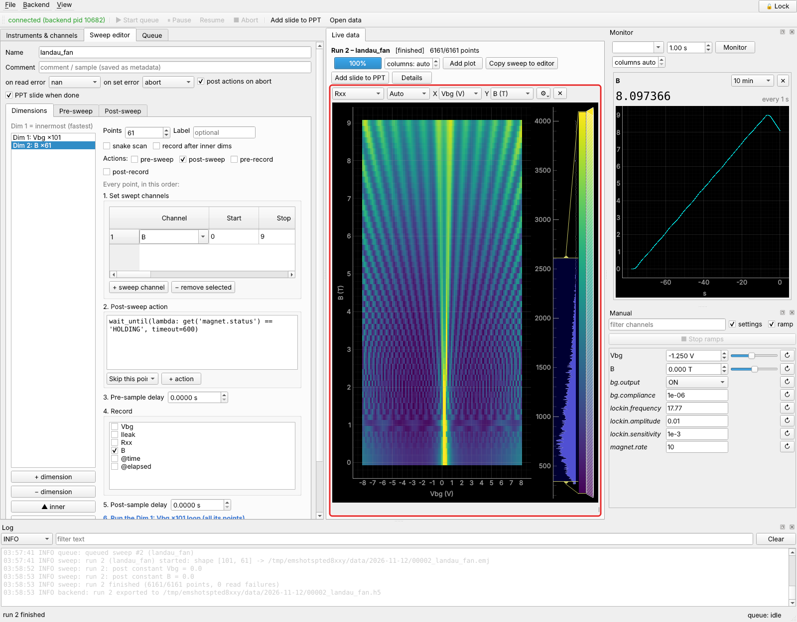
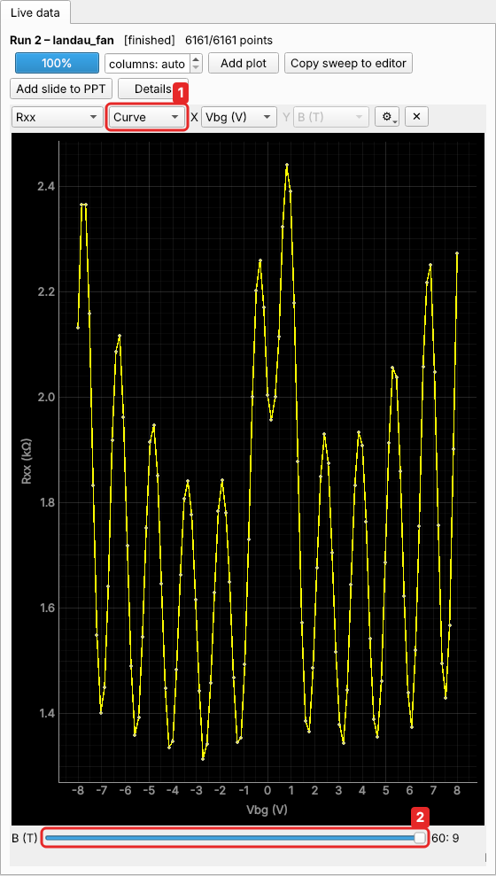

# Tutorial 1: a Landau fan (2-D map)

**You will learn:** two-dimensional sweeps, snake scans, waiting for a slow instrument
with a point action, and looking at 2-D data as a map and as curves.

This continues the [Quick start](../quickstart.md). You have the graphene Hall bar with
the instruments `bg` and `lockin` and the aliases `Vbg`, `Ileak` and `Rxx`. If you
start fresh: *Setup → Load setup…* → `examples/graphene_setup.json`.

**The physics.** In a perpendicular magnetic field the electrons of graphene condense
into Landau levels. $R_{xx}$ drops whenever a whole number of levels is filled. For
bilayer graphene this happens at filling factors $\nu = nh/eB = 4, 8, 12, \dots$, so
in a map of $R_{xx}$ against gate voltage and field the minima lie on straight lines
fanning out from the Dirac point: a **Landau fan**. You need a 2-D map: gate voltage
(fast) × field (slow).

## 1. Add the magnet

In the lab this is the power supply of a superconducting magnet. Here it is
`sim_magnet`, which, like a real one, takes time to ramp: 10 T per minute.
*Instruments → Add…*:



Then select `magnet`, select its channel `field`, and click **Make alias…**. Name `B`,
minimum −9, maximum 9 T:



No ramp rate this time: the magnet supply ramps by itself. Writing `B` only sets its
target, and the field gets there at the supply's own rate.

## 2. Two dimensions

In the **Sweep editor**, start from your Dirac-peak sweep, or click *New*. A sweep can
have any number of **dimensions**. Each one is a loop, and the first is the innermost.
Use **+ dimension** to add the second one.

**Dimension 1 (inner, fast): the gate.**



1. The dimension list: *Dim 1* is the innermost loop, *Dim 2* runs around it.
2. Sweep `Vbg` from −8 to 8 V in 101 points.
3. **snake scan**: every other line runs backwards (−8 → 8, then 8 → −8, …).
   Otherwise the gate would ramp from +8 back to −8 V before every line, which takes 3 s
   at 5 V/s.
4. Record `Rxx`.

**Dimension 2 (outer, slow): the field.**



1. Sweep `B` from 0 to 9 T in 61 points (0.15 T steps), and record `B` (the field
   that was really reached).
2. Tick the **post-sweep** action. A *point action* is a small piece of Python run at
   every point of this dimension, at a fixed place in the sequence. *Post-sweep* runs
   right after `B` was set.
3. Its code waits until the magnet has arrived:

    ```python
    wait_until(lambda: get('magnet.status') == 'HOLDING', timeout=600)
    ```

    `get('magnet.status')` reads the supply's status channel, which is `RAMPING` or
    `HOLDING`. `wait_until` checks it until it is true, for at most 600 s. Pause and
    abort still work while it waits.

    You don't need to type it: the **+ action** box next to the code offers common
    snippets.

Each dimension is laid out in the order its steps happen at every point: set the swept
channels → (post-sweep action) → delay → record. With several dimensions, the inner
dimension's whole loop runs at the end of each outer point, and the editor shows where.

In the **Post-sweep** tab, set `Vbg` = 0 and `B` = 0, so everything returns to zero at
the end. Then **Sweep → Validate**: 101 × 61 = 6161 points, every one checked against the
limits of `Vbg` and `B`.

This sweep is `examples/graphene_fan.json`.

## 3. Run it and watch the field

**Sweep → Add & start.** While it runs, add `B` to the **Monitor** (choose `B`, click
**Monitor**) to watch the magnet step and settle:



The whole map takes a few minutes in the simulation. In a real fridge you would use
smaller field steps and slower gate sweeps, and it would take hours. You can close the
GUI and come back later.

!!! tip "Ramping the field continuously"
    Here the field is stepped and the magnet settles at every step. The other common
    way is to sweep the field continuously and record as it goes, at a fixed gate
    voltage. That is a small script: see
    [Custom sweeps → time traces](../scripting/custom-sweeps.md#time-traces).

## 4. Look at the map



For 2-D data the plot is a **heat map**: X = `Vbg`, Y = `B`, colour = $R_{xx}$.

* Drag the **colour bar** on the right to set the colour range. Its histogram shows
  where the values are.
* **⚙** chooses the colormap and switches automatic levels on or off.
* Zoom with the mouse wheel; right-click → *View all*.

The minima form straight lines from the Dirac point: the Landau fan. Their slopes give
the filling factors.

**As curves.** Set the mode to **Curve** (1). Now you see one line, $R_{xx}(V_{bg})$
at one field, and a **slider** (2) chooses which field. With *follow latest* the slider
follows the line being measured. **Stacked curves** draws all lines at once, offset
from each other.



**More plots.** **Add plot** shows another channel, or the same one in another mode.
**columns** sets how many plots sit side by side.

## What you learned

* A **dimension** is a loop; dimension 1 is the innermost. A 2-D map needs two.
* **Snake scans** avoid long ramps back to the start of each line.
* A **point action** runs a line of code at a fixed place in every point. *Post-sweep*
  plus `wait_until(...)` waits for a slow instrument.
* 2-D data are shown as a heat map, or as curves with a slider.

**Next:** [Tutorial 2: rotated gate sweeps](rotated-gates.md).

!!! tip "Reference"
    [Sweeps](../guide/sweeps.md) and [Point actions](../guide/point-actions.md) in
    the user guide have every option.
