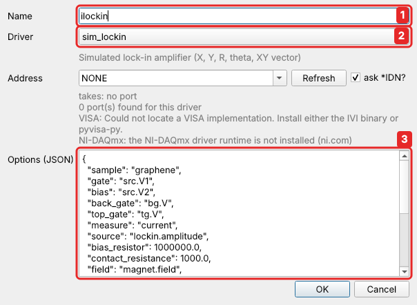
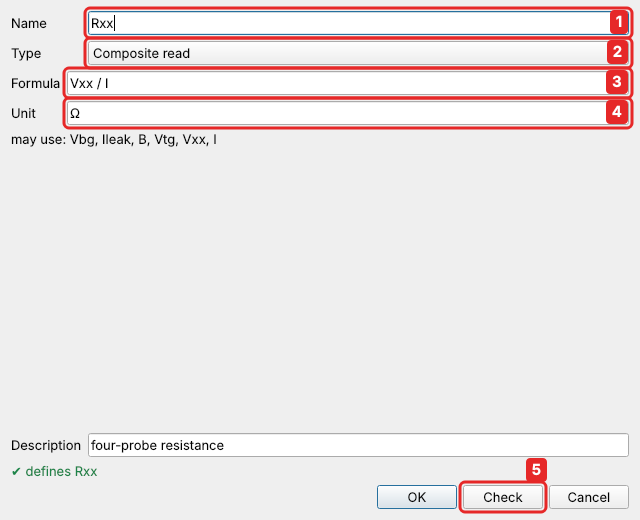
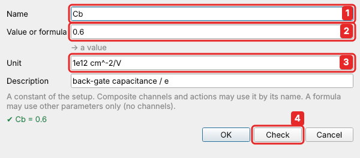
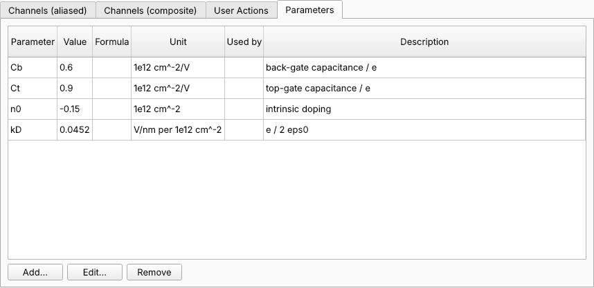
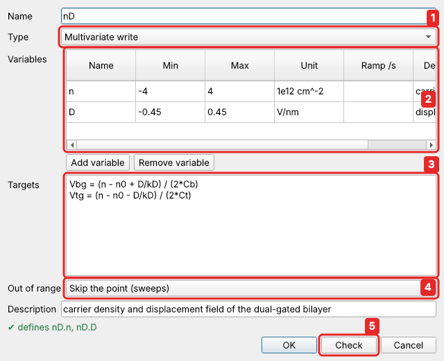
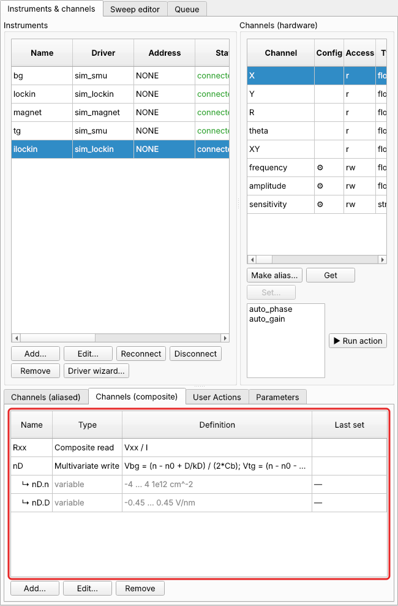
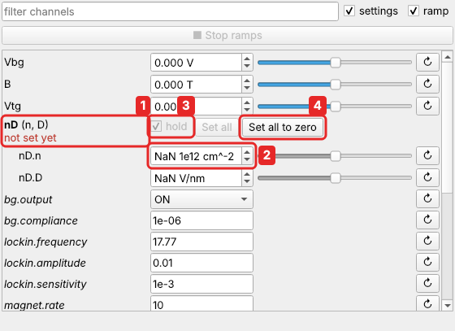
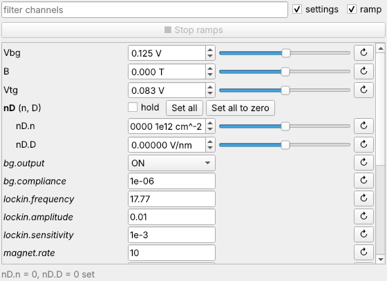
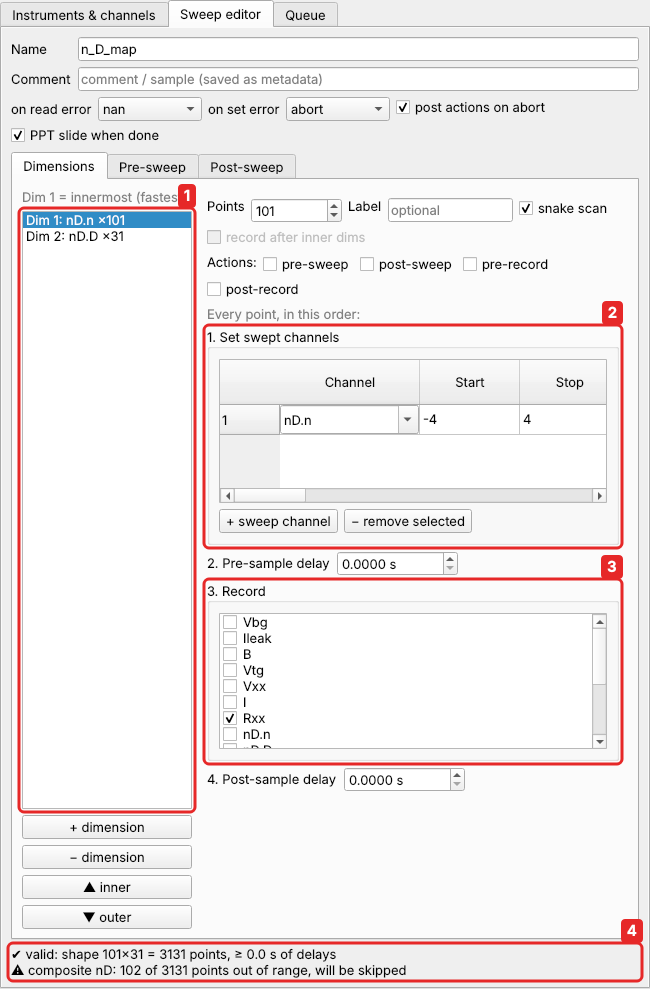
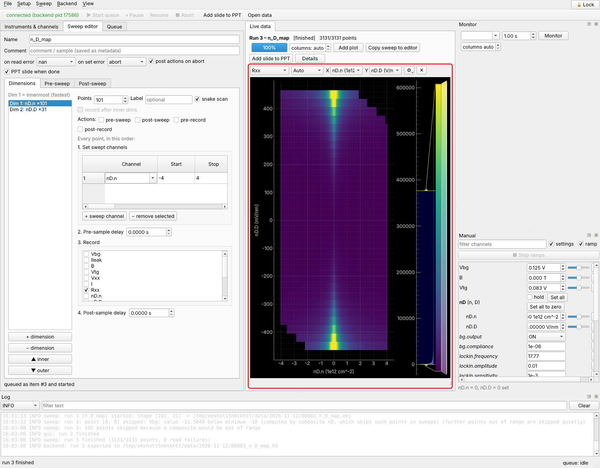

# Tutorial 2: rotated gate sweeps with composite channels

**You will learn:** composite channels. A *composite read* computes a channel from
others ($R_{xx} = V_{xx}/I$ from two lock-ins). A *multivariate write* lets you sweep
physical quantities (density and displacement field) instead of instrument voltages.
You will also see what happens to points that would need a gate voltage beyond its
limit.

**The physics.** Your bilayer graphene has a top gate too. The two gates together set
two physical quantities:

* the **carrier density** $n = (C_b V_{bg} + C_t V_{tg})/e + n_0$;
* the **displacement field** $D = (C_b V_{bg} - C_t V_{tg})/2\varepsilon_0$, which
  opens a band gap in bilayer graphene.

To see the gap open, you want to sweep $n$ at fixed $D$, then step $D$. In the
$(V_{bg}, V_{tg})$ plane these are lines at an angle, a **rotated sweep**: both gates
move at every point. easyMeasure does this with a **composite channel**. You define $n$
and $D$ as channels of their own, give the formulas for the gate voltages, and then
sweep $n$ and $D$ like any other channel.

For this device, $C_b/e = 0.6$ and $C_t/e = 0.9 \times 10^{12}\,\text{cm}^{-2}\,\text{V}^{-1}$,
$n_0 = -0.15 \times 10^{12}\,\text{cm}^{-2}$, and $e/2\varepsilon_0 = 0.0452$ V/nm per
$10^{12}\,\text{cm}^{-2}$. Solving the two equations for the gate voltages
($n$ in $10^{12}\,\text{cm}^{-2}$, $D$ in V/nm):

$$
V_{bg} = \frac{n + 0.15 + D/0.0452}{2 \times 0.6}, \qquad
V_{tg} = \frac{n + 0.15 - D/0.0452}{2 \times 0.9}
$$

## 1. The top gate

Add a second `sim_smu` named `tg` (address `NONE`). Make an alias of `tg.voltage`
named `Vtg`, with limits −10 … 10 V and ramp rate 5 V/s, exactly like `Vbg`
([Quick start, step 4](../quickstart.md#4-name-the-channels-you-care-about)).

## 2. Measure the current too: Rxx = Vxx / I

So far, `Rxx` was the lock-in voltage × 10⁸, which assumes that exactly 10 nA flows.
The current is set by the lock-in's 10 mV output and a 1 MΩ series resistor. That
is fine while the sample has a few kΩ. But once the gap opens, the sample reaches
hundreds of kΩ, the current drops, and $V_{xx}/10\,\text{nA}$ underestimates $R_{xx}$.
The usual remedy is to measure the current with a second lock-in, locked to the
first one's reference, and divide.

**The second lock-in.** *Instruments → Add…*: name `ilockin`, driver `sim_lockin`,
address `NONE`. In the lab this is a second SR830 measuring with its current input.
The simulation needs to know that it measures the current, driven by the first
lock-in's output:



1. Name `ilockin`.
2. Driver `sim_lockin`.
3. Options: `"sample": "graphene"`, `"measure": "current"`, `"source": "lockin.amplitude"`.

**Two aliases.** Make an alias of `lockin.X` named `Vxx` (unit V), and one of
`ilockin.X` named `I` (unit A).

**Rxx as a composite read.** On the **Channels (aliased)** tab, select the old alias `Rxx`
and click **Remove**. Then, on the **Channels (composite)** tab, click **Add…**:



1. Name `Rxx`, the same name as before, so every sweep that records `Rxx` keeps
   working.
2. **Type**: *Composite read*, a read-only channel computed from others.
3. **Formula**: `Vxx / I`. Any formula of channels works: `1/Rxx` for a conductance,
   `(V1 - V2)/I` for a voltage measured as a difference, and so on.
4. **Unit**: Ω.
5. **Check**, then **OK**.

Reading `Rxx` now reads `Vxx` and `I` and divides. It can be recorded, monitored and
plotted like any channel. In the gap, at $D = 0.3$ V/nm, it reads about a third more than
the old alias did, because only about 7.5 nA flow there.

## 3. The device's constants as parameters

The formulas for the gates contain four numbers that belong to this particular
device: the two capacitances, the intrinsic doping and $e/2\varepsilon_0$. Rather
than typing them into formulas, give each a name as a **parameter**. When you cool
down the next device, or calibrate the capacitances better from a Landau fan, you
change the number in one place.

In *Instruments & channels*, on the **Parameters** tab, click **Add…**:



1. Name `Cb`.
2. **Value or formula**: `0.6`. A number is a value; the line below says so.
3. Unit `1e12 cm^-2/V` (and a description, if you like).
4. **Check** shows `✔ Cb = 0.6`; **OK** checks again and saves it.

Add the others the same way:

| Name | Value | Unit | Description |
|---|---|---|---|
| `Cb` | 0.6 | 1e12 cm^-2/V | back-gate capacitance / e |
| `Ct` | 0.9 | 1e12 cm^-2/V | top-gate capacitance / e |
| `n0` | -0.15 | 1e12 cm^-2 | intrinsic doping |
| `kD` | 0.0452 | V/nm per 1e12 cm^-2 | e / 2ε₀ |



A parameter can also be a formula of other parameters: type `Ct/Cb` instead of a
number. Parameters are constants: they can be changed here or in the Manual panel,
but never by a sweep or a script. Every data file records their values. See
[Parameters](../guide/parameters.md).

## 4. The composite channel n, D

On the **Channels (composite)** tab, click **Add…** again:



1. Name `nD`; **Type**: *Multivariate write*. You set variables, and the hardware follows.
2. **Variables**: one row each, using *Add variable*.

    | Name | Min | Max | Unit | Description |
    |---|---|---|---|---|
    | `n` | -4 | 4 | 1e12 cm^-2 | carrier density |
    | `D` | -0.45 | 0.45 | V/nm | displacement field |

    Each variable gets its own limits, unit and, optionally, a ramp rate. Outside
    this editor, a variable is called after its composite: `nD.n` and `nD.D`.
3. **Targets**: one line per gate, `channel = formula of the variables` (and of
   parameters):

    ```
    Vbg = (n - n0 + D/kD) / (2*Cb)
    Vtg = (n - n0 - D/kD) / (2*Ct)
    ```

    This is the pair of equations above, written with the parameters. Here, inside
    the composite, the variables go by their short names `n` and `D`.

4. **Out of range**: what to do with a combination of `n` and `D` that would need a
   gate voltage beyond its ±10 V limit. Leave it at *Skip the point* (see
   [below](#6-sweep-n-and-d)).
5. **Check** asks the backend whether everything is right without saving anything:
   the names, the formulas, and that the targets exist and can be set. It answers
   `✔ defines nD.n, nD.D`. **OK** checks again before it saves.

**OK**, and the composite appears in the table next to `Rxx`, with a row for each of
its variables below it, `↳ nD.n` and `↳ nD.D`, by the names you use from now on:



`nD.n` and `nD.D` are now channels like `Vbg`: you can set them, sweep them and record them.
Whenever one of them is set:

* both gate voltages are computed;
* everything is checked against **all** limits: the limits of `nD.n` and `nD.D`, and also
  the ±10 V of `Vbg` and `Vtg`;
* both gates then ramp **together**, each within its own ramp rate.

## 5. Set n and D by hand

The **Manual** panel now has a group **nD**, with `n` and `D` (short for `nD.n` and
`nD.D`) indented below it.
Neither has been set yet, so neither has a value. Setting `n` alone would need a
value of `D` to compute the gates, and there is none. The panel shows this:



1. The group header of the composite `nD`, marked *not set yet*.
2. `n` and `D` show **NaN**, and their sliders are greyed out.
3. **hold** is ticked, and stays ticked until both have been set: whatever you type
   is held (blue), not sent.
4. **Set all to zero**: `n` and `D` are set to 0 together, and both gates move there.

Click **Set all to zero**. Alternatively, type a value into `n` and one into `D`, then
click **Set all**, which lights up once neither shows NaN.



Now the group works like any other channel: hold unticks itself, the sliders work,
and you can change either variable alone; the other keeps its value.

To set both to other values at once, tick **hold**, type the values, and click
**Set all**: the changes are collected and sent together.

## 6. Sweep n and D

In the **Sweep editor**, sweep the *variables*:



1. Two dimensions.
2. Dimension 1: `nD.n` from −4 to 4 in 101 points, snake scan. Dimension 2: `nD.D` from
   −0.45 to 0.45 in 31 points.
3. Record `Rxx`.
4. *Sweep → Validate* computes all 3131 combinations, converts each to gate voltages and
   checks them. Some of them are out of range: at large $n$ and $D$ of the same sign,
   $V_{bg}$ would have to exceed 10 V. Validation says how many points will be
   skipped.

This sweep is `examples/graphene_nD.json`.

**Out-of-range points.** Usually the rectangle you want in $(n, D)$ doesn't fit in
the square the gates allow. The composite's **Out of range** setting decides what
happens to the corners:

| Out of range | in a sweep | set by hand or from a script |
|---|---|---|
| **Skip the point** (default) | the point is skipped before anything is set: no gate moves, its data stay empty | refused, with the reason |
| **Error** | the sweep does not start; validation names the first bad point | refused |
| **Clamp to the limit** | the gate stops at its limit; the point is measured, but not at the $(n, D)$ it is labelled with | the gate stops at its limit |

For $n$–$D$ maps, *Skip* is what you want: you get the whole region the gates can
reach, and an empty corner where they can't. *Error* is for when every point must
be measured. *Clamp* suits cases where running into the limit is harmless and the
nearest reachable value is good enough.

`nD.n` is swept in dimension 1 and `nD.D` in dimension 2, but the gates never see one
without the other. At every point, `n` and `D` are set together, so a new value of
`D` doesn't move the gates with the old `n` from the end of the previous line.

## 7. The result



At $n = 0$ the resistance grows steeply with $|D|$: the band gap of bilayer graphene
opening in a displacement field. The two empty corners are the skipped points, where
$V_{bg}$ would have exceeded 10 V. The same measurement plotted against $V_{bg}$ and
$V_{tg}$ would show the same feature along a tilted line.

!!! tip "Sweeping two things in one dimension"
    You can also put **both** `nD.n` and `nD.D` in the same dimension, e.g. `nD.n` from
    −2 to 2 and `nD.D` from −0.3 to 0.3 together. That is a diagonal cut through the $(n, D)$
    plane. Variables of one composite swept in the same dimension are set together at
    every point. With a formula for each, the path can be any curve, such as a circle
    around $n = D = 0$: see [Custom sweeps](../scripting/custom-sweeps.md#a-path-through-the-n-d-plane).

## Other kinds of composite channel

| type | what it does | example |
|---|---|---|
| **Multivariate write** | variables of your choice drive hardware channels through formulas | $n, D$ → $V_{bg}, V_{tg}$; detuning ε and energy U of a double dot |
| **Composite read** | a read-only formula of other channels | $R_{xx} = V_{xx}/I$; conductance `1/Rxx`; a sum of two signals |
| **Simple mapping** | a one-to-one view of one channel, with formulas both ways (checked to be each other's inverse) | a field in mT on a supply in A; a temperature in °C on a controller in K |

Formulas can be piecewise: `piecewise(x < 0, -x, 2*x)`, `a if c else b`, `interp(x,
[...], [...])`. Composite channels can also build on each other. See
[Composite channels](../guide/composites.md) for everything.

## What you learned

* A **composite read** computes a channel from others, such as $R_{xx} = V_{xx}/I$
  from two lock-ins. It is read, recorded and plotted like any channel.
* **Parameters** name the constants of a device (capacitances, doping), so formulas
  stay readable and a new calibration is one change.
* A **multivariate composite** turns physical quantities ($n$, $D$) into the voltages
  of several instruments. You sweep the physics; easyMeasure moves the hardware.
* Every point is checked against the limits of the variables **and** of every gate.
  With **Out of range: Skip**, points the gates can't reach are left out of the map.
* New variables show **NaN** until they are first set together: start with **Set all
  to zero**, then set either variable alone.

**Next:** [Tutorial 3: stop at a threshold](stop-at-threshold.md).
