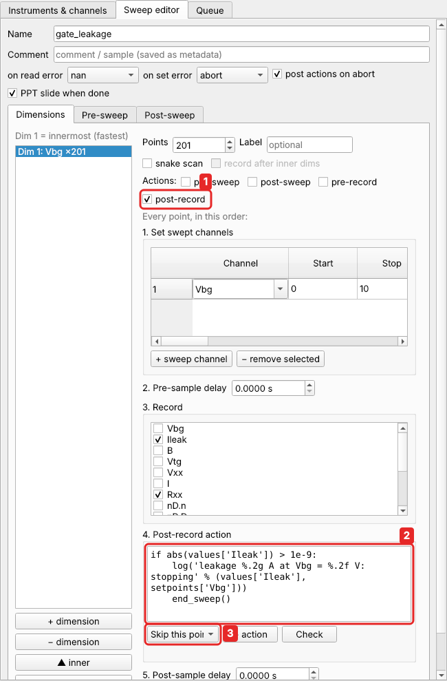
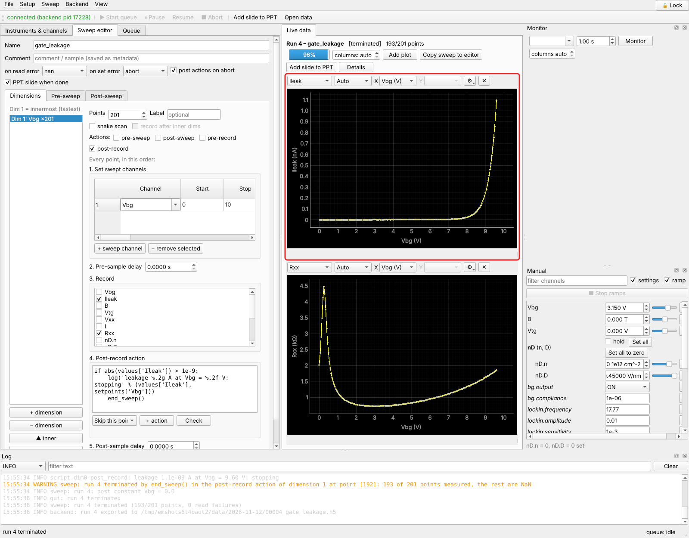
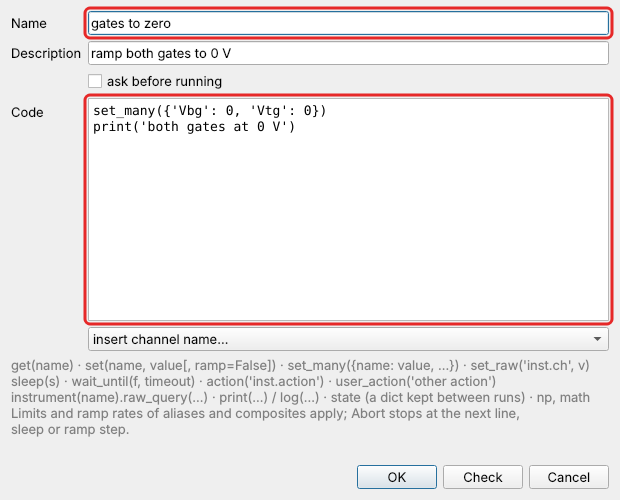
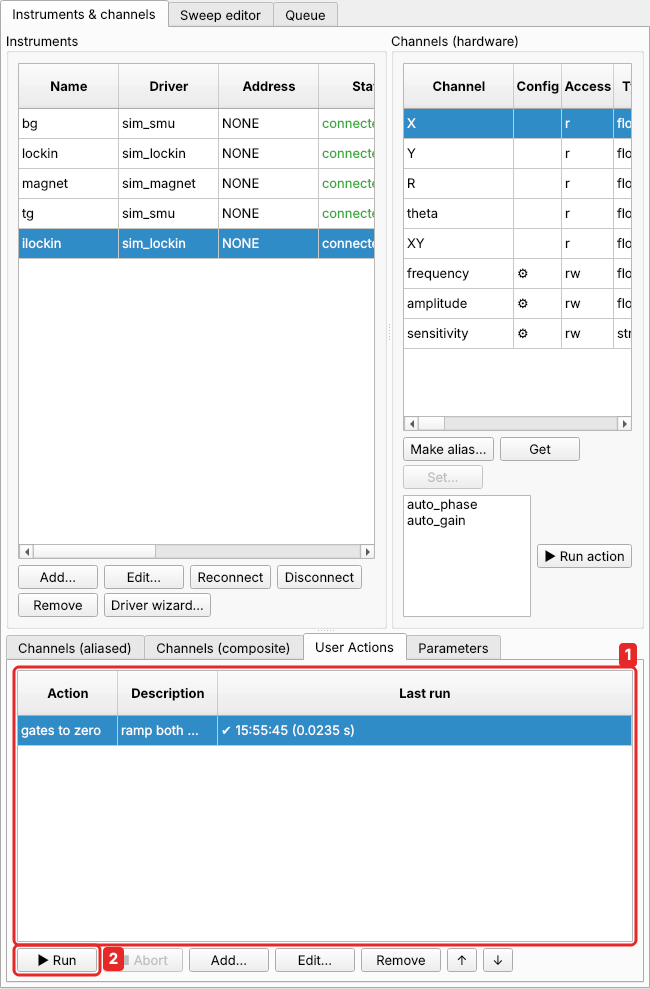
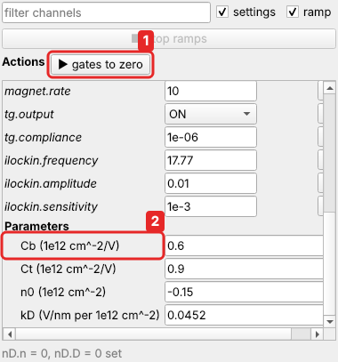

# Tutorial 3: stop a measurement at a threshold

**You will learn:** point actions that decide something at every point (here: stop
the sweep when the leakage current gets too high), and one-click actions of your own.

**The situation.** How far can you push the back gate? Gate dielectrics leak more and
more as the voltage rises, and eventually break down, which destroys the device. A
careful way to find out is to ramp the gate up slowly while watching the leakage
current, and stop the moment it exceeds a threshold, say 1 nA.

Alias limits (±10 V on `Vbg`) are a hard ceiling that nothing can cross. A threshold is
different: easyMeasure watches a *measured* value and reacts to it.

## 1. The sweep

In the **Sweep editor**:

* one dimension: `Vbg` from 0 to 10 V, 201 points;
* record `Ileak` and `Rxx`;
* in **Post-sweep**: `Vbg` = 0, so the gate goes back down at the end, however the
  measurement ended.

## 2. The point action

Tick **post-record**. This action runs at every point, right after the values were
recorded:



1. **post-record**: the action that runs right after recording.
2. The code:

    ```python
    if abs(values['Ileak']) > 1e-9:
        log('leakage %.2g A at Vbg = %.2f V: stopping' % (values['Ileak'], setpoints['Vbg']))
        end_sweep()
    ```

    * `values` holds what was just recorded: `values['Ileak']` is this point's leakage
      current, in A.
    * `setpoints` holds what was set at this point: `setpoints['Vbg']`.
    * `log(...)` writes a line to the log.
    * `end_sweep()` ends the whole measurement normally. The data so far is saved, and
      the post-sweep phase runs, which here sets `Vbg` back to 0.
3. **+ action** offers the common snippets, so you don't have to remember the names:
   *Terminate the entire sweep*, *Skip this point*, *Skip this line*, and actions of
   your instruments.

| call | like in a Python loop | does |
|---|---|---|
| `end_sweep()` | `exit` | stop the measurement; status *terminated* |
| `skip_line()` | `break` | finish this line of a 2-D map early; the next line starts |
| `skip_point()` | `continue` | skip the rest of this point; its data stays empty |

This sweep is `examples/graphene_leakage.json`. **Sweep → Add & start.**

## 3. The result



The leakage current rises steeply above 8 V. At about 9.6 V it passes 1 nA and the
sweep stops by itself:

* its status is *terminated* (not *aborted*: it ended the way you asked);
* the log says where and why;
* `Vbg` ramps back to 0 V;
* the points that were not measured are empty (NaN) in the file.

In a 2-D map, `skip_line()` instead of `end_sweep()` would finish just the current
line, and the map would continue with the next one. A typical case is stopping each
gate sweep at the leakage threshold while stepping the field.

### More things to do in point actions

| when | code |
|---|---|
| post-record | `if values['Rxx'] > 1e6: skip_line()`: the device went insulating; next line |
| pre-record | `action('dmm.trigger')`: trigger a meter in triggered mode |
| post-sweep | `wait_until(lambda: abs(get('T') - setpoints['Tset']) < 0.01, timeout=1800)`: wait for the temperature |
| pre-sweep | `if 0.10 < setpoints['Vbg'] < 0.12: skip_point()`: skip a known bad spot |

## 4. One-click actions of your own

Some things you do again and again: bring both gates to zero, switch outputs off, ramp
the magnet down. Make each one a button. On *Instruments & channels*, on the
**User Actions** tab, click **Add…**:



* **Name**, and a **Description** shown in the list.
* **Code**: the same small Python as in point actions:

    ```python
    set_many({'Vbg': 0, 'Vtg': 0})
    print('both gates at 0 V')
    ```

    `set_many` sets several channels together, each with its limits and ramp rate.
* **ask before running**: tick it for actions that should be confirmed first.
* **Check** checks the code without running it: a syntax error, or a channel in quotes
  that does not exist. **OK** checks too.

Select it and click **▶ Run** (or press Enter):



1. Your actions, with the result of the last run.
2. **▶ Run**, and **■ Abort** to stop a running action.

Your actions are also buttons at the top of the **Manual** panel, at hand while you
work there:



1. **▶ gates to zero** runs the action. While an action runs its button turns orange
   (**■**), and clicking it again aborts it.
2. Below the channels, under **Parameters**, the setup's
   [parameters](../guide/parameters.md): type a value and press Enter to change one.

Actions run **at once**, not through the queue, so they also work while a measurement
is paused. They are saved with your setup. Their code can use the setup's parameters
by name, e.g. `set('Vbg', V0)`.

## What you learned

* A **post-record** point action sees each point's values and can stop the
  measurement (`end_sweep`), finish the line (`skip_line`) or skip the point
  (`skip_point`).
* The post-sweep phase always runs, so the sample is brought back to a safe state.
* **User actions** turn routine steps into buttons.

**Next:** [Tutorial 4: a VNA power sweep](vna-power.md).
