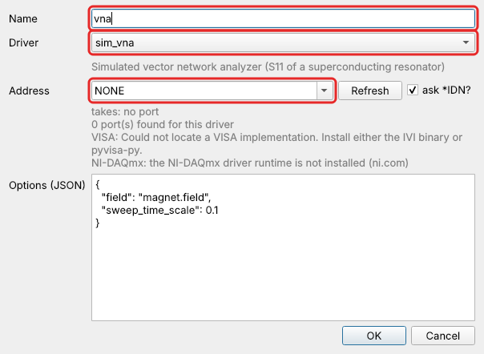
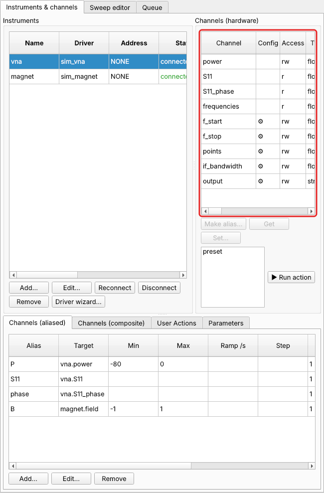
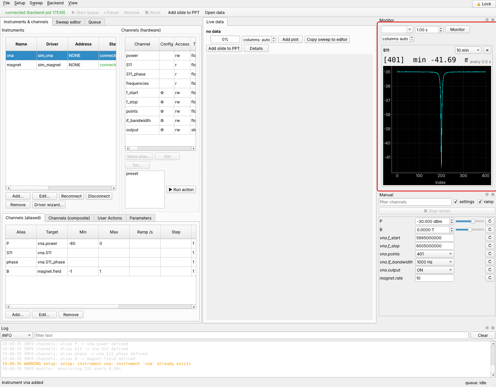
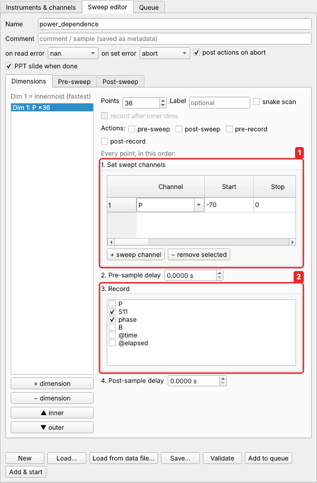
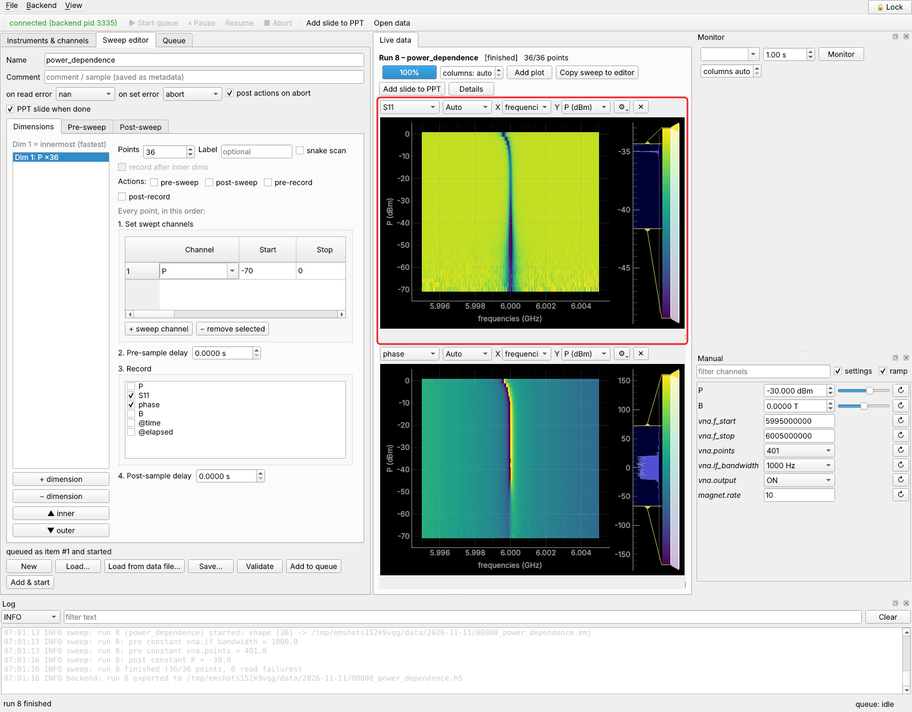
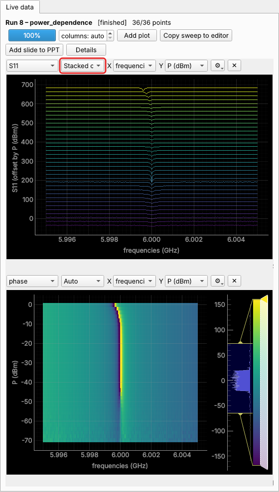
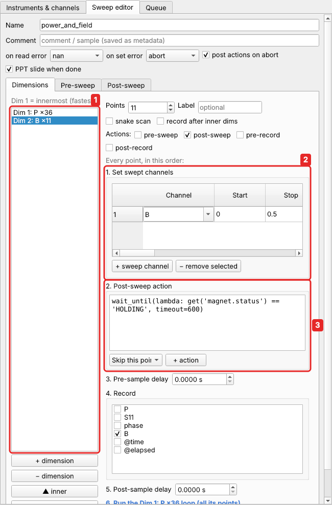
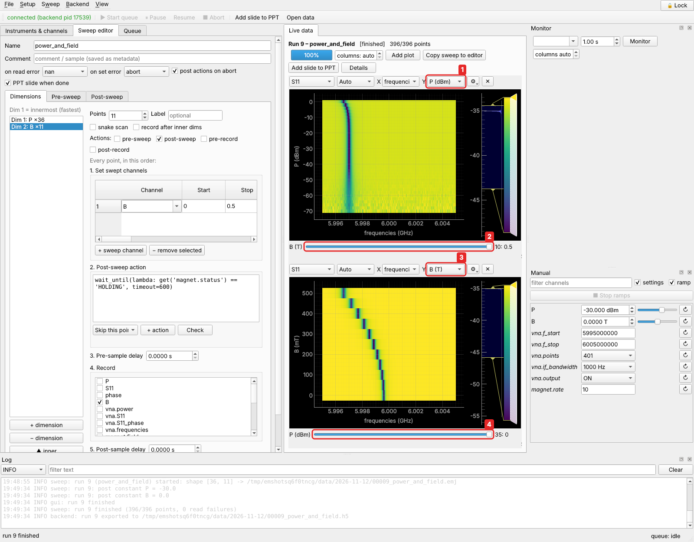

# Tutorial 4: a VNA power sweep (high-dimensional data)

**You will learn:** instruments that return a whole spectrum per reading, how a 1-D
sweep then gives 2-D data and a 2-D sweep gives 3-D data, and how to look at it.

**The story.** A new student in the group measures superconducting microwave
resonators. The question: how do the resonance frequency and the quality factor depend on
the microwave power? The vector network analyzer (VNA) measures the reflection $S_{11}$
over a frequency window around the resonance. Each reading is a whole trace of 401
points. At low power the resonance is shallow, because two-level-system losses dominate.
As the power rises, these saturate and the dip deepens. At high power the Kerr
nonlinearity pulls the resonance down. Later, a magnetic field is added as a third
parameter.

| role | real instrument | simulated stand-in |
|---|---|---|
| VNA | Keysight PNA / Rohde & Schwarz ZNB / … (a driver from the [Driver Wizard](../guide/driver-wizard.md) or [written](../scripting/writing-drivers.md) for it) | `sim_vna` |
| magnet supply | any | `sim_magnet` |

Start with a fresh setup (*Setup → Load setup…* →
`examples/vna_setup.json` has everything below).

## 1. The VNA

*Instruments → Add…*: name `vna`, driver `sim_vna`, address `NONE`.



Its channels:



| channel | is |
|---|---|
| `power` | source power, dBm: you will sweep this |
| `S11` | one whole frequency sweep: the magnitude in dB, an array of `points` values |
| `S11_phase` | the same sweep's phase, degrees |
| `frequencies` | the frequency of each point |
| ⚙ `f_start`, `f_stop`, `points`, `if_bandwidth`, `output` | settings |

Settings are changed with **Set…** under the channel list, or in a sweep's
**Pre-sweep** constants (below), so every measurement records how the VNA was set.

Make aliases:

* `P` for `vna.power`, with limits −80 … 0 dBm. This protects the sample and the
  amplifiers from too much power.
* `S11` and `phase` for the two traces.
* `B` for `magnet.field`, with limits −1 … 1 T.

**A look at the trace.** Monitor `S11`. A 401-point trace is shown as a curve,
refreshed every reading:



## 2. Power dependence: a 1-D sweep that gives 2-D data



1. Sweep `P` from −70 to 0 dBm in 36 points (2 dB steps).
2. Record `S11` and `phase`.

In **Pre-sweep**, set the constants `vna.if_bandwidth` = 1000 and `vna.points` = 401.
In **Post-sweep**, set `P` = −30.

This sweep is `examples/vna_power.json`. Every recorded value is a trace of 401
points, so the result is **two-dimensional**: power × frequency. `S11` is stored as an
array of shape `(36, 401)`.



The plot puts the frequency on X (the VNA tells easyMeasure the frequency of each
point, so the axis is in Hz, not point numbers) and the swept power on Y. The resonance
deepens from −70 to −40 dBm as the losses saturate, then bends to lower frequency at
the highest powers. The low-power traces are noisier: less signal. In a real
measurement you would use a smaller IF bandwidth or averaging there.

**As spectra.** Mode **Stacked curves** draws every trace, offset by power:



**Curve** shows one trace, with a slider for the power.

## 3. Add the field: 3-D data

Add a second dimension: `B` from 0 to 0.5 T in 11 points, recording `B`. Tick the
**post-sweep** action and wait for the magnet, as in
[tutorial 1](landau-fan.md#2-two-dimensions):



1. Dimension 2 runs around dimension 1: a full power sweep at every field.
2. `B` from 0 to 0.5 T.
3. The post-sweep action:
   `wait_until(lambda: get('magnet.status') == 'HOLDING', timeout=600)`.

This sweep is `examples/vna_power_field.json`. Now `S11` has shape `(36, 11, 401)`:
power × field × frequency, **three-dimensional**.

A plot shows two of the axes, and every other axis gets a **slider**. Two plots of the
same data, side by side:



* **Left**: X = frequency, Y = `P`, and a slider (2) for `B`. This is the power
  dependence at one field. Move the slider to see it change with field.
* **Right**: X = frequency, Y = `B` (3), and a slider (4) for `P`. The resonance moves
  down and broadens as the field rises (kinetic inductance and vortex losses).

Use **Add plot** for more views. Each plot's **Y** box (1, 3) picks the second axis,
and *(none)* gives a curve with sliders for everything else. Any number of dimensions
works the same way: add a temperature dimension and you have 4-D data and two sliders.

## 4. The data afterwards

The file holds the arrays with all their axes, including the frequency axis of the
traces. In Python:

```python
from easymeasure.backend.storage import DataSet
ds = DataSet.load("D:/data/2026-11-11/00002_power_and_field.emj")
S = ds.data["S11"]                          # (36, 11, 401): P × B × frequency
P = ds.setpoints[0]["P"]                    # 36 powers
B = ds.setpoints[1]["B"]                    # 11 fields (as set; ds.data["B"]: as measured)
f = ds.value_axes["S11"][0]["coords"]       # 401 frequencies, Hz

import numpy as np
f0 = f[np.argmin(S, axis=-1)]               # resonance frequency at every (P, B): (36, 11)
```

The HDF5 copy has the same, under `/data/S11`, `/setpoints/0/P`, `/setpoints/1/B` and
`/value_axes/S11/0` (the frequencies). See [Data files](../guide/data.md).

## What you learned

* A channel can return a whole spectrum. Each reading then adds its own axis to the
  data, and the frequency axis comes from the instrument.
* A 1-D sweep of a spectrum gives 2-D data; a 2-D sweep gives 3-D data. There is no
  limit.
* Plots show any two axes; every other axis becomes a slider. Several plots can show
  different cuts of the same data.

## Where to go from here

* The [User guide](../guide/index.md) explains each part in full: instruments,
  sweeps, plots, data files, remote access.
* [Scripting and Python](../scripting/index.md), when the GUI is not enough: loops over
  conditions, sweeps computed on the fly, controlling easyMeasure from a notebook.
* [Supported instruments](../instruments.md), and the
  [Driver Wizard](../guide/driver-wizard.md) for instruments without a driver.
